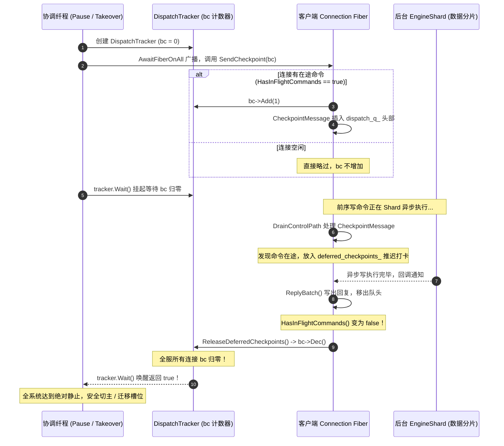

# Dragonfly Checkpoint（并发同步检查点）设计与实现深度解析

本文系统梳理 Dragonfly 连接层与协调层的核心并发同步机制——**Checkpoint（检查点）**。重点阐述其设计背景、与传统数据库及 Redis 的异同、完整的生命周期、核心函数的逐行实现原理以及边界容错机制。

---

## 目录

- [1. 核心定义：Dragonfly 的 Checkpoint 到底是什么？](#1-核心定义dragonfly-的-checkpoint-到底是什么)
- [2. 架构分水岭：为什么 Dragonfly 必须设计 Checkpoint，而 Redis 不需要？](#2-架构分水岭为什么-dragonfly-必须设计-checkpoint而-redis-不需要)
  - [2.1 Redis 的单线程红利：天生全局静止](#21-redis-的单线程红利天生全局静止)
  - [2.2 Dragonfly 的多核异步并发：静止态的缺失与风险](#22-dragonfly-的多核异步并发静止态的缺失与风险)
  - [2.3 有计划平滑运维下的“零数据丢失”保证](#23-有计划平滑运维下的零数据丢失保证)
- [3. 核心数据结构与核心概念](#3-核心数据结构与核心概念)
- [4. Checkpoint 全生命周期深度拆解（函数级剖析）](#4-checkpoint-全生命周期深度拆解函数级剖析)
  - [4.1 阶段一：协调器创建与全服多核广播](#41-阶段一协调器创建与全服多核广播)
  - [4.2 阶段二：单线程连接扫描与 Checkpoint 注入](#42-阶段二单线程连接扫描与-checkpoint-注入)
  - [4.3 阶段三：协调纤程挂起等待](#43-阶段三协调纤程挂起等待)
  - [4.4 阶段四：连接纤程消费与推迟打卡（Defer 机制）](#44-阶段四连接纤程消费与推迟打卡defer-机制)
  - [4.5 阶段五：在途任务落库与检查点释放（Release 机制）](#45-阶段五在途任务落库与检查点释放release-机制)
    - [4.5.1 深度追问：为什么释放时会有“多个”检查点？（为什么使用 std::vector）](#451-深度追问为什么释放时会有多个检查点为什么使用-stdvector)
  - [4.6 阶段六：计数归零，全服绝对静止态建立](#46-阶段六计数归零全服绝对静止态建立)
- [5. 全链路时序图与字符流转图](#5-全链路时序图与字符流转图)
- [6. 边界与容错处理](#6-边界与容错处理)
  - [6.1 阻塞命令（如 BLPOP）防死锁](#61-阻塞命令如-blpop-防死锁)
  - [6.2 连接异常断开防泄漏](#62-连接异常断开防泄漏)
  - [6.3 超时回滚机制](#63-超时回滚机制)
- [7. 总结与源码速查表](#7-总结与源码速查表)

---

## 1. 核心定义：Dragonfly 的 Checkpoint 到底是什么？

在传统关系型数据库（如 MySQL InnoDB 或 PostgreSQL）中，**Checkpoint（检查点）** 指的是：存储引擎把内存中的脏页（Dirty Pages）刷盘，并将 WAL / Redo Log 的安全重做起点（LSN）向前推进，以便截断旧日志。

**而在 Dragonfly 中，这里的 Checkpoint 与磁盘刷盘、AOF 毫无关系！**

Dragonfly 是一个全内存、Shared-Nothing 架构的高性能存储引擎，它没有 AOF 日志概念。Dragonfly 中的 Checkpoint 回归了计算机科学与分布式系统（如 Chandy-Lamport 算法、多线程屏障）中的原始本意：

> **Checkpoint 是一个并发同步栅栏（Synchronization Barrier）与状态对齐哨兵（Sentinel Token）。**  
> 它的唯一使命是：在多核多线程并发且支持异步执行的环境中，确认并保证：**“在 Checkpoint 发起之前的所有在途写操作（In-Flight Writes），已经 100% 在各个 CPU 核心上执行落地、回复已写回，全系统达到绝对一致的静止状态（Quiescent State）。”**

---

## 2. 架构分水岭：为什么 Dragonfly 必须设计 Checkpoint，而 Redis 不需要？

### 2.1 Redis 的单线程红利：天生全局静止

在 Redis 中，网络命令的解析、事务排队和具体命令执行，全部由**唯一的单线程（Main Thread）**顺序执行。

当在 Redis 中执行 `CLIENT PAUSE WRITE`，或者执行 Redis Cluster 的 `CLUSTER FAILOVER` 时：
- 执行该命令的正是唯一的单线程本身；
- 在这一个微秒，**整个进程在物理上绝不可能有第二条命令在任何 CPU 上并行修改内存**；
- Redis 只要将全局变量 `server.client_pause_type = CLIENT_PAUSE_WRITE` 置位，主线程随后停止读取 Socket，系统**天然就进入了绝对静止状态**。

因此，**Redis 凭借单线程特性，免费获得了“全局静止”，根本不需要任何内部检查点机制。**

### 2.2 Dragonfly 的多核异步并发：静止态的缺失与风险

Dragonfly 的架构是多线程无共享（Shared-Nothing Thread-per-core），每个核心绑定独立的 `EngineShard`，并且在 **IoLoopV2** 中引入了**命令级异步并发（SingleHopAsync）**：
- 客户端连接由 Proactor 线程管理；
- 一条写命令（如 `SET a b`）被解析后，Connection Fiber 通过 `SingleHopAsync` 将任务异步派发到另一个核心的 `EngineShard`，**派发函数随即立刻返回，连接继续处理其他事务**；
- 此时写命令正在后台其他 CPU 上“飞行”（**In-Flight**）。

**如果不设计 Checkpoint 会引发什么灾难？**
假设管理员要在此时执行有计划的主从切换（`DFLY TAKEOVER`）或集群槽位迁移（Slot Migration）：
1. 协调线程在线程 0 宣布“写暂停”；
2. 协调线程以为系统已经停工，开始让从库追平数据、或者直接把槽位切给其他节点；
3. **但此时，线程 30 的 `EngineShard` 上卡顿的在途写命令才刚刚落库！**
4. 切换完成后，该数据被遗落在旧主库，新主库根本没有同步到这笔写入，**造成严重的主从数据不一致、丢写（Lost Updates）甚至分布式脑裂！**

### 2.3 有计划平滑运维下的“零数据丢失”保证

需要明确区分两种故障场景：
1. **非计划宕机（Crash / 意外断电）**：异步复制确实无法挽回尚未发送到网络链路的在途数据；
2. **有计划平滑运维（Planned Failover / Switchover / Slot Migration）**：**Redis 和 Dragonfly 都严格保证 100% 零数据丢失！**
   - Redis 官方文档对于 `CLUSTER FAILOVER` 的定义明确指出：*"Manual failovers are safe failovers: they are coordinated with the master and **will not result in any data loss**."*
   - Dragonfly 为了在多核并发下达到**与 Redis 完全相同的零丢失保证**，必须依靠一套机制把“半空中飞着的所有在途写操作”彻底落库对齐，这套机制就是 **Checkpoint**。

---

## 3. 核心数据结构与核心概念

Checkpoint 机制主要由以下 4 个关键组件协同工作：

```text
+-------------------------------------------------------------------------------+
| 1. DispatchTracker                                                            |
|    协调器：负责协调全系统 Proactor 线程，维护全局 BlockingCounter。            |
+-------------------------------------------------------------------------------+
                                      │
                                      ▼ 持有引用
+-------------------------------------------------------------------------------+
| 2. util::fb2::BlockingCounter (bc)                                            |
|    并发倒计时门闩（类似 CountDownLatch / WaitGroup）：                        |
|    - bc->Add(1)：每发现一个有在途写操作的忙碌连接，计数加 1                     |
|    - bc->Dec()  ：某连接所有在途任务彻底写完落库，计数减 1                     |
|    - bc->Wait() ：协调纤程挂起，直到计数减至 0 唤醒                             |
+-------------------------------------------------------------------------------+
                                      │
                                      ▼ 包装传递
+-------------------------------------------------------------------------------+
| 3. CheckpointMessage                                                          |
|    控制消息：将 bc 包装为高优先级控制消息，注入各连接的 dispatch_q_ 队列。      |
+-------------------------------------------------------------------------------+
                                      │
                                      ▼ 暂存容器
+-------------------------------------------------------------------------------+
| 4. deferred_checkpoints_                                                      |
|    连接内部向量：当收到 Checkpoint 但后台 Shard 仍在写时，暂存 bc，推迟打卡。 |
+-------------------------------------------------------------------------------+
```

---

## 4. Checkpoint 全生命周期深度拆解（函数级剖析）

以下以 [`ServerFamily::Pause`](../src/server/server_family.cc:1122)（即 `CLIENT PAUSE` 的底层实现）以及 [`DflyCmd::Takeover`](../src/server/dflycmd.cc:541) 为入口，完整梳理从发起到底层释放的六大阶段。

### 4.1 阶段一：协调器创建与全服多核广播

**入口代码**：[`src/server/server_family.cc`](../src/server/server_family.cc)
```cpp
std::optional<fb2::Fiber> Pause(std::vector<facade::Listener*> listeners, Namespace* ns,
                                facade::Connection* conn, ClientPause pause_state,
                                ...) {
  // 1. 创建 DispatchTracker
  DispatchTracker tracker{listeners, conn, true /* ignore paused commands */,
                          true /* ignore blocking */};

  // 2. 广播到全服所有 Proactor 线程
  shard_set->pool()->AwaitFiberOnAll([&tracker, pause_state](unsigned, util::ProactorBase*) {
    tracker.TrackOnThread();
    ServerState::tlocal()->SetPauseState(pause_state, true);
  });
...
```

**底层执行细节**：
1. `DispatchTracker` 构造函数中初始化了 `bc_ = new fb2::BlockingCounter(0)`，当前计数值为 0。
2. `shard_set->pool()->AwaitFiberOnAll(...)`：利用底层 Proactor 线程池，在**每一个 Proactor OS 线程**上起一个独立的执行纤程（Fiber），当前协调纤程等待，直到所有核心都执行完毕该任务才返回。
3. `ServerState::tlocal()->SetPauseState(pause_state, true)`：设置本线程的暂停标志。**从这一时刻起，后续任何新到来的客户端写请求在解析入口就会被直接暂停/拒绝，关死增量写入的闸门。**

### 4.2 阶段二：单线程连接扫描与 Checkpoint 注入

各个 Proactor 线程在自身线程上下文执行 `tracker.TrackOnThread()`：

**代码位置**：[`src/facade/dragonfly_listener.cc`](../src/facade/dragonfly_listener.cc)
```cpp
void DispatchTracker::TrackOnThread() {
  for (auto* listener : listeners_) {
    listener->TraverseConnectionsOnThread(
        [this](unsigned thread_index, util::Connection* conn) { Handle(thread_index, conn); },
        UINT32_MAX, nullptr);
  }
}

void DispatchTracker::Handle(unsigned thread_index, util::Connection* conn) {
  if (auto* fconn = static_cast<facade::Connection*>(conn); fconn != issuer_)
    fconn->SendCheckpoint(bc_, ignore_paused_, ignore_blocked_);
}
```

利用线程亲和性（Thread Affinity），无锁遍历该线程当前管理的所有客户端连接，调用 `SendCheckpoint`：

**代码位置**：[`src/facade/dragonfly_connection.cc:2512`](../src/facade/dragonfly_connection.cc:2512)
```cpp
void Connection::SendCheckpoint(fb2::BlockingCounter bc, bool ignore_paused, bool ignore_blocked) {
  // 核心过滤器：检查连接当前是否存在活跃命令或异步在途命令
  bool has_active_command = IsCurrentlyDispatching() || (ioloop_v2_ && HasInFlightCommands());
  if (!has_active_command)
    return; // 完全空闲的连接直接略过！bc 不会增加！

  if (cc_->paused && ignore_paused)
    return;

  if (cc_->blocked && ignore_blocked)
    return;

  bc->Add(1); // 发现一条存在未完成写操作的忙碌连接，等待计数器 +1
  SendAsync({CheckpointMessage{bc}}); // 生成 Checkpoint 控制消息注入队列
}
```

接着看 `SendAsync` 中的入队逻辑（第 2607 行）：
```cpp
// 规则：CheckPoint 属于管理消息，具有最高优先级，插入到 dispatch_q_ 最前端！
if (msg.IsCheckPoint()) {
  auto it = dispatch_q_.begin();
  while (it < dispatch_q_.end() && it->IsCheckPoint())
    ++it;
  dispatch_q_.insert(it, std::move(msg));
}

if (ioloop_v2_) {
  io_event_.notify(); // 唤醒该连接自身的 Connection Fiber！
}
```

### 4.3 阶段三：协调纤程挂起等待

在所有 Proactor 线程扫描完各自的连接并完成入队后，协调纤程调用 `Wait`：

**代码位置**：[`src/server/server_family.cc`](../src/server/server_family.cc)
```cpp
const absl::Duration kDispatchTimeout = absl::Seconds(absl::GetFlag(FLAGS_pause_wait_timeout));
if (!tracker.Wait(kDispatchTimeout)) {
  LOG(WARNING) << "Couldn't wait for commands to finish dispatching in " << kDispatchTimeout;
  ...
}
```
`tracker.Wait` 底层调用 `bc_->WaitFor(...)`。如果全服没有任何忙碌连接，`bc_` 为 0，函数立刻返回；如果全服有 $N$ 条连接手头有活，`bc_ == N`，协调纤程**进入挂起休眠状态，把 CPU 让出，等待倒计时归零**。

### 4.4 阶段四：连接纤程消费与推迟打卡（Defer 机制）

客户端连接的 Connection Fiber 被 `io_event_.notify()` 唤醒，进入主循环 [`IoLoopV2`](../src/facade/dragonfly_connection.cc:3852)，首先排空控制队列 `DrainControlPath`。

当从 `dispatch_q_` 取出 `CheckpointMessage` 时，调用访问器：

**代码位置**：[`src/facade/dragonfly_connection.cc:798`](../src/facade/dragonfly_connection.cc:798)
```cpp
void Connection::AsyncOperations::operator()(CheckpointMessage msg) {
  // V2 核心拦截：
  // 如果此连接此前发射的异步命令仍在后台 EngineShard 运行：
  if (self->ioloop_v2_ && self->HasInFlightCommands() && !self->cc_->blocked) {
    // 绝对不能打卡！把它暂存到 deferred_checkpoints_ 中，推迟处理
    self->deferred_checkpoints_.push_back(std::move(msg.bc));
    return;
  }

  // 只有在彻底没有任何在途命令时，才敢直接减计数
  msg.bc->Dec();
}
```

**为什么这里必须 Defer？**
在 V2 中，`ExecuteBatch()` 将写命令发射给远端 Shard 后立刻返回了。此时 Checkpoint 赶到了，若贸然调用 `bc->Dec()`，协调器就会误以为该连接的写操作已结束；但实际上后台 Shard 的内存写入还没有完成！因此，**必须扣留 `bc`，推迟打卡**。

### 4.5 阶段五：在途任务落库与检查点释放（Release 机制）

后台 `EngineShard` 终于将数据写入了 Hash 表：
1. 远端 Shard 完成任务，触发回调，唤醒连接 Fiber；
2. 连接 Fiber 在 `IoLoopV2` 中调用 `ReplyBatch()`，把响应数据写出到客户端 Socket；
3. 将已完成的命令从 `parsed_head_` 队列中彻底销毁移除；
4. 队列中所有的在途任务全部完成，**`HasInFlightCommands()` 变成了 `false`**！
5. 在 [`IoLoopV2`（3942 行）](../src/facade/dragonfly_connection.cc:3942) 紧接着触发安全放行检查：
   ```cpp
   if (!HasInFlightCommands()) {
     ReleaseDeferredCheckpoints();
   }
   ```

**代码位置**：[`src/facade/dragonfly_connection.cc:2048`](../src/facade/dragonfly_connection.cc:2048)
```cpp
void Connection::ReleaseDeferredCheckpoints() {
  DCHECK(!HasInFlightCommands());
  if (deferred_checkpoints_.empty())
    return;

  // 遍历所有之前暂存的 Checkpoint 门闩，真正执行 -1！
  for (auto& bc : deferred_checkpoints_) {
    bc->Dec();
  }
  deferred_checkpoints_.clear();
}
```

#### 4.5.1 深度追问：为什么释放时会有“多个”检查点？（为什么使用 std::vector）

很多初读者会疑惑：*“一条连接同一时刻既然按顺序推进，为什么 `deferred_checkpoints_` 会是一个 `std::vector`，里面居然还会堆叠多个 Checkpoint？”*

其核心原因在于：**在真实的分布式与生产环境中，可能存在多个不同的系统级管理操作并发发起（或同一次操作的重试扫描），每一个操作都代表一个完全独立的等待者（Fiber）！**

1. **官方注释的明确列举**：
   在 [`src/facade/dragonfly_connection.h:502`](../src/facade/dragonfly_connection.h:502) 中明确说明：
   > *"Each counter belongs to a DispatchTracker (**CLIENT PAUSE / REPLTAKEOVER / cluster migration / shutdown**) that is blocked in Wait()."*  
   这表明系统中存在至少 4 类完全独立的 `DispatchTracker` 协调器。

2. **什么场景会导致一条连接堆叠多个 Checkpoint？**
   假设连接 A 正在执行一个耗时较长的异步写任务（例如涉及多分片的大批量写入，或者正在等待分层存储 Tiered Storage 从磁盘读取冷数据，`HasInFlightCommands()` 持续为真）：
   - **场景 A：不同系统级操作重叠到达**
     - 时刻 T1：管理员发起了 `CLIENT PAUSE WRITE`，协调器 1 生成了 `Checkpoint 1`（持有 `bc_1`），连接 A 暂存入向量；
     - 时刻 T2（在途写仍在运行）：集群槽位重平衡触发了 `Cluster Migration`，协调器 2 生成了 `Checkpoint 2`（持有 `bc_2`），连接 A 同样将其暂存入向量；
     - 此时向量中便有了 2 个独立的 Checkpoint！
   - **场景 B：DispatchTracker 的超时重试机制（Retry）**
     - 查看 [`src/facade/dragonfly_listener.cc:443`](../src/facade/dragonfly_listener.cc:443)：当协调器第一次 `Wait` 超时时，会重置计数并调用 `TrackAll()` 重新扫描全服连接，这会导致对尚未完成在途任务的连接再次追加一个 Checkpoint。

3. **为什么不能用一个 `int count` 累加，必须用 `std::vector<BlockingCounter>`？**
   因为 `bc_1` 和 `bc_2` 分别属于不同的堆对象，它们在等待唤醒**不同的协调纤程**（一个是管理员暂停的 Fiber，一个是集群槽迁移的 Fiber）。连接 A 必须妥善持有每一个协调者的门闩对象句柄，在自身在途任务彻底落地时，通过 `for (auto& bc : deferred_checkpoints_) bc->Dec();` **挨个打卡**，才能确保各个独立的等待者都被精准、安全地唤醒！

### 4.6 阶段六：计数归零，全服绝对静止态建立

当全服最后一条忙碌连接调用了 `bc->Dec()`：
1. `BlockingCounter` 计数正式归零（`bc == 0`）；
2. 协调纤程的 `tracker.Wait()` 被唤醒并成功返回 `true`；
3. **静止态正式确立**：全系统所有线程、所有分片上的存量写命令已全部落库并回复，增量写命令已被入口 Pause 状态拦截；
4. 协调器可以安全地执行后续流程：
   - 如果是 `CLIENT PAUSE`：禁止 key 过期淘汰，保持全局暂停；
   - 如果是 `DFLY TAKEOVER`：调用 `WaitReplicaFlowToCatchup`，因为主库 LSN 已彻底固定，从库瞬间追平，安全提升为主库。

---

## 5. 全链路时序图与字符流转图

### 字符流转全景图

```text
[阶段 1: Pause / Takeover 发起]
   │
   ├─ 创建 DispatchTracker (bc = 0)
   └─ AwaitFiberOnAll 广播到所有 Proactor 核心:
        ├─ 设置本地 Pause 状态 (关死新命令大门)
        └─ 扫描本线程客户端连接:
             └─ 若连接处于活跃/在途写:
                  ├─ bc->Add(1)
                  └─ SendAsync(CheckpointMessage) 插入队列头部并唤醒连接

[阶段 2: 协调纤程挂起]
   │
   └─ tracker.Wait() 阻塞等待 bc 减至 0 ...
   
~~~~~~~~~~~~~~~ 多核心异步执行世界 ~~~~~~~~~~~~~~~

[阶段 3: 客户端连接处理 Checkpoint]
   │
   └─ Connection Fiber 从 dispatch_q_ 取出 CheckpointMessage:
        ├─ 检查: HasInFlightCommands() == true ?
        │    ├─ 是: 后台还在写！不可调 bc->Dec()，存入 deferred_checkpoints_ (推迟)
        │    └─ 否: 没有任何在途写，直接调 bc->Dec()

[阶段 4: 在途写落库与检查点释放]
   │
   ├─ 后台 Shard 写操作完成，ReplyBatch() 写回客户端并销毁命令
   ├─ HasInFlightCommands() 终于变为 false
   └─ 触发 ReleaseDeferredCheckpoints() -> 执行 bc->Dec() !

~~~~~~~~~~~~~~~~~~~~~~~~~~~~~~~~~~~~~~~~~~~~~~~~~~~

[阶段 5: 归零与唤醒]
   │
   ├─ 全服忙碌连接的 bc 全部减完，bc 降为 0
   └─ tracker.Wait() 被唤醒，确认全服 100% 绝对静止，安全执行切换/迁移！
```

### Mermaid 架构时序图



---

## 6. 边界与容错处理

### 6.1 阻塞命令（如 BLPOP）防死锁

如果某个连接正在执行 `BLPOP`、`BRPOP` 等阻塞读取命令：
- 阻塞命令只读不写，且可能阻塞数分钟甚至数小时，直到其他客户端 push 数据；
- 如果 Checkpoint 把阻塞命令当成在途任务而推迟 `bc->Dec()`，会导致 `tracker.Wait()` 发生**永久死锁**；
- **防护实现**：在 [`AsyncOperations::operator()(CheckpointMessage msg)`](../src/facade/dragonfly_connection.cc:808) 中包含判断条件 `!self->cc_->blocked`：
  ```cpp
  if (self->ioloop_v2_ && self->HasInFlightCommands() && !self->cc_->blocked) {
    self->deferred_checkpoints_.push_back(std::move(msg.bc));
    return;
  }
  msg.bc->Dec(); // 阻塞连接不推迟，直接打卡放行
  ```

### 6.2 连接异常断开防泄漏

如果客户端连接在暂存了 `deferred_checkpoints_` 之后，网络突然中断（客户端发 RST 或超时）：
- 如果连接直接销毁而不释放 `deferred_checkpoints_`，`bc` 计数将永远无法归零，导致协调器挂死；
- **防护实现**：在连接销毁清理函数 [`Connection::DrainConnectionQueues()`](../src/facade/dragonfly_connection.cc:2041) 中：
  ```cpp
  ReleaseDeferredCheckpoints(); // 连接销毁前无条件强制释放，确保计数扣减
  ```

### 6.3 超时回滚机制

如果因为不可预期的长耗时命令导致 `tracker.Wait(timeout)` 超时：
- `Pause` 函数不会盲目进行后续危险操作，而是调用 `AwaitBrief` 将各 Proactor 线程的 `PauseState` 恢复为 `false`，安全取消暂停，避免服务被永久锁死。

---

## 7. 总结与源码速查表

| 功能阶段 | 核心作用 | 源码文件与行号 |
| :--- | :--- | :--- |
| **发起入口** | 创建 Tracker 并向各 Proactor 广播暂停与扫描 | [`src/server/server_family.cc:1122`](../src/server/server_family.cc:1122) |
| **主从切换入口** | `DFLY TAKEOVER` 依赖 Checkpoint 确定主库最终 LSN | [`src/server/dflycmd.cc:541`](../src/server/dflycmd.cc:541) |
| **单线程扫描** | 线程亲和性遍历本核心所有客户端连接 | [`src/facade/dragonfly_listener.cc:429`](../src/facade/dragonfly_listener.cc:429) |
| **检查点注入** | 活跃连接加计数并插入控制队列最前端 | [`src/facade/dragonfly_connection.cc:2512`](../src/facade/dragonfly_connection.cc:2512) |
| **推迟打卡 (Defer)** | 在途任务未完时暂存计数器，拒绝提前放行 | [`src/facade/dragonfly_connection.cc:808`](../src/facade/dragonfly_connection.cc:808) |
| **安全释放 (Release)** | 在途写命令彻底落库后对计数器执行 `Dec()` | [`src/facade/dragonfly_connection.cc:2048`](../src/facade/dragonfly_connection.cc:2048) |
| **主循环触发点** | `IoLoopV2` 每次在途清零时检查并放行 | [`src/facade/dragonfly_connection.cc:3942`](../src/facade/dragonfly_connection.cc:3942) |

---

> **核心结论**：  
> Dragonfly 的 Checkpoint 不是关系型数据库的 WAL 刷盘点，而是为了在**多核多线程异步并发**架构下，弥补相比 Redis 单线程所缺失的“天然静止态”。通过 **“全服扫描加计数 $\to$ 在途推迟打卡 $\to$ 异步落库放行”** 的闭环设计，Dragonfly 在保持极致并发性能的同时，完美实现了有计划主从切换与槽位迁移下的 **100% 数据零丢失**。
