# Dragonfly IO 与命令处理生命周期源码解析

> 本文只以当前工作树源码为依据。Dragonfly 基线：
> `0ab6e227bb1286a9bda7b0438c9ea3abaf633e60`
> （`v1.40.0-74-g0ab6e227`）；Helio 子模块基线：
> `3d8b4ece14ed62cb516e36afbc8947c0cc392826`。
>
> 核验日期：2026-09-01。文中的“当前”“默认”均指上述基线；后续版本若修改
> IO loop 默认值、命令处理协程或事务快速路径，应重新沿本文给出的符号核验。

本文不按目录罗列模块，而是跟随一个请求的实际执行顺序：

```text
建栈与监听
  -> accept
  -> 创建连接 Fiber
  -> TLS / HTTP / RESP(Memcache) 分流
  -> socket 收包
  -> 协议解析
  -> 命令查找与校验
  -> 创建 Transaction（若命令需要）
  -> 跳转到目标 EngineShard
  -> 修改 DbSlice
  -> 构造并写出回复
  -> 复用连接或关闭
```

阅读时请先记住三个当前源码事实：

1. **Dragonfly 没有把“网络线程”和“分片线程”做成两组固定线程。**一个
   Proactor OS 线程既可以承载连接 Fiber，也可以拥有一个 `EngineShard`。
2. **连接不会为每条命令迁移到键所在的 Proactor。**连接 Fiber 通常留在接入时选定的
   Proactor 上，作为协调者向一个或多个 shard queue 投递事务 hop；同线程时才可能内联。
3. **当前服务端 RESP 热路径使用 `RespSrvParser`，不是名字更显眼的
   `RedisParser`。**后者仍用于协议客户端、复制等场景。

### 目录

- [1. 一张图建立全局心智模型](#1-一张图建立全局心智模型)
- [2. 进程启动：先有 Proactor，再有 Listener](#2-进程启动先有-proactor再有-listener)
- [3. 从 listen socket 到 Connection Fiber](#3-从-listen-socket-到-connection-fiber)
- [4. 连接初始化：TLS、HTTP 与数据协议分流](#4-连接初始化tlshttp-与数据协议分流)
- [5. 收包与协议解析](#5-收包与协议解析)
- [6. 单命令、Pipeline 与 V1/V2 IO loop](#6-单命令pipeline-与-v1v2-io-loop)
  - [6.8 MultiCommandSquasher：流水线与多命令压平并发分发](#68-multicommandsquasher流水线与多命令压平并发分发)
- [7. Service 分发：命令查找、校验与上下文](#7-service-分发命令查找校验与上下文)
- [8. Transaction 如何把命令送到 EngineShard](#8-transaction-如何把命令送到-engineshard)
  - [8.9 同线程内联与跨线程 PollExecution：两条真实执行栈](#89-同线程内联与跨线程-pollexecution两条真实执行栈)
- [9. 以 SET 为例走完整调用链](#9-以-set-为例走完整调用链)
- [10. ReplyBuilder 如何把结果写回客户端](#10-replybuilder-如何把结果写回客户端)
- [11. 特殊分支：MULTI、阻塞命令与异步消息](#11-特殊分支multi阻塞命令与异步消息)
- [12. Proactor、Fiber、协程与 Boost](#12-proactorfiber协程与-boost)
  - [12.2.2 main fiber、dispatcher fiber 与 worker fiber](#1222-main-fiberdispatcher-fiber-与-worker-fiber)
- [13. 后台任务、快照与复制如何共存](#13-后台任务快照与复制如何共存)
- [14. 连接复用、关闭与进程停机](#14-连接复用关闭与进程停机)
- [15. 建议的源码阅读路线](#15-建议的源码阅读路线)

---

## 1. 一张图建立全局心智模型

### 1.1 整体架构


<!-- Mermaid source: ./dragonfly-io-command-lifecycle-assets/ch01-01.mmd -->

图中最容易误读的是“线程”和“角色”的关系：

- `ProactorPool` 创建 N 个 OS 线程；每个线程有一个 Proactor IO 轮询器、一个
  Fiber scheduler，以及驱动二者的 dispatcher Fiber。具体后端的 `MainLoop` 在该
  dispatcher Fiber 中运行。
- `EngineShardSet` 只在前 S 个 Proactor 线程创建 shard，S 不大于 N（shared nothing）。
- 连接可分布到配置允许的任意 Proactor；一个线程因此可能同时处理网络、连接 Fiber、
  自己的 shard queue、心跳、快照或复制 Fiber。
- 一个连接是命令的**协调者**，`EngineShard` 才是 shard 数据的唯一拥有者。

### 1.2 一次普通请求的主调用链


<!-- Mermaid source: ./dragonfly-io-command-lifecycle-assets/ch01-02.mmd -->

这条链比“Client → Connection → Dispatch → Reply”多出的层，分别解决以下问题：

| 层                                       | 为什么存在                       | 主要职责                                  |
| ---------------------------------------- | -------------------------------- | ----------------------------------------- |
| `AcceptServer` / `ListenerInterface` | 监听协议与连接对象是两种生命周期 | bind/listen/accept、连接计数、停机遍历    |
| `facade::Connection`                   | 网络协议与服务实现解耦           | IO buffer、解析、Pipeline、回复顺序、反压 |
| `ServiceInterface` / `Service`       | facade 不依赖 server 业务        | 命令查找、权限/状态校验、事务准备         |
| `Transaction`                          | 连接线程不能直接读写远端 shard   | 算 shard、排队、意向锁、hop 与完成屏障    |
| `EngineShard` / `DbSlice`            | 共享无锁的所有权边界             | 只在 owner thread 访问 shard 数据         |
| `ReplyBuilder`                         | handler 不应手写 RESP/sendmsg    | 编码、聚合、向量写、IO 错误传播           |

### 1.3 “Proactor 路由”应怎样理解


<!-- Mermaid source: ./dragonfly-io-command-lifecycle-assets/ch01-03.mmd -->

普通 `SET key value` 的 key 若属于 shard j，路由的是事务 callback，不是客户端
Connection。`ListenerInterface::Migrate` 与 `Connection::Migrate` 确实存在，但属于受约束的
显式迁移能力，不是每条命令的常规分片机制。

### 本章节源码阅读建议

先只读接口，暂时不要钻进实现：

1. [`helio/util/proactor_pool.h`](../helio/util/proactor_pool.h)；
2. [`helio/util/listener_interface.h`](../helio/util/listener_interface.h)；
3. [`src/facade/service_interface.h`](../src/facade/service_interface.h)；
4. [`src/server/transaction.h`](../src/server/transaction.h) 文件头的大段设计注释；
5. [`src/server/engine_shard.h`](../src/server/engine_shard.h)。

目标只是识别边界：谁拥有 socket、谁拥有连接状态、谁拥有 shard 数据。

---

## 2. 进程启动：先有 Proactor，再有 Listener

### 2.1 启动顺序


<!-- Mermaid source: ./dragonfly-io-command-lifecycle-assets/ch02-01.mmd -->

核心源码顺序如下：

| 阶段               | 主要函数                                                | 文件                                                                                                                                                           | 下一步                       |
| ------------------ | ------------------------------------------------------- | -------------------------------------------------------------------------------------------------------------------------------------------------------------- | ---------------------------- |
| 选择 IO 后端       | `ShouldUseEpollAPI`、`fb2::Pool::IOUring/Epoll`     | [`src/server/dfly_main.cc`](../src/server/dfly_main.cc)、[`helio/util/fibers/pool.cc`](../helio/util/fibers/pool.cc)                                         | `ProactorPool::Run`        |
| 启动线程池         | `ProactorPool::SetupProactors`、`ProactorBase::Run` | [`helio/util/fibers/proactor_pool.cc`](../helio/util/fibers/proactor_pool.cc)、[`helio/util/fibers/proactor_base.cc`](../helio/util/fibers/proactor_base.cc) | 每线程进入 backend main loop |
| 创建服务           | `RunEngine`、`Service::Service`                     | [`src/server/dfly_main.cc`](../src/server/dfly_main.cc)、[`src/server/main_service.cc`](../src/server/main_service.cc)                                       | 注册命令                     |
| 绑定监听端口       | `MakeListener`、`AcceptServer::AddListener`         | [`src/server/dfly_main.cc`](../src/server/dfly_main.cc)、[`helio/util/fibers/accept_server.cc`](../helio/util/fibers/accept_server.cc)                       | `Service::Init`            |
| 初始化线程局部状态 | `Service::Init`、`EngineShardSet::Init`             | [`src/server/main_service.cc`](../src/server/main_service.cc)、[`src/server/engine_shard_set.cc`](../src/server/engine_shard_set.cc)                         | 启动 accept                  |

### 2.2 IO 后端为何藏在 Proactor 后面


<!-- Mermaid source: ./dragonfly-io-command-lifecycle-assets/ch02-02.mmd -->

> **概念解释：Proactor**
>
> Proactor 将“发起 IO”和“IO 完成后继续执行”统一起来。io_uring 天然是 completion
> 模型；epoll 本质是 readiness 模型，但 Helio 在 `EpollSocket` 中把 EAGAIN 后的等待包装成
> Fiber 挂起，因此上层看到相同的阻塞式写法：`Recv()`、`Write()`。这里的“阻塞”只挂起当前
> Fiber，不阻塞 OS 线程。
>
> `EAGAIN` 时先让出 CPU；epoll 就绪回调负责唤醒 Fiber；恢复后的 Fiber 再执行真正的读写。（模拟的异步）

当前 Linux 代码在内核低于 5.10、`--force_epoll`、io_uring 不可用、权限或锁页内存不足时
回退 epoll。`ProactorPool` 默认线程数取显式 `--proactor_threads` 或可用 CPU 数，并可设置
CPU affinity。

### 2.3 Service 初始化与 shard 数量


<!-- Mermaid source: ./dragonfly-io-command-lifecycle-assets/ch02-03.mmd -->

`EngineShard::shard_id_` 直接取 owner Proactor 的 pool index。因此当前布局是：

```text
Proactor 0  <-> EngineShard 0
Proactor 1  <-> EngineShard 1
...
Proactor S-1 <-> EngineShard S-1
Proactor S ... N-1：没有 EngineShard，但仍可承载连接/后台 Fiber
```

这也是 `EngineShard::tlocal()` 能成立的原因：在 shard owner 线程中通过 thread-local
指针直接取得唯一 shard，不需要全局 map 和锁。

### 2.4 CommandRegistry 何时建立


<!-- Mermaid source: ./dragonfly-io-command-lifecycle-assets/ch02-04.mmd -->

命令不是第一次请求到来时动态发现的。`Service` 构造时依次注册 server、generic、list、
string、set、hash、zset、stream、扩展、search、cluster 和 ACL family，最后调用
`registry_.Init(pp_.size())` 初始化每线程命令统计及命令别名。

这种“启动时写、运行时读”的设计让热路径中的 `FindExtended` 可以直接查
`absl::flat_hash_map<std::string, CommandId>`，而不需要为插件式动态修改加锁。

### 本章节源码阅读建议

按以下顺序阅读：

1. [`src/server/dfly_main.cc`](../src/server/dfly_main.cc)：只读 `main` 与 `RunEngine`；
2. [`helio/util/fibers/pool.cc`](../helio/util/fibers/pool.cc)；
3. [`helio/util/fibers/proactor_pool.cc`](../helio/util/fibers/proactor_pool.cc) 的
   `Run`、`SetupProactors`；
4. [`src/server/main_service.cc`](../src/server/main_service.cc) 的构造函数与 `Init`；
5. [`src/server/engine_shard_set.cc`](../src/server/engine_shard_set.cc) 的 `Init`。

先不要阅读 io_uring SQE/CQE 细节；只需确认“一个 Proactor 对应一个 OS 线程和一个 Fiber
调度器”。

---

## 3. 从 listen socket 到 Connection Fiber

### 3.1 Listener 的创建与所有权


<!-- Mermaid source: ./dragonfly-io-command-lifecycle-assets/ch03-01.mmd -->

Dragonfly 可同时创建：

- 主 RESP listener；
- Unix domain socket RESP listener；
- 管理端口 RESP/HTTP listener；
- Memcached listener。

`facade::Listener` 记录 `Protocol`、`ServiceInterface*`、角色和可选 TLS/HTTP 状态；
`AcceptServer` 则只理解抽象的 `ListenerInterface`，负责 socket 和生命周期。

监听 socket 由 `AddListener` 当时轮询到的 Proactor 拥有**（每个 Listener 一个 Proactor，然后建立分发机制）**。这个 Proactor 只决定 AcceptLoop 在哪里运行，并不限制新连接最终由哪个 Proactor 处理。

### 3.2 accept 到连接 Fiber 的真实调用链

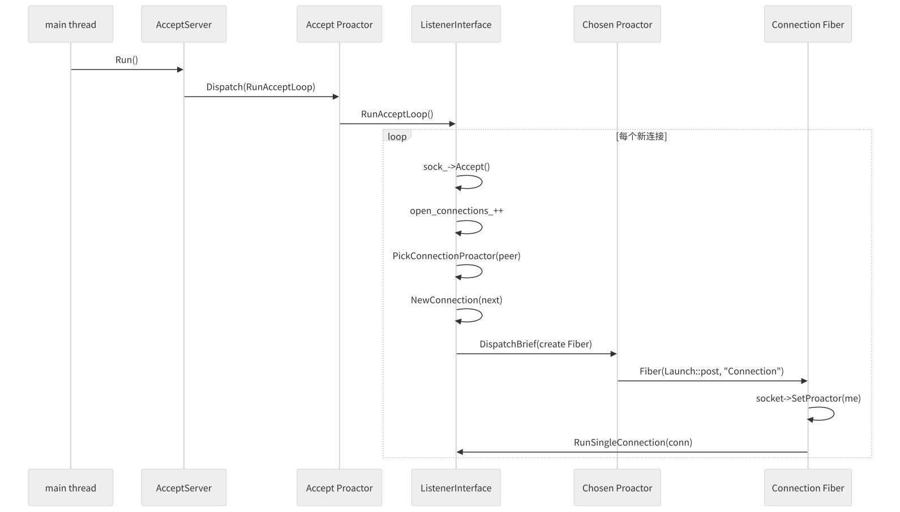

<!-- Mermaid source: ./dragonfly-io-command-lifecycle-assets/ch03-02.mmd -->

对应源码：

1. `AcceptServer::Run` 对每个 listener 调用其监听 socket 所属 Proactor 的 `Dispatch`；
2. `ListenerInterface::RunAcceptLoop` 在专用 AcceptLoop Fiber 中循环 `Accept()`；
3. `facade::Listener::PickConnectionProactor` 选择连接线程；
4. `facade::Listener::NewConnection` 创建 `facade::Connection`；
5. 目标 Proactor 上创建名为 `Connection` 的 detached Fiber；
6. Fiber 进入 `ListenerInterface::RunSingleConnection`。

### 3.3 连接 Proactor 如何选择


<!-- Mermaid source: ./dragonfly-io-command-lifecycle-assets/ch03-03.mmd -->

默认 `conn_io_threads=0` 表示从 `conn_io_thread_start` 开始使用剩余全部 Proactor。
`conn_use_incoming_cpu` 可让连接靠近内核接收包的 CPU，但需要系统 RPS/NAPI 配置配合。（CPU/NUMA 亲和性）

### 3.4 为什么每条连接一个 Fiber


<!-- Mermaid source: ./dragonfly-io-command-lifecycle-assets/ch03-04.mmd -->

连接处理代码可以按同步风格写 `Recv`、`Write`、条件变量等待与事务屏障等待，同时不把整个
OS 线程卡住。相较于“每连接一个 std::thread”，Fiber 的栈更小、切换在用户态完成，且大量
连接共享有限的 Proactor 线程。

当前默认 Fiber 栈由 `dfly_main.cc` 计算：Release 基数约 40 KiB、Debug 约 56 KiB，
ASAN 再乘 2，最后减 16 字节以避免分配器跨页（**分配器本身的元数据占用 8~16字节**）。它不是可无限递归的线程栈，因此 server/Fiber
热路径避免递归深的实现（例如 `std::regex`）。

### 3.5 连接对象怎样被追踪


<!-- Mermaid source: ./dragonfly-io-command-lifecycle-assets/ch03-05.mmd -->

> **概念解释：intrusive list**
>
> 普通 `std::list<Connection*>` 会为每个节点另行分配一个 list node；intrusive list
> 把前后指针所需的 hook 直接嵌进 `Connection`。`TLConnList` 因而可以无额外节点分配地
> 链接连接，并从对象地址直接定位节点。代价是对象不能在仍 linked 时销毁或移动；当前代码用
> `safe_link`、`is_linked()` 和严格的 Link/Unlink 顺序检查这一约束。
>
> **概念解释：intrusive_ptr**
>
> `boost::intrusive_ptr` 也把引用计数放进对象本身，没有 `shared_ptr` 的独立控制块。
> `util::Connection` 继承 `intrusive_ref_counter`；`RunSingleConnection` 和停机遍历可能在
> Fiber 切换点同时持有它，因此用 guard 保证关闭过程中对象仍活着。连接计数使用
> `thread_unsafe_counter`，因为正常引用操作被约束在所属 Proactor 线程内。

这些 thread-local intrusive list 还支撑 `CLIENT LIST`、全连接 checkpoint、暂停和有序停机。
连接迁移时 `ListenerInterface::Migrate` 会先从源线程 list 移除，迁移 Fiber，再链接到目标
线程 list。

### 本章节源码阅读建议

1. [`helio/util/fibers/accept_server.cc`](../helio/util/fibers/accept_server.cc)：
   `AddListener`、`Run`；
2. [`helio/util/fibers/listener_interface.cc`](../helio/util/fibers/listener_interface.cc)：
   `RunAcceptLoop`、`RunSingleConnection`；
3. [`src/facade/dragonfly_listener.cc`](../src/facade/dragonfly_listener.cc)：
   `NewConnection`、`PickConnectionProactor`；
4. [`helio/util/connection.h`](../helio/util/connection.h)：观察 intrusive hook 与引用计数。

此时先把 `HandleRequests` 当成黑盒；下一章再打开。

---

## 4. 连接初始化：TLS、HTTP 与数据协议分流

### 4.1 HandleRequests 的完整分支


<!-- Mermaid source: ./dragonfly-io-command-lifecycle-assets/ch04-01.mmd -->

`HandleRequests` 所在文件是
[`src/facade/dragonfly_connection.cc`](../src/facade/dragonfly_connection.cc)。它是连接 Fiber
进入 facade 后的总入口。

### 4.2 为什么先探测 HTTP


<!-- Mermaid source: ./dragonfly-io-command-lifecycle-assets/ch04-02.mmd -->

主端口（若 `primary_port_http_enabled`）和管理端口可复用 HTTP/RESP。`CheckForHttpProto`
读取到首个换行，匹配 `GET/POST ... HTTP/1.1`。非 HTTP 数据没有丢失：它仍留在
`io_buf_`，`ConnectionFlow` 会先处理这批预读输入，再进入正常 Recv 循环。

Memcached listener 和不支持 HTTP 的 listener 会直接得到“非 HTTP”结果，不做首行探测。

> **概念解释：boost::asio 在这里做什么**
>
> 当前请求链路没有使用 Asio 的 `io_context`、异步 executor 或 `strand`。
> `FiberSocketBase::endpoint_type` 只是复用了
> `boost::asio::ip::tcp::endpoint` 作为地址值类型。真正的事件循环是 Helio
> `UringProactor/EpollProactor`。strand 是 Asio 用于保证一组 handler 不并发进入的串行
> executor 约束；当前路径没有使用它，同一连接的串行性由“单 Proactor 所属 +
> Fiber/队列规则”提供。

### 4.3 ConnectionContext 与 ParsedCommand


<!-- Mermaid source: ./dragonfly-io-command-lifecycle-assets/ch04-03.mmd -->

`Service::CreateContext` 返回 server 层的 `dfly::ConnectionContext`，保存 DB、namespace、
认证/ACL、MULTI、脚本、订阅、tracking 与复制状态（标识 replica）。facade 只通过基类字段观察连接是否正在
dispatch、阻塞或关闭。

`Service::AllocateParsedCommand` 实际分配 `CommandContext`。协议层只把它视为
`ParsedCommand`；进入 server 后再取得 `CommandId`、`Transaction` 和去掉命令名的参数视图。
这让解析后的参数在异步 pipeline/协程跨越 Fiber 切换时仍由对象自己持有(**保证“每个命令在异步执行全过程中，其参数数据始终有效**)。

### 4.4 ReplyBuilder 也在此时绑定 socket


<!-- Mermaid source: ./dragonfly-io-command-lifecycle-assets/ch04-04.mmd -->

ReplyBuilder 持有的是 `io::Sink*`，当前即连接的 `FiberSocketBase`（TLS 时是
`TlsSocket`）。命令 handler 因而只表达逻辑响应类型，不关心后端最终走
io_uring send、epoll sendmsg 还是 TLS 加密写。

`SinkReplyBuilder`：回复的“构建器”和“发送器”，作为客户端回复缓存区，与命令 1:1。

### 本章节源码阅读建议

1. [`src/facade/dragonfly_connection.cc`](../src/facade/dragonfly_connection.cc)：
   `Connection` 构造函数、`OnConnectionStart`、`HandleRequests`、`CheckForHttpProto`；
2. [`src/facade/dragonfly_connection.h`](../src/facade/dragonfly_connection.h)：
   先看公开注释，再看 data/control 两个队列字段；
3. [`src/facade/conn_context.h`](../src/facade/conn_context.h)；
4. [`src/server/conn_context.h`](../src/server/conn_context.h)：
   `ConnectionState` 与 `CommandContext`；
5. [`src/facade/parsed_command.h`](../src/facade/parsed_command.h)。

阅读目标是区分三种“上下文”：连接对象、连接状态 `ConnectionContext`、单命令
`CommandContext`。

---

## 5. 收包与协议解析

### 5.1 从 socket 到 io_buf_


<!-- Mermaid source: ./dragonfly-io-command-lifecycle-assets/ch05-01.mmd -->

V1 的 `Connection::IoLoop` 是最容易读懂的入口：

```text
IoLoop
  -> HandleMigrateRequest
  -> HandleRecvSocket
       -> io_buf_.AppendBuffer()
       -> socket_->Recv()
       -> io_buf_.CommitWrite()
  -> phase_ = PROCESS
  -> RESP: ParseRedis(...)
     Memcache: ParseLoop()
  -> 根据 NEED_MORE 扩大或按低使用率缩小 io_buf_
  -> 回到 Recv
```

`base::IoBuf` 维护“已写入但尚未消费”的输入区和尾部可写区。Recv 直接写
`AppendBuffer()`，成功后必须 `CommitWrite(n)`；解析完则 `ConsumeInput(n)`。这种结构避免每次半包到来都移动尚未解析的数据（标识数据边界）。

#### 5.2 当前 RESP 服务端解析链


<!-- Mermaid source: ./dragonfly-io-command-lifecycle-assets/ch05-02.mmd -->

这里有一个重要的源码辨识点：

| 类型               | 当前用途                                        | 不要混淆                                 |
| ------------------ | ----------------------------------------------- | ---------------------------------------- |
| `RespSrvParser`  | Dragonfly 服务端 RESP 请求热路径                | `Connection::redis_parser_` 的实际类型 |
| `RedisParser`    | RESP 表达式解析，协议客户端、主从复制及部分测试 | 不是普通客户端请求的主 parser            |
| `MemcacheParser` | Memcached 文本协议                              | 结果附在`ParsedCommand::mc_cmd_`       |

`Connection` 的成员名仍叫 `redis_parser_`，但声明是
`std::unique_ptr<RespSrvParser>`。判断实际实现时应看成员类型与构造函数，而不是根据文件名猜。

### 5.3 RespSrvParser 状态机


<!-- Mermaid source: ./dragonfly-io-command-lifecycle-assets/ch05-03.mmd -->

解析器支持两种请求形式：

- 标准 RESP array，例如 `*3\r\n$3\r\nSET...`；
- inline，例如 `PING\r\n`。

服务端 array 中每个参数必须是 bulk string（`$`）。解析器用 `small_buf_` 暂存被拆开的长度
行（半包数据），用 `bulk_len_` 记录尚缺数据的长度，并把 bulk 内容逐段拷入 `BackedArguments` 的稳定存储。
因此返回 `INPUT_PENDING` 时，Connection 可以**消费/移除**已经被 parser 内部吸收的输入前缀。

> 这段优化能提高缓存行的利用率。

解析结果含义：

| `ParserStatus` | Connection 行为                                            |
| ---------------- | ---------------------------------------------------------- |
| `OK`           | 至少完成一条命令，可继续处理同一 buffer                    |
| `NEED_MORE`    | 保留 parser 状态，必要时增长`io_buf_`，继续 Recv         |
| `ERROR`        | 先完成此前合法命令的有序回复，再发送 protocol error 并关闭 |

### 5.4 一次 buffer 内可能有多条命令


<!-- Mermaid source: ./dragonfly-io-command-lifecycle-assets/ch05-04.mmd -->

`ParseRedis` 不只解析一条命令。它在同一 buffer 上循环，`has_more` 表示当前命令后还有数据，
并影响后续选择同步还是 pipeline 路径。为了避免一个超大 pipeline 长时间霸占 Proactor，
运行超过 `max_busy_read_usec` 对应周期后会 `ThisFiber::Yield()`。

V2 的 `ParseRedisBatch` 仍调用 `ParseRedis`，但传入 `enqueue_only=true`：解析阶段只入
`ParsedCommand` 链表，执行由 `ExecuteBatch` 负责。

### 5.5 Memcached 的差异


<!-- Mermaid source: ./dragonfly-io-command-lifecycle-assets/ch05-05.mmd -->

`MemcacheParser::Command` 保存命令枚举、key/value 视图、CAS、TTL、flags 和 noreply/meta
选项；底层参数仍由 `BackedArguments` 持有。可恢复的 Memcache 解析错误也进入命令队列并变成
deferred reply，以保证前面 pipeline 回复的顺序不被破坏。

### 5.6 协议错误为何不是立刻 close

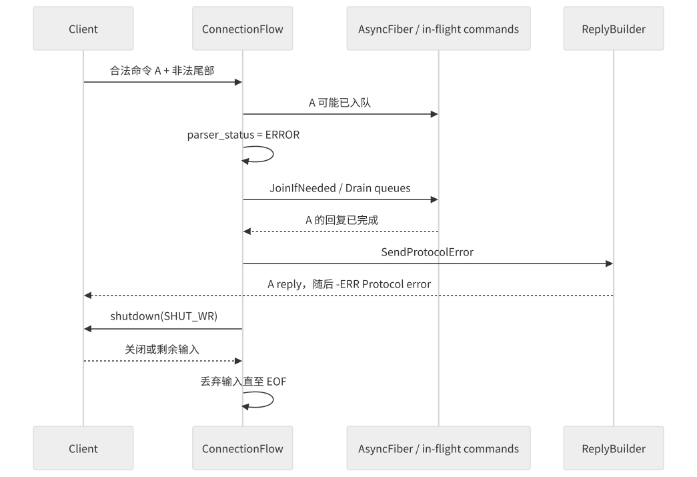

<!-- Mermaid source: ./dragonfly-io-command-lifecycle-assets/ch05-06.mmd -->

这样做是为了让同一 TCP 写入中位于错误之前的合法命令仍按序得到响应，也避免服务器直接 RST
导致客户端读不到 protocol error。源码注释同时指出：错误后等待对端关闭的 drain 循环仍有
潜在永久等待问题，阅读时不要把它误认为带超时的完整方案。

### 本章节源码阅读建议

1. [`src/facade/dragonfly_connection.cc`](../src/facade/dragonfly_connection.cc)：
   `ConnectionFlow`、`HandleRecvSocket`、`IoLoop`、`ParseRedis`；
2. [`src/facade/resp_srv_parser.h`](../src/facade/resp_srv_parser.h) 后读
   [`resp_srv_parser.cc`](../src/facade/resp_srv_parser.cc)；
3. [`src/common/backed_args.h`](../src/common/backed_args.h)；
4. Memcached 读 [`src/facade/memcache_parser.h`](../src/facade/memcache_parser.h) 与
   `ParseMCBatch`；
5. 最后对照 [`src/facade/redis_parser.h`](../src/facade/redis_parser.h)，明确它为何不是本链
   主 parser。

---

## 6. 单命令、Pipeline 与 V1/V2 IO loop

### 6.1 当前默认值先讲清楚


<!-- Mermaid source: ./dragonfly-io-command-lifecycle-assets/ch06-01.mmd -->

| 协议             | 当前默认 loop                     | 主要代码                              |
| ---------------- | --------------------------------- | ------------------------------------- |
| RESP             | V1                                | `IoLoop` + 按需 `AsyncFiber`      |
| Memcached        | V2                                | `IoLoopV2`                          |
| RESP 显式开启 V2 | V2，且可启用 vectorized squashing | `ParseLoop/ExecuteBatch/ReplyBatch` |

因此只画一种“Connection 读取后交给 Dispatch Fiber”的图是不准确的。当前源码必须同时理解 V1 与 V2；而第一次阅读建议先掌握默认 RESP 的 V1，再读 V2。

### 6.2 V1：简单请求走同步快路径


<!-- Mermaid source: ./dragonfly-io-command-lifecycle-assets/ch06-02.mmd -->

当 buffer 中只有一条普通命令、没有订阅/异步队列占用时，解析它的 Connection Fiber 直接调用
`Service::DispatchCommand`。这避免创建或唤醒第二个 Fiber 和复制队列状态，是低延迟路径。
V1 只有在 pipeline 或异步消息需要并行消费时，才会按需创建该连接的 `AsyncFiber`；它不是
每条连接启动时都必然存在的 Fiber。

“同步”只表示命令在当前 Connection Fiber 的控制流中完成；若它等待远端 shard 或 socket，当前 Fiber 仍可 yield，OS 线程继续运行其他 Fiber。

### 6.3 V1 Pipeline：一个生产者、一个消费者


<!-- Mermaid source: ./dragonfly-io-command-lifecycle-assets/ch06-03.mmd -->

V1 的 AsyncFiber 有三类策略：

1. pipeline 足够长、都是可 squash 的 RESP 命令时，`SquashPipeline` 调
   `Service::DispatchSquashedBatch`；
2. 否则逐条 `ProcessPipelineCommandV1`；
3. Pub/Sub、MONITOR、migration、checkpoint、invalidation 等从 control queue 处理。

它在合适时机 `Yield` 或短暂等待更多命令以扩大批次，并用 quota 防止 control 消息一直饿死数据路径。

### 6.4 两条队列不是同一种结构


<!-- Mermaid source: ./dragonfly-io-command-lifecycle-assets/ch06-04.mmd -->

数据路径的手工单链表同时表达三个区间：

```text
parsed_head_
    -> 已 dispatch、等待完成/回复的前缀
    -> parsed_to_execute_
    -> 已解析、尚未 dispatch 的后缀
    -> parsed_tail_
```

已完成的异步命令不能马上释放，因为客户端回复必须遵守请求顺序。`parsed_head_` 只能在队头回复 ready 后前移。

control path 使用 `std::deque<MessageHandle>`，variant 可装 Pub/Sub、MONITOR、migration、checkpoint 和 RESP3 invalidation。checkpoint 可前插，并与 data path 的时间戳共同维持全局可见性/顺序。

### 6.5 V2：单 Fiber 的事件驱动循环


<!-- Mermaid source: ./dragonfly-io-command-lifecycle-assets/ch06-05.mmd -->

V2 不再依赖一个长期消费者 AsyncFiber：

- Proactor 的 recv hook 把“有输入/错误”转成 `io_event_` 唤醒；
- 同一个 Connection Fiber 依次 drain、parse、dispatch、reply；
- 支持的 command handler 可用 `SingleHopAsync` 让 shard 任务在后台完成；
- Fiber 订阅队头 `ParsedCommand::Blocker()`，完成后立即醒来；
- `ReplyBatch` 只从 ready 的有序队头发送。

io_uring 且配置了 buffer ring、连接又非 TLS 时，`MaybeEnableRecvMultishot` 可启用 multishot receive；否则仍通过统一 hook/`TryRecv` 路径工作。

### 6.6 V1 与 V2 的异步含义


<!-- Mermaid source: ./dragonfly-io-command-lifecycle-assets/ch06-06.mmd -->

V1 的“异步”主要是**连接级双 Fiber 并行**：生产者可继续收包，消费者仍以 ONLY_SYNC 执行每条命令。V2 进一步支持**命令级 deferred 执行**：`DispatchCommandSimple` 可以在 shard hop 尚未完成时返回，完成状态由 `ParsedCommand` 与 blocker 持有。

### 6.7 Pipeline 反压


<!-- Mermaid source: ./dragonfly-io-command-lifecycle-assets/ch06-07.mmd -->

反压既看单连接 queue length，也看当前 Proactor 的 pipeline 总内存。V1 可能让生产者 Fiber等待 `pipeline_cnd`；V2 会先 drain 已排队命令，再用持久订阅等待全局内存下降。空队列始终允许至少解析一条命令，使 `CONFIG SET` 等管理命令仍有机会提高限制或解除压力。

### 6.8 MultiCommandSquasher：流水线与多命令压平并发分发

`MultiCommandSquasher` 是 Dragonfly 核心引擎层的**批量分发优化器**。它将一批连续的命令按目标分片（`ShardId`）分组打包，利用 Dragonfly 的多核无共享架构并发下发给多个 `EngineShard` 执行，从而将多次跨线程调度折叠为一次。

#### 6.8.1 应用场景一览

| 场景                              | 是否使用`MultiCommandSquasher` |      依赖 IoLoopV2 吗？      | 说明                                                                                   |
| :-------------------------------- | :------------------------------: | :---------------------------: | :------------------------------------------------------------------------------------- |
| **客户端流水线 (Pipeline)** |           **是**           |   **必须是 IoLoopV2**   | IoLoopV1 为单步阻塞式处理；IoLoopV2 批量解析后通过`DispatchSquashedBatch` 压平分发。 |
| **事务 (MULTI/EXEC)**       |           **是**           | **无关** (V1/V2 均支持) | `Service::Exec` 在 `--multi_exec_squash=true` 时直接调用。                         |
| **Lua 脚本 (EVAL)**         |           **是**           | **无关** (V1/V2 均支持) | `Service::FlushEvalAsyncCmds` 批量刷新 Lua 累积的写命令。                            |

#### 6.8.2 核心执行机制（Run 与 TrySquash）

`MultiCommandSquasher::Run` 采用流式拉取（Streaming Pull）模型驱动：

```cpp
void MultiCommandSquasher::Run(RedisReplyBuilder* rb) {
  for (CmdRef cmd = cmd_gen_(); cmd.IsValid(); cmd = cmd_gen_()) {
    num_commands_++;
    auto res = TrySquash(cmd);

    if (res == SquashResult::NOT_SQUASHED || res == SquashResult::SQUASHED_FULL) {
      if (!ExecuteSquashed(rb))
        break;

      if (res == SquashResult::NOT_SQUASHED) {
        if (!ExecuteStandalone(rb, cmd))
          break;
      }
    }
  }

  ExecuteSquashed(rb);  // 刷盘尾部残留命令
  // ...
}
```

1. **分拣装箱 (`TrySquash`)**：
   - 检查命令是否为单 Shard 读写命令。
   - 若是单 Shard 命令，推入对应分片的等待队列：`sharded_[sid].dispatched.push_back(...)`。
   - 若命令涉及多 Shard、全局锁或跨分片事务，则返回 `NOT_SQUASHED`，先行清空前面已聚合的批次，再通过 `ExecuteStandalone` 走普通单命令调度。
2. **时序保序索引 (`order_`)**：
   - 每压入一条命令，同步记录该命令所属的分片：`order_.push_back(last_sid)`。
   - `sharded_` 负责**空间并行**（按 Shard 聚合任务并发执行）；
   - `order_` 负责**时间保序**（乱序并发跑完后，严格按照客户端发送命令的 FIFO 顺序抽取回复拼装并返回）。

#### 6.8.3 批量派发与协程阻塞模型 (`ExecuteSquashed`)

当批次达到上限（默认 32 条）或遇到无法压平的命令时，触发 `ExecuteSquashed`：

1. **构建协程计数屏障**：创建 `fb2::FiberBlockingCounter bc(num_shards)`。
2. **轻量投递到目标分片**：
   ```cpp
   for (unsigned i = 0; i < sharded_.size(); ++i) {
     if (!sharded_[i].dispatched.empty())
       shard_set->AddL2(i, cb);
   }
   bc.Wait();
   ```

   闭包 `cb` 体积小于 32 字节，仅捕获 `this`。目标 Shard 线程被唤醒后，通过 `EngineShard::tlocal()->shard_id()` 直接读取对应 `sharded_[sid].dispatched`，**实现零内存深拷贝和天然互斥的分片无锁访问**。
3. **分片本地批处理与 CPU 预取 (`SquashedHopCb`)**：
   - 目标 Shard 线程以 8 条为一组（`kPrefetchBatch`），利用 `prime->Prefetch(...)` 提前将 Dashtable 哈希桶拉入 CPU L1/L2 缓存，消除内存寻址等待。
   - 内联紧凑执行当前分片的所有命令并收集回复。
   - 执行完成后调用 `bc.Release()`。
4. **用户态协程让出 CPU**：
   - `bc.Wait()` 挂起的是**当前连接的 Fiber（协程）**，而非 Linux OS 线程。
   - 底层 Proactor 线程不会陷入内核休眠，而是继续处理其他就绪网络事件或执行其他连接的 Fiber。
   - 最后一个执行完成的分片线程调用 `bc.Release()` 将原 Fiber 放回就绪队列唤醒。
5. **按序重排回复**：
   唤醒后，按照 `order_` 记录的分片顺序，从各 `sharded_[idx]` 中逐个取出 `reply` 写入 `RedisReplyBuilder`，完成响应发回。

### 本章节源码阅读建议

1. V1：在 [`dragonfly_connection.cc`](../src/facade/dragonfly_connection.cc) 依次读
   `DispatchSingle`、`LaunchAsyncFiberIfNeeded`、`AsyncFiber`、
   `ProcessPipelineCommandV1`；
2. 对照 [`dragonfly_connection.h`](../src/facade/dragonfly_connection.h) 的两个队列注释；
3. V2：再读 `IoLoopV2`、`RunParsePath`、`ExecuteBatch`、`ReplyBatch`；
4. 最后读 `QueueBackpressure` 和 `ParkOnBackpressure`，不要一开始陷入统计字段。

---

## 7. Service 分发：命令查找、校验与上下文

### 7.1 facade 到 server 的窄接口


<!-- Mermaid source: ./dragonfly-io-command-lifecycle-assets/ch07-01.mmd -->

facade 不包含 Dragonfly 命令实现。它只知道：

- `CreateContext`；
- `AllocateParsedCommand`；
- `DispatchCommand` / `DispatchCommandSimple`；
- 可选 `DispatchSquashedBatch`；
- 连接关闭回调。

这让 RESP/Memcache IO 生命周期不依赖 `SET`、`EVAL` 或 cluster 的具体实现。

### 7.2 DispatchCommand 主流程


<!-- Mermaid source: ./dragonfly-io-command-lifecycle-assets/ch07-02.mmd -->

`DispatchCommand` 是网络与命令业务之间最关键的桥。它不执行 key-value 细节，而是把“解析后的一串参数”变为“经过校验、带事务上下文的 handler 调用”。

### 7.3 CommandRegistry 与 CommandId


<!-- Mermaid source: ./dragonfly-io-command-lifecycle-assets/ch07-03.mmd -->

`FindExtended` 先把命令名转大写；`ACL subcommand` 会拼成如 `ACL SETUSER` 的完整 key，
`XGROUP HELP` 有专门兼容分支。普通命令返回 `CommandId*` 和去掉命令名的 `tail_args`。

`CommandId` 同时是：

- handler 的函数对象；
- 参数 arity 与 key 位置的静态描述；
- 事务/只读/日志/OOM/阻塞/脚本/管理命令能力位；
- ACL 分类与每线程统计入口；
- 是否支持 async command coroutine 的标志。

注册示例：

```cpp
CI{"SET",
   CO::JOURNALED | CO::DENYOOM | CO::NO_AUTOJOURNAL,
   -3, 1, 1}
    .SetAsyncHandler(CmdSet)
```

含义是：`SET` 至少 3 个总参数；第 1 个 tail 参数是唯一 key；是写命令、OOM 时拒绝，并由
handler 自己写 journal；handler 支持 deferred async 路径。

### 7.4 VerifyCommandState 到底检查什么


<!-- Mermaid source: ./dragonfly-io-command-lifecycle-assets/ch07-04.mmd -->

把这些检查集中在 Service 层有两个好处：

1. handler 可以假设 arity、server state、ACL 和 cluster ownership 已经合法；
2. 同一个 handler 被普通客户端、Memcache 映射、脚本或复制调用时可复用一致规则，并通过 context 标志显式放宽内部调用。

### 7.5 什么命令会创建 Transaction


<!-- Mermaid source: ./dragonfly-io-command-lifecycle-assets/ch07-05.mmd -->

`CommandId::IsTransactional` 当前在以下情况为真：

- 至少声明一个 key；
- `GLOBAL_TRANS` 或 `NO_KEY_TRANSACTIONAL`；
- EVAL family；
- EXEC（但不是单纯的 MULTI/DISCARD）。

因此 `PING`、某些纯连接状态命令可以完全跳过 Transaction。不要在图里强行给每条命令都画
一个事务对象。

顶层新事务由 `boost::intrusive_ptr<Transaction>` 持有，`ConnectionContext::transaction`
只是执行期间的非 owning 指针。命令结束后记录 txid/stat 并清空该指针。

### 7.6 InvokeCmd 才真正调用 handler


<!-- Mermaid source: ./dragonfly-io-command-lifecycle-assets/ch07-06.mmd -->

`CommandId::Invoke` 本身只是调用预注册 `handler_`。这一层仍在连接协调 Fiber 上；只有
handler 随后调用 `Transaction::Schedule...` 时，数据操作才进入 shard owner 线程。

### 本章节源码阅读建议

1. [`src/facade/service_interface.h`](../src/facade/service_interface.h) 与
   [`service_interface.cc`](../src/facade/service_interface.cc)；
2. [`src/server/main_service.cc`](../src/server/main_service.cc)：
   `DispatchCommand` → `VerifyCommandState` → `PrepareTransaction` → `InvokeCmd`；
3. [`src/server/command_registry.h`](../src/server/command_registry.h)：
   `CommandId` 能力位与 `SetAsyncHandler`；
4. [`src/server/command_registry.cc`](../src/server/command_registry.cc)：
   `FindExtended`、`Validate`；
5. 最后看 `Service::RegisterCommands`，不要先逐个阅读所有 family。

---

## 8. Transaction 如何把命令送到 EngineShard

### 8.1 Transaction 是协调器，不是数据容器


<!-- Mermaid source: ./dragonfly-io-command-lifecycle-assets/ch08-01.mmd -->

`Transaction` 保存命令、参数视图、目标 shard、每 shard 参数 slice、key lock fingerprint、
状态位、txid、callback 和完成屏障。它不保存数据库值，也不允许 shard callback 把 shard
内部指针带回协调线程。

Dragonfly 把一次跨线程 callback 往返称为一个 **hop**。简单命令通常一个 hop；例如需要先读
后写的跨 shard 操作可能有多个 hop。

### 8.2 从参数确定 shard


<!-- Mermaid source: ./dragonfly-io-command-lifecycle-assets/ch08-02.mmd -->

默认非 cluster 特殊模式下，`Shard(key, shard_num)` 用带固定 seed 的 XXH64 后取模。当前还要注意两个分支：

- cluster 配置按 slot 分 shard 时：`KeySlot(key) % shard_num`；
- cluster 配置按 tag 分 shard 时：先取 `LockTag` 部分再 XXH64。

因此文档或调试脚本不要永远写死“`hash(full_key) % N`”。

### 8.3 调度总流程


<!-- Mermaid source: ./dragonfly-io-command-lifecycle-assets/ch08-03.mmd -->

看源码时要把两个动作分开：

1. **Schedule**：在相关 shard 建立顺序和 intent lock；
2. **DispatchHop**：把当前 callback 标记为 armed，触发 `PollExecution`。

但常见单 shard 快路径会在 Schedule 阶段直接把 callback 做完，因此不是每次都真的执行第二次跨线程投递。

### 8.4 最常见的单 shard 乐观快路径


<!-- Mermaid source: ./dragonfly-io-command-lifecycle-assets/ch08-04.mmd -->

这是理解 Dragonfly 性能设计的关键：

- 协调 Fiber 与目标 shard 同线程时可省掉 message；
- 即使跨线程，schedule callback 到达 shard 后，只要无冲突也可就地执行命令；
- 快路径不触碰全局 `op_seq`，不插 `TxQueue`；
- callback 若在执行中发生 Fiber preemption，当前代码会用 `running_tx_` 与延迟注册 intent lock 保护并发可见性。

所以“每个 SET 都先申请全局 txid、排队、再执行”并不符合当前实现。

### 8.5 需要排队时的数据结构


<!-- Mermaid source: ./dragonfly-io-command-lifecycle-assets/ch08-05.mmd -->

> **概念解释：intent lock**
>
> 它不是让线程在 `mutex.lock()` 上睡眠的互斥锁，而是在 shard owner 线程中记录某些 key
> fingerprint 上有多少 shared/exclusive 意图。真正的运行顺序由 tx queue、txid 和 armed
> 状态共同决定。无冲突事务可标记 `OUT_OF_ORDER` 提前运行；有冲突事务等待逻辑顺序。

> **概念解释：BlockingCounter / barrier**
>
> `run_barrier_` 初始为本 hop 要运行的 shard 数。每个 shard 完成后 `Dec()`，协调 Fiber 在
> `Wait()` 处挂起；归零后恢复。挂起的是 Fiber，不是 OS 线程。

`Transaction` 自己用原子引用计数配合 `boost::intrusive_ptr`。与 Connection 的 thread-unsafe
计数不同，Transaction 会同时被协调线程、多个 shard task 和 barrier 完成路径持有，所以其
`use_count_` 是 atomic。

### 8.6 多 shard 调度与重试

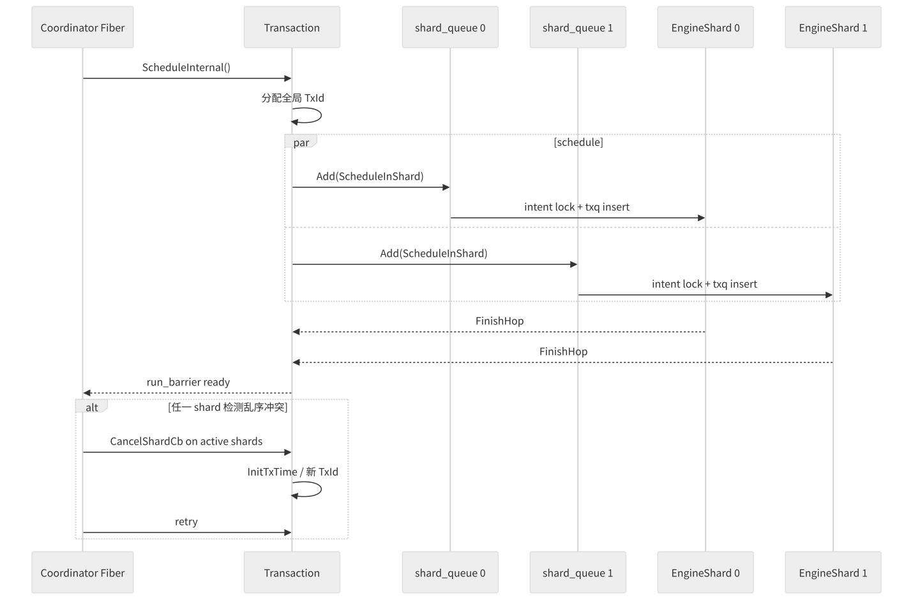

<!-- Mermaid source: ./dragonfly-io-command-lifecycle-assets/ch08-06.mmd -->

多 shard 先取得共同 txid，使各 shard 对事务有一致总序。消息到达不同 shard 的物理顺序可能
不同；若较早 txid 晚到且与已排事务冲突，不能安全重排，就撤销本轮 schedule 后重试。成功
schedule 之后执行阶段不做业务 rollback。

### 8.7 DispatchHop 到 PollExecution


<!-- Mermaid source: ./dragonfly-io-command-lifecycle-assets/ch08-07.mmd -->

`EngineShard::PollExecution` 还处理两个容易被简化图漏掉的状态：

- `continuation_trans_`：一个未 conclude、后续还有 hop 的事务必须优先继续；
- awakened blocking transaction：从 `BlockingController` 唤醒的事务优先于普通 tx queue。

`RunInShard` 在 callback 前设置 `running_tx_`，callback 后处理自动 journal、tracking、
blocking 清理、锁释放和 queue removal，最后 `FinishHop`。从 `FinishHop` 开始 callback 不应再
访问可能已因引用计数归零而销毁的 Transaction。

### 8.8 TaskQueue 内部有一根高优先级的 consumer Fiber，它负责不断从队列里取出 lambda 并执行


<!-- Mermaid source: ./dragonfly-io-command-lifecycle-assets/ch08-08.mmd -->

`EngineShardSet::Add` 不是直接运行 lambda，而是进入目标 `EngineShard::queue_`（类型为
`TaskQueue`）。
`TaskQueue::Start` 创建高优先级 consumer Fiber，`FiberQueue::Run` 成批 dequeue callback。
这样：

- 多协调线程只传消息，不共享 shard 容器；
- 同一 shard callback 在 owner 线程串行进入；
- queue 满时提交 Fiber 可以被反压而不是丢任务；
- 高优先级避免 shard 事务被大量普通连接 Fiber 长时间饿死，可能会优先被放到就绪纤程队列对头，优先执行。

### 8.9 同线程内联与跨线程 PollExecution：两条真实执行栈

前面的章节分别介绍了 `CanRunInlined`、`DispatchHop` 和 `PollExecution`。这里把一个
`GET`/`SET` 从命令 handler 到真正 shard callback 的两条执行栈放在同一张图中。要点是：
`CommandId::Invoke`、`CmdGet/CmdSet` 属于连接侧的协调控制流；访问 `DbSlice` 的 lambda
才是必须在目标 `EngineShard` owner 线程执行的数据操作。下面先以同步派发为主；V2 deferred
模式改变的是 Connection 侧等待方式，不改变 callback 必须在 shard owner 线程执行这一边界。

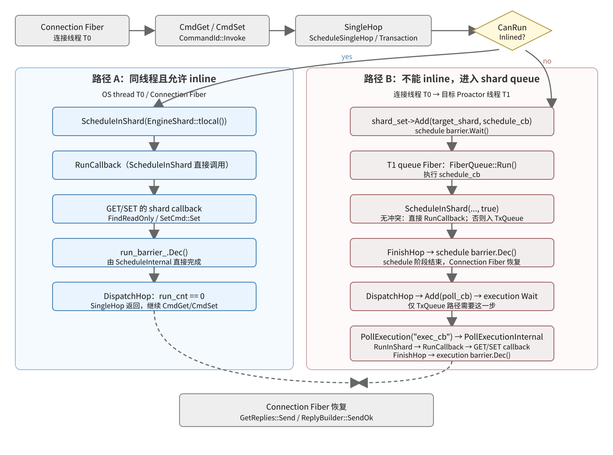

<!-- Mermaid source: ./dragonfly-io-command-lifecycle-assets/ch08-09.mmd -->

图中的调用关系可以按下面的逻辑调用栈阅读：

```text
Connection Fiber（连接所属 Proactor，线程 T0）
  -> Service::DispatchCommand
  -> PrepareTransaction / Transaction::InitByArgs
  -> CommandId::Invoke
  -> CmdGet / CmdSet
  -> co_await cmd::SingleHop(callback)
  -> SingleHopWaiter::await_ready
  -> Transaction::ScheduleSingleHop
  -> Transaction::Execute
  -> Transaction::ScheduleInternal
```

之后根据 `CanRunInlined()` 分成两条路径：

```text
路径 A：同线程且允许 inline

Connection Fiber（T0）
  -> ScheduleInternal
  -> CanRunInlined() == true
  -> ScheduleInShard(EngineShard::tlocal(), execute_optimistic=true)
  -> ScheduleInShard 的 immediate_run 分支
  -> Transaction::RunCallback
  -> GET/SET 的 shard callback（访问 DbSlice）
  -> ScheduleInternal 直接 run_barrier_.Dec()
  -> PollExecutionIfDeferred()（通常为空操作）
  -> DispatchHop 看到 OPTIMISTIC_EXECUTION，run_cnt == 0，直接返回
  -> 从 SingleHop 返回
  -> GetReplies::Send 或 ReplyBuilder::SendOk
```

这条路径里不会进入 `EngineShard::queue_`，也不会调用 `RunInShard`。`RunCallback` 是
`ScheduleInShard` 的乐观执行分支直接调用的，因此此时真正的 GET/SET lambda 就运行在当前
Connection Fiber 上；线程和 Fiber 都没有切换。

```text
路径 B：不能 inline，投递到目标 shard 的专有 queue Fiber

Connection Fiber（T0）
  -> ScheduleInternal
  -> shard_set->Add(target_shard, schedule_cb)
  -> schedule 阶段的 run_barrier_.Wait()
  -> 当前 Connection Fiber 挂起（不阻塞 OS 线程 T0）

目标 Proactor 线程 T1 的 shard queue Fiber
  -> FiberQueue::Run
  -> schedule_cb
  -> ScheduleInShard(EngineShard::tlocal(), execute_optimistic=true)
     -> 无冲突：直接 RunCallback，GET/SET 在这个 queue Fiber 中完成
     -> 不能立即执行：插入 TxQueue，等待 DispatchHop arm
  -> FinishHop / schedule barrier.Dec

连接线程 T0 的 Connection Fiber 恢复
  -> 从 schedule barrier.Wait() 返回
  -> DispatchHop
     -> 若 schedule 阶段已乐观完成：run_cnt == 0，不再调用 PollExecution
     -> 若事务仍在 TxQueue：标记 is_armed，shard_set->Add(target_shard, poll_cb)
  -> execution 阶段的 run_barrier_.Wait()
  -> Connection Fiber 再次挂起

目标线程 T1 的同一个 shard queue Fiber
  -> FiberQueue::Run
  -> poll_cb
  -> EngineShard::PollExecution("exec_cb")
  -> PollExecutionInternal
  -> Transaction::RunInShard
  -> Transaction::RunCallback
  -> GET/SET 的 shard callback（访问 DbSlice）
  -> FinishHop / execution barrier.Dec

连接线程 T0 的 Connection Fiber 再次恢复
  -> 从 execution barrier.Wait() 返回
  -> CmdGet/CmdSet 从 co_await 后继续
  -> 构造并发送回复
```

因此，不能只用“GET/SET 在 Fiber 中还是线程中”二选一来描述。更准确地说，callback 总是在
目标 shard owner **线程**上执行，而承载它的 **Fiber** 有三种可见情况：

- **同线程 inline：当前 Connection Fiber 直接执行 `RunCallback`；**
- **跨线程但 schedule 阶段乐观成功：目标线程的 shard queue Fiber 在 `schedule_cb` 中直接
  执行 `RunCallback`，没有 `PollExecution`；**
- **进入 TxQueue：目标线程的 shard queue Fiber 在 `poll_cb -> PollExecution -> RunInShard`
  中执行 `RunCallback`。**

对应下面的表格：

| 场景                                               | `PollExecution`调用者                               | 是否一定经过`PollExecution`         |
| -------------------------------------------------- | ----------------------------------------------------- | ------------------------------------- |
| 同 shard、无冲突、允许 inline                      | Connection/coordinator fiber                          | 不一定，通常直接 optimistic execution |
| 跨 shard、调度阶段无冲突                           | shard queue consumer fiber                            | 可能不经过，schedule 阶段直接执行     |
| 事务进入 TxQueue，等待顺序执行                     | shard queue consumer fiber                            | 会经过                                |
| `CanRunInlined()`成立但需要执行已 armed 事务     | Connection/coordinator fiber                          | 会直接调用                            |
| `FinalizeMulti()`、阻塞清理等 shard 内部后续处理 | 当前 shard callback 所在 fiber，通常是 consumer fiber | 会调用                                |
| 多 shard 事务                                      | 各目标 shard 的 consumer fiber                        | 通常每个 shard 都会调用               |

> TaskQueue：把任务送到 shard 线程
> TxQueue：决定事务在 shard 上的先后

后两种也可能发生在“目标 shard 与当前线程相同、但当前不允许 inline”的情况：此时没有 OS
线程切换，但 callback 仍然会经过当前线程上的 `TaskQueue` 专有 Fiber。因此不能把“同线程”
直接等同于“Connection Fiber”，也不能把“跨线程”理解成“为每条命令创建新的 OS 线程”。

几个源码边界分别对应：

- [`CommandId::Invoke`](../src/server/command_registry.h) 只调用预注册 handler；
- [`CmdGet` / `CmdSet`](../src/server/string_family.cc) 创建实际的 shard callback；
- [`SingleHopWaiter`](../src/server/cmd_support.cc) 决定同步 Fiber 等待还是 deferred coroutine；
- [`Transaction::RunInShard` / `RunCallback`](../src/server/transaction.cc) 在 shard owner
  线程调用 callback；
- [`EngineShardSet::Add`](../src/server/engine_shard_set.h) 保证排队 callback 由目标
  `FiberQueue` consumer Fiber 消费。

### 本章节源码阅读建议

建议分三轮：

1. [`src/server/transaction.h`](../src/server/transaction.h)：
   只读文件头、`RunnableType`、`ScheduleSingleHop`、`PerShardData`/字段注释；
2. [`src/server/transaction.cc`](../src/server/transaction.cc)：
   `InitByArgs` → `ScheduleInternal` → `ScheduleInShard` →
   `DispatchHop` → `RunInShard`/`RunCallback`；
3. [`src/server/engine_shard.cc`](../src/server/engine_shard.cc)：
   `PollExecution`；随后读 [`src/core/task_queue.cc`](../src/core/task_queue.cc)。

若这是第一次读事务源码，先只跟单 shard `SET`，确认快路径后再看 multi-shard retry 和
blocking。

---

## 9. 以 SET 为例走完整调用链

前面已经分别解释了网络、解析、命令和事务。现在把它们重新接成一条不跳步的 `SET key value` 链路。

### 9.1 SET 是怎样进入注册表的

`RegisterStringFamily` 中的当前注册项是：	

```cpp
CI{"SET", CO::JOURNALED | CO::DENYOOM | CO::NO_AUTOJOURNAL, -3, 1, 1}
    .SetAsyncHandler(CmdSet)
```


<!-- Mermaid source: ./dragonfly-io-command-lifecycle-assets/ch09-01.mmd -->

这些字段会在不同阶段被消费：

| 注册信息           | 使用者                                          | 对本次请求的影响                                      |
| ------------------ | ----------------------------------------------- | ----------------------------------------------------- |
| arity`-3`        | `CommandId::Validate`                         | 至少需要命令名、key、value                            |
| key 范围`1,1,1`  | `DetermineKeys` / `Transaction::InitByArgs` | 只有第一个 tail argument 是 key                       |
| `DENYOOM`        | `Service::InvokeCmd`                          | 内存策略要求拒绝写入时，handler 前直接报 OOM          |
| `JOURNALED`      | 事务与监控逻辑                                  | 把它视为写命令                                        |
| `NO_AUTOJOURNAL` | `Transaction::LogAutoJournalOnShard`          | 通用 auto-journal 跳过，由`SetCmd` 显式记录实际效果 |
| async handler      | `CommandId::Invoke`                           | 调用`CmdSet`，返回 `cmd::CmdR` 协程对象           |

`NO_AUTOJOURNAL` 很重要：带 `NX`、`XX`、过期时间或 Memcache 参数的 `SET`，实际写入的
journal 命令可能需要规范化；`SetCmd::RecordJournal` 会去掉已经完成判断使命的 `NX/XX/GET`，
把相对过期时间改写为 `PXAT`。

### 9.2 一条普通 SET 的完整时序

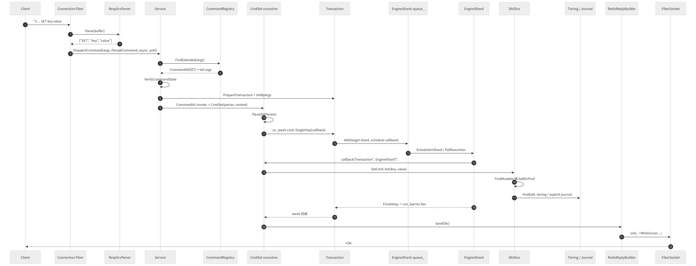

<!-- Mermaid source: ./dragonfly-io-command-lifecycle-assets/ch09-02.mmd -->

“`ES->>CS callback`”只是为了表达 callback 的来源；真正运行 callback 的栈仍在目标
EngineShard 所属 OS 线程上。连接 Fiber 不会跟着迁移。

这里的 `Transaction -> queue -> EngineShard` 是需要投递到 shard queue 的一般路径；如果
`CanRunInlined()` 成立，`ScheduleInShard`、`RunInShard` 和 `RunCallback` 会直接出现在当前
Connection Fiber 的调用栈中。完整的同线程 inline、同线程排队和跨线程
`PollExecution` 对照见 [8.9 同线程内联与跨线程 PollExecution：两条真实执行栈](#89-同线程内联与跨线程-pollexecution两条真实执行栈)。

核心文件与函数按发生顺序如下：

| 阶段       | 类 / 函数                                                                     | 所在目录                    | 职责                                 |
| ---------- | ----------------------------------------------------------------------------- | --------------------------- | ------------------------------------ |
| 解析       | `Connection::ParseRedis` → `RespSrvParser::Parse`                        | `src/facade/`             | 生成参数视图                         |
| 查命令     | `CommandRegistry::FindExtended`                                             | `src/server/`             | 返回`CommandId` 和 tail args       |
| 建事务     | `PrepareTransaction` → `Transaction::InitByArgs`                         | `src/server/`             | 计算 key/shard                       |
| 进 handler | `CommandId::Invoke` → `CmdSet`                                           | `src/server/`             | 解析 SET option，定义 shard callback |
| 调度       | `cmd::SingleHop` → `Transaction::ScheduleSingleHop` / `SingleHopAsync` | `src/server/`             | 同步等待或注册异步完成               |
| 改数据     | `SetCmd::Set` → `DbSlice::AddOrFind`                                     | `src/server/`             | 在 owner shard 修改数据              |
| 副作用     | `SetCmd::PostEdit` / `RecordJournal`                                      | `src/server/`             | 内存记账、tiering、journal           |
| 回复       | `SinkReplyBuilder::SendOk` → socket `WriteSome`                          | `src/facade/`、`helio/` | 编码 RESP 并写回                     |

### 9.3 同一个 CmdSet 协程有两种等待方式

`CmdSet` 的 `co_await cmd::SingleHop(cb)` 会先由 `CmdR::Coro::await_transform` 变成
`SingleHopWaiter`。之后根据 `ParsedCommand::IsDeferredReply()` 分流：


<!-- Mermaid source: ./dragonfly-io-command-lifecycle-assets/ch09-03.mmd -->

这里同时存在两种“协作式暂停”，不要混为一谈：

- 同步模式暂停的是 **Helio Fiber**；C++ 调用栈和局部变量保存在 Fiber 栈上；
- deferred 模式暂停的是 **C++ coroutine**；`ParsedCommand` 保存 coroutine handle，
  `Transaction::run_barrier_` 是完成条件；
- deferred 事务完成后也不是任意时刻直接写 socket。`ReplyBatch` 只在命令到达 pipeline
  队首且 `CanReply()` 时 `resume`，以守住 RESP 回包顺序。

> **概念解释：C++ coroutine**
>
> coroutine 是编译器把函数改写成一个可暂停状态机；它不是线程，也不是 Dragonfly Fiber。
> `CmdR::Coro` 是它的 promise type。`initial_suspend` 和 `final_suspend` 都返回
> `suspend_never`，所以 `CmdSet` 立即开始、结束后立即销毁；真正的暂停点由
> `SingleHopWaiter` 接管。这里的 promise type 是编译器协议要求的生命周期/await hook
> 对象，不是“稍后装入一个值”的通用 Promise。
>
> 这里引入协程，我的理解是：本质上是 **为了在保持单个客户端连接顺序逻辑的前提下，突破串行执行的性能瓶颈** ，通过更细粒度的异步等待和并发提交，来大幅提升pipeline场景下的吞吐量。

### 9.4 SET 在 shard 内怎样改数据


<!-- Mermaid source: ./dragonfly-io-command-lifecycle-assets/ch09-04.mmd -->

`DbSlice::AddOrFind(..., std::nullopt)` 的 `nullopt` 表示 `SET` 可以覆盖旧类型并变成 string。
如果旧值在 tiered storage 中，`SetExisting` 会先通知 tiering 删除旧 external value；
如果旧值原来是 stream，还会唤醒可能等待该 key 的 blocking controller。

`PostEdit` 有意先执行 `post_updater.Run()`，再进行可能暂停的 journal/tiering 工作，避免
Fiber 暂停期间其他操作观察到错误的内存记账。tiering 过载时可以通过
`optional<util::fb2::Future<bool>>` 返回反压信号；`CmdSet` 在 shard hop 后最多等待 5ms，
防止客户端与后台 offload 形成无限等待。

> **概念解释：Helio Future**
>
> `util::fb2::Future<T>` 是一个共享结果槽和 Fiber-aware 完成通知。消费者
> `Get/GetFor` 时只挂起当前 Fiber，生产者 `Resolve` 后将其唤醒；它不是
> `boost::future`，当前类型也没有拆成单独的 Future/Promise 两端。

### 9.5 状态如何变成 RESP 回复


<!-- Mermaid source: ./dragonfly-io-command-lifecycle-assets/ch09-05.mmd -->

因此，`SET NX` 没写入时并不报事务错误，而是走 `SKIPPED -> RESP null`；显式 journal 也
不会记录一条未发生的写入。

### 本章节源码阅读建议

建议把断点按以下顺序放置：

1. [`src/server/string_family.cc`](../src/server/string_family.cc)：
   `RegisterStringFamily` → `CmdSet` → `SetCmd::Set` → `PostEdit`；
2. [`src/server/cmd_support.cc`](../src/server/cmd_support.cc)：
   `SingleHopWaiter::await_ready` / `await_suspend` / `await_resume`；
3. [`src/facade/parsed_command.cc`](../src/facade/parsed_command.cc)：
   `CanReply` 与 `SendReply`，理解 V2 为什么按序 resume；
4. 最后回看 [`src/server/transaction.cc`](../src/server/transaction.cc) 的
   `ScheduleSingleHop` 和 `SingleHopAsync`。

第一次跟踪时使用无 option 的单 key `SET a b`，再分别加 `NX`、`GET`、`PX`，观察
`ParseSetParams` 和 journal 规范化分支。

---

## 10. ReplyBuilder 如何把结果写回客户端

命令 handler 不拼 `"+OK\r\n"`，也不直接调用 `send(2)`。ReplyBuilder 隔开“业务返回
什么”和“如何高效、按序地写 socket”。

### 10.1 从 SendOk 到内核的调用链


<!-- Mermaid source: ./dragonfly-io-command-lifecycle-assets/ch10-01.mmd -->

`io::Sink::Write` 使用 `ApplyExactly`，所以一次 `WriteSome` 只写出部分 iovec 时会继续推进
剩余区间；`EINTR` 在 `WriteSomeBytes` 中重试。最终错误返回到 `SinkReplyBuilder::ec_`，
连接主循环检查它并进入统一关闭路径。

### 10.2 WritePieces、WriteRef 与 iovec


<!-- Mermaid source: ./dragonfly-io-command-lifecycle-assets/ch10-02.mmd -->

> **概念解释：iovec / scatter-gather IO**
>
> `iovec` 只保存“地址 + 长度”。内核可以把多个不连续内存片段当成一个连续字节流写出，
> 因而 RESP 前缀、value 和 CRLF 不必先拼成一个大 `std::string`。这不是异步性的来源，
> 而是减少复制和系统调用的表示方式。

`WritePieces` 把短片段复制进 builder 自己的 `buffer_`，并让相邻片段共用一个 iovec；
`WriteRef` 直接加入外部内存引用。iovec 数接近 `IOV_MAX` 或 buffer 不足时会先 `Flush`。

### 10.3 ReplyScope 与 ReplyAggregator 解决什么问题


<!-- Mermaid source: ./dragonfly-io-command-lifecycle-assets/ch10-03.mmd -->

> **概念解释：RAII guard**
>
> `ReplyScope` 和 `ReplyAggregator` 都是在构造时切换 builder 状态、析构时恢复并收尾的
> 栈对象。即使函数提前返回，C++ 析构仍会执行，避免遗忘 flush 或留下错误的 batch 状态。

- `ReplyScope` 主要解决外部字符串引用的生命周期，并允许 zero-copy iovec；
- `ReplyAggregator` 主要减少连续多回复的 raw send 次数；`EXEC` 就用它包住数组回复；
- V2 `ReplyBatch` 把多条已就绪命令放在一个 `ReplyScope` 中，并在释放
  `ParsedCommand` 之前完成引用处理；
- 若 coroutine resume 过程中还会暂停，V2 使用 `ScopePause`，临时关闭外部引用优化，
  避免跨暂停点保留不安全的 `string_view`。

### 10.4 写 socket 时为什么不会卡死整个 IO 线程


<!-- Mermaid source: ./dragonfly-io-command-lifecycle-assets/ch10-04.mmd -->

这是 Proactor 与 Fiber 配合的直接价值：接口对业务代码看起来像同步 `Write`，等待期间
Proactor OS 线程仍能服务其他连接、shard queue 和定时 Fiber。它不意味着同一
`Connection` 可以有多个 Fiber 随意并发写；回复顺序仍由连接层串行化。

### 10.5 Pipeline 回复顺序


<!-- Mermaid source: ./dragonfly-io-command-lifecycle-assets/ch10-05.mmd -->

V1 通过同步执行或单独 `AsyncFiber` 的串行消费维持顺序；V2 可以让后续支持 async 的命令
先执行，但 `ReplyBatch` 只从 `parsed_head_` 连续发送已就绪结果。命令执行并发与 socket
回复有序是两件独立的事。

### 本章节源码阅读建议

先读 [`src/facade/reply_builder.cc`](../src/facade/reply_builder.cc) 的
`WritePieces` → `WriteRef` → `FinishScope` → `Flush` → `Send`，再读：

1. [`helio/io/io.cc`](../helio/io/io.cc) 的 `Sink::Write`；
2. [`helio/util/fibers/uring_socket.cc`](../helio/util/fibers/uring_socket.cc) 的
   `UringSocket::WriteSome` 和 `FiberCall::Get`；
3. 或 epoll 环境下读
   [`helio/util/fibers/epoll_socket.cc`](../helio/util/fibers/epoll_socket.cc) 的
   `PendingReq` / `WriteSome`；
4. 最后读 [`src/facade/dragonfly_connection.cc`](../src/facade/dragonfly_connection.cc)
   的 `ReplyBatch`，把内存生命周期与 pipeline 顺序连起来。

---

## 11. 特殊分支：MULTI、阻塞命令与异步消息

普通 `SET` 是一次请求对应一个 transaction hop。下面三类路径会改变这个简单模型，但都
复用前面已经看到的 Connection、Transaction、EngineShard 与 ReplyBuilder。

### 11.1 MULTI/EXEC：先收集，再决定事务模式


<!-- Mermaid source: ./dragonfly-io-command-lifecycle-assets/ch11-01.mmd -->

收集期的关键点是：`DispatchCommand` 仍然先查命令并运行 `VerifyCommandState`；通过后，
`StoreInMultiBlock` 把 command id 与参数存进 `ConnectionState::ExecInfo::body`，然后只回
`QUEUED`。这些命令此时没有修改 DbSlice。

`StoredCmd` 必须拥有参数的 backing storage，因为原始网络 buffer 会继续复用。当前实现可
从 `ParsedCommand` 移走 `BackedArguments`，避免无条件再复制一次。


<!-- Mermaid source: ./dragonfly-io-command-lifecycle-assets/ch11-02.mmd -->

当前 `multi_exec_squash` 默认开启，但存在 script run 或 client tracking 时不会使用这条
优化。非 squash 路径会复用 EXEC 的 `CommandContext` 和 `Transaction`，逐条
`MultiSwitchCmd`、`InitByArgs`、`InvokeCmd`；所以不能把 EXEC 理解成“把收到的 RESP 文本
重新塞回普通连接解析器”。

### 11.2 WATCH 与 MULTI 的关系


<!-- Mermaid source: ./dragonfly-io-command-lifecycle-assets/ch11-03.mmd -->

WATCH 使用的是 `ExecInfo::watched_dirty` 原子标记，不是本章下一节用于 `BLPOP` 的
`BlockingController`；两者名字都含“watch”，用途完全不同。

### 11.3 阻塞命令：阻塞 Connection Fiber，不阻塞 shard 线程

以 `BLPOP` 一类命令为例：


<!-- Mermaid source: ./dragonfly-io-command-lifecycle-assets/ch11-04.mmd -->

`BlockingController::Awaken` 只把 key 标成待检查。修改事务收尾时
`NotifyPending` 才用 command 提供的 `KeyReadyChecker` 验证数据是否真的满足条件，然后
`Transaction::NotifySuspended` 只允许一个 shard 成功 claim `blocking_barrier_`。这避免
“收到一次写事件就一定能消费”的错误假设。

在等待期间：

- Connection context 的 `blocked` 标志为 true；
- `blocking_barrier_.Wait` 是 Fiber-aware wait，OS 线程继续运行；
- shard 侧 Transaction 带 `WAS_SUSPENDED` 状态；被唤醒后，`EngineShard::PollExecution`
  优先考虑 awakened transaction；
- socket 断开时 `ConnectionContext::OnSocketError` 调用
  `Transaction::CancelBlocking`，关闭 barrier，让连接能完成清理；
- atomic MULTI 中不允许进入这条 blocking wait。

### 11.4 Pub/Sub、MONITOR、checkpoint 与 invalidation 走控制队列


<!-- Mermaid source: ./dragonfly-io-command-lifecycle-assets/ch11-05.mmd -->

V2 明确把数据路径和控制路径分开：

- parsed commands 在 `ParsedCommand` 链表；
- Pub/Sub、MONITOR、迁移、checkpoint、tracking invalidation 在 `dispatch_q_`；
- checkpoint 插到已有 checkpoint 之后、其他消息之前，用于 `CLIENT PAUSE`、迁移或停机
  等“等到在途命令真正完成”的屏障；
- V2 按 quota 排空控制消息，避免 Pub/Sub 洪水饿死正常请求；
- V1 在需要时懒创建 `connection_dispatch` AsyncFiber；V2 不再为控制消息创建第二个
  Connection Fiber，而是用 `io_event_` 唤醒主循环。

`AsyncOperations` 对 variant 做具体处理：Pub/Sub 编码 RESP PUSH/array，MONITOR 发 simple
string，invalidation 只在 RESP3 下发 `invalidate` PUSH，checkpoint 对 blocking counter
`Dec()`。慢订阅者还受 per-thread/per-connection buffer 与超时策略保护。

### 本章节源码阅读建议

建议按三条互不混读的路径阅读：

1. MULTI：[`src/server/main_service.cc`](../src/server/main_service.cc) 的
   `StoreInMultiBlock` → `Multi` → `Exec` → `MultiCleanup`，配合
   [`src/server/conn_context.h`](../src/server/conn_context.h) 的 `ExecInfo`；
2. blocking：[`src/server/transaction.cc`](../src/server/transaction.cc) 的
   `WaitOnWatch` / `WatchInShard` / `NotifySuspended` / `CancelBlocking`，再读
   [`src/server/blocking_controller.cc`](../src/server/blocking_controller.cc)；
3. 异步消息：[`src/facade/dragonfly_connection.h`](../src/facade/dragonfly_connection.h)
   的 `MessageHandle` variant，再读 `SendAsync` 与 `AsyncOperations`。

先确认三者使用的数据结构分别是 `ExecInfo::body`、每 shard watch queue、
`Connection::dispatch_q_`，就不容易把它们误认为同一种“队列”。

---

## 12. Proactor、Fiber、协程与 Boost

这一章只讲到足以读懂 Dragonfly：Helio 把每个 OS 线程变成一个“事件循环 +
Fiber scheduler”；Dragonfly 再把连接、shard queue、定时任务放到这些 Fiber 上。

### 12.1 Helio 在边界的哪一侧


<!-- Mermaid source: ./dragonfly-io-command-lifecycle-assets/ch12-01.mmd -->

Helio 负责：

- 创建和驱动 Proactor OS 线程；
- 把 io_uring completion、epoll readiness 变成 Fiber 唤醒；
- 调度 ready、sleeping、remote-ready Fiber；
- 提供 Fiber-aware mutex、event count、barrier、future 和 socket。

Dragonfly 负责决定哪些工作是连接、事务、shard 或后台任务，以及跨 shard 消息怎样组织。
因此看到 `util::fb2::*` 时可先把它理解成“Helio 的 Fiber 运行时接口”，不必进入
Boost.Context 汇编。

> **概念解释：Boost.Context**
>
> 它只提供“保存当前寄存器/栈位置，切到另一个有栈上下文”的底层能力。Helio 在其上实现
> Fiber 对象、ready/sleep queue 和调度策略；Boost.Context 本身不负责 Dragonfly 的
> socket 事件循环或 shard 调度。

### 12.2 当前线程关系：IO 线程也是 shard 线程


<!-- Mermaid source: ./dragonfly-io-command-lifecycle-assets/ch12-02.mmd -->

不存在固定的“accept thread → 网络线程池 → shard 线程池”三级线程切换。`ProactorPool`
先创建一组 pthread；`EngineShardSet::Init` 在其中前 `size_` 个线程安装 thread-local
`EngineShard`，连接也选择这些 Proactor 中的线程运行。逻辑角色不同，物理线程可以相同。

### 12.2.1 连接、socket 与 Proactor 的三层绑定

这里需要把“连接属于哪个线程”和“socket 由哪个 IO 轮询器监听”看成同一个运行时归属，
但不要把它误读成“每条命令都迁移到 key 所在的线程”。一条连接建立时的关键步骤是：

1. AcceptLoop 在监听 socket 所属的 Proactor 上接受连接；
2. `Listener::PickConnectionProactor` 选出连接的目标 Proactor；
3. 目标 Proactor 的 task queue 创建名为 `Connection` 的 detached Fiber；
4. Fiber 入口调用 `conn->socket()->SetProactor(ProactorBase::me())`，将 socket 的
   `proactor_` 指针绑定到这个线程，并执行后端的注册/准备动作：epoll 会 `Arm` fd，
   io_uring 则在后续把读写操作提交到这个 ring（启用 direct fd 时还会在此处注册 fd）。

所以，未发生显式迁移时，可以用下面的关系理解一条连接：

```text
Proactor OS thread i
  ├─ ProactorBase / EpollProactor 或 UringProactor
  ├─ fb2::detail::Scheduler
  ├─ Connection Fiber（ConnectionFlow / IoLoop）
  └─ FiberSocketBase::proactor_ → 该线程的 socket/fd 监听与 IO 提交
```

这不是三个独立的 owner：Connection Fiber 的同步风格 `Recv`、`Write`、事务等待和
`io_event_` 等待，都必须回到它所绑定的 Proactor scheduler；socket 的回调也在该 Proactor
的事件循环中触发。因此，内核事件不会被一个全局网络线程接收后再“转发”给连接 Fiber，
而是由 socket owner 的 Proactor 直接把对应等待者变成可运行的 Fiber。

V1 在 pipeline 或异步消息需要并行消费时，可能懒创建 `async_fb_`；它与主 Connection
Fiber 共用同一个 Proactor scheduler，并不拥有独立的 socket 轮询器。V2 不再依赖长期运行
的第二个 Connection Fiber，而是把这类工作并入主循环，用 `io_event_` 统一唤醒。

命令跨 shard 时，迁移的是 transaction callback、shard queue 中的任务和完成通知，
不是客户端 Connection。只有显式的 `ListenerInterface::Migrate` 才会执行
`SetProactor(nullptr)`、转移 Fiber scheduler、再在目标线程 `SetProactor(dest)` 重新注册
socket 事件；迁移完成后，连接和 socket 又重新绑定到同一个目标 Proactor。

### 12.2.2 main fiber、dispatcher fiber 与 worker fiber

每个 Proactor OS 线程都拥有一套独立的 Helio Fiber 运行时。这里的三个名称表示不同的
运行时角色，不是一个固定的三层函数调用栈：

```text
一个 pthread
  ├─ main fiber       // pthread 原始栈上的启动/退出上下文
  ├─ dispatcher fiber // 每线程一个，驱动 Proactor MainLoop 并调用 scheduler
  └─ worker fibers    // AcceptLoop、Connection、shard queue、后台任务等
```

线程初始化时，`FiberInterface` 为该线程创建 `MainFiberImpl` 和一个
`DispatcherImpl`。调度器构造时会把 dispatcher 放入 NORMAL ready queue，因此
`ProactorBase::Run()` 设置 `ProactorDispatcher` 后立即对当前 main fiber 调用
`Suspend()`。这一步会切换到 dispatcher；main fiber 只是保存自己的上下文，并没有进入
Fiber 的 sleep queue。

之后 dispatcher 执行 `ProactorDispatcher::Run()`，进入具体后端的
`EpollProactor::MainLoop` 或 `UringProactor::MainLoop`。主循环反复处理 task queue、内核
I/O completion/readiness、remote-ready queue 和各优先级 ready Fiber，再通过
`Scheduler::Run` 选择 ready Fiber；NORMAL 队列中的 dispatcher 也会参与这一轮转调度。
Dragonfly 没有另建一个“连接调度 Fiber”；同一 Proactor 的 dispatcher 统一调度该线程上的
AcceptLoop、Connection 和其他 Fiber。

因此“main fiber 上来就睡眠”需要分两层理解：

1. **Fiber 层面**：main fiber 启动后立即被 `Suspend()` 挂起，不在 ready queue 中运行；
2. **OS 线程层面**：只有当 task queue 为空、没有 ready Fiber，并且短暂自旋结束后，dispatcher
   才会让线程进入 `epoll_wait()` 或 `io_uring` 的 `wait_for_cqe()`。真正睡眠的是
   Proactor 主循环所在的 OS 线程，不是 main fiber 自己调用了 sleep。

I/O 或跨线程任务到达后，事件回调会唤醒对应等待者，把 Fiber 放入 ready queue（跨线程时先
进入 remote-ready queue），dispatcher 再恢复它。Proactor 停止时，dispatcher 退出并切回
main fiber，随后线程完成清理并返回。

### 12.3 Proactor 一轮大致做什么

两个后端循环的细节不同，但都会在“处理内核 completion/readiness”和“运行 ready Fiber”之间循环：


<!-- Mermaid source: ./dragonfly-io-command-lifecycle-assets/ch12-03.mmd -->

这张图表达的是共同职责，不应拿它推断每个 `if` 的绝对顺序；精确顺序分别在
`UringProactor::MainLoop` 和 `EpollProactor::MainLoop`。两者都给 CPU-only brief task
设置预算，批量处理 completion，并只在没有 ready work 时真正阻塞。

> **概念解释：Proactor**
>
> Reactor 通常先告诉应用“fd 可读/可写”，应用再执行 IO；Proactor 模式强调提交操作后接收
> “操作已完成”的通知。Helio 用同一 `ProactorBase` 同时抽象 io_uring 和 epoll，所以 epoll
> 后端内部仍要在 readiness 后执行实际 `recv/send`。阅读 Dragonfly 时，“Proactor”最实用
> 的含义是：**一个拥有事件循环、Fiber scheduler 与 socket 的 owner OS 线程**。

### 12.3.1 “Fiber 阻塞”究竟发生了什么

Dragonfly 源码中的“阻塞”通常只表示**当前 Fiber 停车**，不表示把拥有它的 pthread
阻塞在系统调用中。以 V1 `IoLoop` 调用 `socket_->Recv()` 为例，epoll 后端的过程如下：

1. `EpollSocket::RecvMsg` 先执行非阻塞 `recvmsg`。若读到数据，直接返回；若返回
   `EAGAIN`，创建 `PendingReq`，记录 `FiberActive()` 和 `read_req_`；
2. `PendingReq::Suspend` 调用 `context_->Suspend()`（有超时时使用 `WaitUntil`），最终
   进入 `Scheduler::Preempt(false)`；
3. `Preempt(false)` 不把当前 Fiber 放回 ready queue，而是切换到 scheduler 的 dispatcher
   或另一个 ready Fiber。保存的用户态栈和寄存器仍属于这个 Fiber，所以它会在原来的
   `recvmsg` 调用点之后继续执行；
4. 如果所有 Fiber 都在等待，dispatcher 才让 Proactor 进入 `epoll_wait`。因此“等待网络”
   和“OS 线程睡眠”是两个层次：前者先让出当前 Fiber，后者只在整个线程没有可运行工作时
   才发生。

写路径完全对称：`WriteSome` 遇到发送缓冲区满（`EAGAIN`）后保存 `write_req_` 并挂起，
收到 `EPOLLOUT` 后被唤醒，再从原调用栈重试 `sendmsg`。事务 barrier、`EventCount`、
`Future::Get` 和 Fiber join 也是同一模式：先把当前 Fiber 链到等待队列，再
`Preempt(false)`；通知方通过 `ActivateOther` 把它放回 ready queue。

`ThisFiber::Yield()` 则是另一种情况：它调用 `Preempt(true)`，会主动把当前 Fiber 重新
加入 ready queue，然后切换到同一 Proactor 上的下一个 Fiber。这是协作式让出 CPU，不是
等待某个外部事件；如果一段 CPU-only 代码既不等待也不 `Yield`，同线程其他 Fiber 就只能
等它返回或下一次调度。

### 12.3.2 从内核事件到对应 Fiber 的激活

把一条 IO 等待压缩成调度链，就是：

```text
Fiber 发起 Recv/Write 或等待 io_event_
  → 非阻塞操作未完成（EAGAIN）或已提交异步 IO
  → 当前 Fiber 挂起，Proactor 继续运行其他 ready Fiber
  → epoll 就绪事件 / io_uring CQE 到达
  → Proactor 回调找到对应 socket/operation 的等待者
  → ActivateSameThread / EventCount::notify
  → Scheduler::AddReady（跨线程时先进入 remote_ready_queue）
  → Scheduler::Run 选择它并 SwitchTo
  → Fiber 从 Suspend/Get 返回，重试 IO 或消费完成结果
```

这里的“激活”通常只做入队，不会在内核事件回调里递归地直接执行整个 ConnectionFlow。
同一 scheduler 的等待者由 `AddReady` 放入 NORMAL/HIGH 等优先级队列；如果通知来自其他
线程，`ScheduleFromRemote` 先放入目标 scheduler 的 `remote_ready_queue`，并唤醒目标
Proactor，下一轮 `ProcessRemoteReady` 再转入本地 ready queue。进入 ready queue 只表示
“可以运行”，何时真正恢复仍由 `Scheduler::Run` 决定。

#### epoll 后端：就绪通知后再执行实际读写

`EpollSocket::OnSetProactor` 会把 fd 以 `EPOLLIN | EPOLLOUT | EPOLLET | EPOLLRDHUP`
注册到 owner `EpollProactor`。`EpollProactor::MainLoop` 的 `epoll_wait` 返回后，
`DispatchCompletions` 根据 completion entry 调用 `EpollSocket::Wakey`：

- V1 同步读写若有 `PendingReq`，`Wakey` 的 `HandleAsyncRequest` 找到 `read_req_` 或
  `write_req_`，调用 `PendingReq::Activate`，后者通过 `ActivateSameThread` 将原 Fiber
  放入 ready queue。Fiber 恢复后再次执行真正的 `recvmsg/sendmsg`；因此 epoll 给的是
  **readiness**，不是“已经读完/写完”的 completion。
- IoLoopV2 的 `RegisterOnRecv` 走另一条通知路径：可读事件触发
  `OnRecvNotification`，它在 Fiber 停车期间用 `TryRecv` 尽量排空 socket，并设置
  `pending_input_`；随后 `io_event_.notify()` 唤醒正在 `io_event_.await()` 的连接 Fiber。
  如果通知到达时 Fiber 尚未进入等待，`pending_input_`、`read_notified_` 或 EventCount
  epoch 会保留状态，下一轮谓词检查仍会看到事件，不会因为“早到一步”而丢唤醒。
- 可写事件同样由 `EPOLLOUT` 唤醒挂起的写请求。V2 的 `FlushReplies` 最终仍通过 socket
  `Write`；当发送缓冲区满时，连接 Fiber 会停车，等 `EPOLLOUT` 后从原位置继续。

#### io_uring 后端：提交操作并等待 CQE

`UringSocket::Recv`/`WriteSome` 创建 `FiberCall`，把 `recv`/`send` SQE 放入 owner
`UringProactor` 的 submission queue，然后在 `FiberCall::Get` 中挂起当前 Fiber。Proactor
主循环提交 SQE，并在 `ReapCompletions`/`ProcessCqeBatch` 中按 `user_data` 找到 callback；
该 callback 保存 CQE 结果，再调用 `ActivateSameThread(current, me_)` 将发起操作的 Fiber
放回 ready queue。Fiber 恢复后，`FiberCall::Get` 返回字节数或错误码，调用方继续原来的
`Recv`/`WriteSome` 调用链。

因此 io_uring 正常路径对上层表现为 completion 模型，而不是先收到一个裸的可读/可写事件。
内核可能使用 `IORING_RECVSEND_POLL_FIRST` 在 socket 尚未 ready 时先等待；这段等待仍由
内核完成，Dragonfly 看到的仍是最终 CQE。IoLoopV2 的 `RegisterOnRecv` 在启用 multishot
时直接接收带数据的 CQE；不启用时，Helio 用 `EpollAdd` 在 io_uring 上模拟 multishot poll，
回调再走 `OnRecvNotification → io_event_.notify()`。这两种实现最终都把连接 Fiber 变成
ready，而不是在 Proactor 回调里同步执行整条命令流水线。

### 12.4 Fiber 的完整生命周期


<!-- Mermaid source: ./dragonfly-io-command-lifecycle-assets/ch12-04.mmd -->

对应到一条连接：

1. `ListenerInterface::RunAcceptLoop` 在目标 Proactor 的 brief task 中构造
   名为 `Connection` 的 Fiber，默认 `Launch::post`；
2. scheduler 从 ready queue 取出它，进入 `RunSingleConnection` →
   `Connection::HandleRequests`；
3. socket 没数据、跨 shard barrier 未完成、写缓冲区满时，当前 Fiber 在
   `PendingReq::Suspend`、`FiberCall::Get` 或 `EventCount::await` 处停车；它让出的是
   当前 Proactor 线程的执行权，不是阻塞 pthread；
4. epoll 的 readiness callback、io_uring 的 CQE callback、queue consumer 或 counter
   通知等待者，把对应 Fiber 放入 ready queue（跨线程时先进入 remote-ready queue）；
5. scheduler 之后再次 `SwitchTo`，C++ 调用栈从原等待点继续，读写路径重试 IO 或消费已保存
   的完成结果；
6. `HandleRequests` 返回后 Fiber 函数返回，`Terminate` 唤醒 joiner，把对象排入
   termination queue；真正释放 Fiber 栈要在另一个 Fiber/dispatcher 上完成。

要特别区分三种状态：`Waiting` 表示 Fiber 已经从可运行队列移出并等待外部条件；`Ready`
表示条件已满足、已入队但还没有得到 CPU；`Running` 才表示 scheduler 当前通过
`SwitchTo` 正在执行它。一个 socket 事件到达时，通常只完成 `Waiting → Ready`，接下来仍要
经过 Proactor 主循环中的 `Scheduler::Run` 才是 `Ready → Running`。

Helio 没有要求业务代码显式调用 `Resume()`；恢复由 event completion 和 scheduler 完成。
`Launch::dispatch` 才表示构造后立即切入新 Fiber，普通 Connection 使用 `post`。

### 12.5 Fiber、OS thread、C++ coroutine 不同在哪里

| 属性           | OS thread         | Helio`fb2::Fiber`                          | `cmd::CmdR` coroutine            |
| -------------- | ----------------- | -------------------------------------------- | ---------------------------------- |
| 调度者         | 内核              | 同一 Proactor 内的`fb2::detail::Scheduler` | 代码显式`resume` / awaiter       |
| 栈             | 独立系统线程栈    | 独立用户态栈                                 | 通常是编译器生成的 coroutine frame |
| 能否并行       | 不同 CPU 可真并行 | 同一 OS 线程内一次只运行一个                 | 自身不是并行实体                   |
| 暂停点         | 内核抢占或阻塞    | IO、同步原语、`Yield` 等协作点             | `co_await`                       |
| Dragonfly 例子 | Proactor 0        | Connection、shard queue、heartbeat           | `CmdSet`                         |

Fiber 是协作式调度：一段纯 CPU 代码若既不等待也不 `Yield`，同线程其他 Fiber 就不能运行。
这也是 snapshot 每批/每 bucket 主动 yield、accept burst 超过约 1ms 主动 yield 的原因。
`FiberAtomicGuard` 则声明一段代码不能在 Fiber preemption point 暂停。

Dragonfly 不为每条连接创建 pthread，因为连接的大部分时间在等网络或 shard；Fiber 保留
同步风格的调用栈，同时避免海量内核线程。当前默认 Fiber 栈在 release 为
`40 KiB - 16`，debug 为 `56 KiB - 16`；ASAN 构建再乘 2。这个小栈也解释了开发指南为何
禁止在请求路径使用可能深递归的 `std::regex`。

### 12.6 Boost 在这条链路中到底扮演什么角色


<!-- Mermaid source: ./dragonfly-io-command-lifecycle-assets/ch12-05.mmd -->

- **Boost.Context**：`FiberInterface` 底层的 context switch 与 fixed-size stack。读到
  `boost::context::fiber_context` 时知道它负责“保存当前位置并切栈”即可；
- **Boost.Intrusive**：节点自己带 hook。scheduler 的 ready/sleep/all-fiber 列表、
  listener 的 connection list、ReplyBuilder 的 pending send list 都避免另分配 list node；**(消除内存分配和释放开销，内存极致优化)**
- **`boost::intrusive_ptr`**：引用计数也在对象内。Connection guard 防止关闭/迁移的
  preemption point 销毁对象；Transaction 的 atomic count 支撑多 shard 并发持有；**（内存更紧凑）**
- **Boost.Asio**：本请求链路只借用 endpoint/address 等类型，没有运行 Asio
  `io_context`，也没有 `strand`。串行性来自 Proactor thread ownership、Fiber scheduler
  和 shard queue；
- **Boost.Fiber**：当前 Connection/Transaction 热路径的生产调度器是 Helio `fb2`，
  底层直接使用 Boost.Context。仓库外围仍可能包含 Boost.Fiber 类型或兼容 include，
  不能据此把 `fb2::Fiber` 等同于 Boost.Fiber scheduler；
- **Boost.Container**：不在这条主调用链中。这里更常见的是 `std::*`、Abseil 容器和
  Boost.Intrusive，无需为读懂一次请求先学习 Boost.Container。

> **概念解释：strand**
>
> Asio strand 是让多个 handler 即使在线程池中执行也不并发进入的一种 executor 约束。
> 当前路径没有 strand；同一 Connection 的状态由 owner Proactor 上的连接逻辑串行管理，
> shard 数据由 owner shard 线程串行管理，跨线程工作通过队列传递。

> **概念解释：future / promise**
>
> 本链路看到的 `util::fb2::Future<T>` 不是 `boost::future`。它内部共享
> `Block{value, atomic has_value, EventCount}`；消费者 `Get/GetFor` 时 Fiber-aware 等待，
> 生产者在同一个 Future 句柄上 `Resolve`，没有单独的 Promise 类型。
> `CmdR::Coro` 被称为 coroutine 的 `promise_type` 是另一套 C++ coroutine 协议，也不是
> 这个 Future 的生产端。

### 本章节源码阅读建议

按从公共接口到内部实现的顺序：

1. [`helio/util/fibers/fibers.h`](../helio/util/fibers/fibers.h)：
   `Fiber`、`Launch`、`ThisFiber::Yield/SleepFor`；
2. [`helio/util/fibers/proactor_base.h`](../helio/util/fibers/proactor_base.h)：
   `DispatchBrief`、`Await`、`LaunchFiber`；
3. 连接与 socket 归属：[`helio/util/fibers/listener_interface.cc`](../helio/util/fibers/listener_interface.cc)
   的连接 Fiber 创建、`Migrate`，以及
   [`helio/util/fibers/fiber_socket_base.cc`](../helio/util/fibers/fiber_socket_base.cc) 的
   `SetProactor`；
4. epoll 后端读
   [`helio/util/fibers/epoll_socket.cc`](../helio/util/fibers/epoll_socket.cc) 的
   `PendingReq::Suspend/Activate`、`OnSetProactor`、`Wakey`，再读
   [`helio/util/fibers/epoll_proactor.cc`](../helio/util/fibers/epoll_proactor.cc) 的
   `MainLoop`、`DispatchCompletions`；
5. 调度状态读
   [`helio/util/fibers/detail/scheduler.cc`](../helio/util/fibers/detail/scheduler.cc) 的
   `Preempt`、`AddReady`、`ProcessRemoteReady`、`DestroyTerminated`，确认 Waiting、Ready
   和 Running 的转换；
6. io_uring 读
   [`helio/util/fibers/uring_socket.cc`](../helio/util/fibers/uring_socket.cc) 的
   `Recv/WriteSome/RegisterOnRecv`，以及
   [`helio/util/fibers/uring_proactor.cc`](../helio/util/fibers/uring_proactor.cc) 的
   `FiberCall::Get`、`ProcessCqeBatch`；
7. Dragonfly 连接等待点读
   [`src/facade/dragonfly_connection.cc`](../src/facade/dragonfly_connection.cc) 的
   `IoLoop`、`IoLoopV2`、`OnRecvNotification`、`ReadPendingInput` 和 `io_event_`；

不要从 `boost::context` 汇编入口开始；先能在源码中回答“这个等待把哪个 Fiber 从哪张
queue 移到哪张 queue”，已经足以继续读 Dragonfly。

---

## 13. 后台任务、快照与复制如何共存

“后台任务”不等于“另开后台线程”。当前大多数维护工作仍是 Proactor 上的 Fiber 或
on-idle callback；明确另开 pthread 的重要例外，是 epoll 文件 IO 的
`FiberQueueThreadPool`。

### 13.1 完整线程与任务关系


<!-- Mermaid source: ./dragonfly-io-command-lifecycle-assets/ch13-01.mmd -->

名称中有 background 也不一定使用 BACKGROUND priority：

- `background_heartbeat` 当前默认 `false`，默认 heartbeat 是 NORMAL Fiber；
- `background_snapshotting` 当前默认 `false`，默认 `SliceSnapshot` 也是 NORMAL Fiber；
- 开启相应 flag 后才使用 `FiberPriority::BACKGROUND`，只在没有 NORMAL ready Fiber 时获得
  主体运行机会；
- defrag 不是 Fiber，而是 `ProactorBase::AddOnIdleTask` 注册的分段 idle callback。

### 13.2 每个 shard 的周期维护

`EngineShardSet::Init` 在 shard thread-local 对象和 Namespaces 建好之后，最后启动 heartbeat
与 shard handler：


<!-- Mermaid source: ./dragonfly-io-command-lifecycle-assets/ch13-02.mmd -->

`Heartbeat` 仍运行在 shard owner 线程，所以能直接访问本地 `DbSlice`。遇到 global lock
不可取得、journal write 会阻塞，或有 callback 正在 shard 内暂停（`running_tx_ != nullptr`）时会跳过本轮，避免破坏事务可见性。defrag 使用 cursor 和 cycle quota 分段推进，
而不是一次遍历整库。

这种设计的原因与请求路径一致：让数据维护发生在数据 owner 线程，避免为了后台扫描给
DashTable 加跨线程锁；代价是任务必须主动分片、yield 或受 quota 限制。

### 13.3 BGSAVE 与每 shard SliceSnapshot


<!-- Mermaid source: ./dragonfly-io-command-lifecycle-assets/ch13-03.mmd -->

`SAVE` 与 `BGSAVE` 共用 `SaveStagesController`；差别是 `BGSAVE` 在回应客户端后由
`bg_save_fiber` 等待完成。DF snapshot 为每个 shard 建文件并另建 summary；传统 RDB 使用
一个 saver，但仍在各 shard 通过 transaction callback 启动 shard snapshot。

`SliceSnapshot::Start` 的关键动作是：

1. 注册 change listener；复制场景还注册 journal consumer；
2. 建 `RdbSerializer`；
3. 在 owner Proactor 创建 `SliceSnapshot-{index}` Fiber；
4. 按 bucket/version 遍历，序列化符合 snapshot version 的记录；
5. 分批 `PushSerialized`，结束时 unregister listener 并 `Finalize` consumer。


<!-- Mermaid source: ./dragonfly-io-command-lifecycle-assets/ch13-04.mmd -->

epoll 本身不能异步执行普通文件 IO，因此 Dragonfly 启动
`FiberQueueThreadPool(epoll_file_threads)`，worker 是 `base::StartThread` 创建的真实
pthread；提交方通过 Fiber-aware `Done/EventCount` 等结果。io_uring 后端则没有这组
snapshot file worker，使用 `OpenLinux`/io_uring file wrapper。

### 13.4 复制不是一条超大连接 Fiber


<!-- Mermaid source: ./dragonfly-io-command-lifecycle-assets/ch13-05.mmd -->

`Replica::MainReplicationFb` 负责状态机：重连、greet、full/partial sync、stable sync 和
错误清理。Dragonfly-to-Dragonfly 复制根据 master 提供的 flow 数创建
`DflyShardReplica`，`Partition` 以 round-robin 把 flow id 分配到整个 Proactor pool，
`AwaitFiberOnAll` 在相应 owner 线程启动 flow。

full sync flow 创建 `shard_full_sync` Fiber 运行 `RdbLoader`；stable 阶段创建
`shard_stable_sync_read`，并为 ACK 再建 `shard_acks` Fiber。网络等待仍是 Fiber-aware
socket wait，不需要为每条复制 flow 新建 pthread。

### 13.5 背景工作为何不会“天然免费”


<!-- Mermaid source: ./dragonfly-io-command-lifecycle-assets/ch13-06.mmd -->

Fiber 降低的是等待成本，不会凭空增加 CPU。压缩、序列化、RDB load 仍消耗 owner thread
时间，所以源码通过 priority、bucket 粒度、cycle quota、egress throttler 和显式 yield
控制尾延迟。

### 本章节源码阅读建议

建议分三条路线：

1. 周期任务：[`src/server/engine_shard_set.cc`](../src/server/engine_shard_set.cc) 的
   `Init`，再读 [`src/server/engine_shard.cc`](../src/server/engine_shard.cc) 的
   `StartPeriodicHeartbeatFiber`、`Heartbeat`、`DefragTask`；
2. 快照：[`src/server/server_family.cc`](../src/server/server_family.cc) 的
   `BgSave`/`BgSaveFb` → [`src/server/detail/save_stages_controller.cc`](../src/server/detail/save_stages_controller.cc)
   → [`src/server/snapshot.cc`](../src/server/snapshot.cc)；
3. 复制：[`src/server/replica.cc`](../src/server/replica.cc) 的
   `MainReplicationFb` → `InitiateDflySync` → `StartSyncFlow` →
   `StartStableSyncFlow`。

只有在使用 epoll 且要追文件 IO 时，再读
[`helio/util/fibers/fiberqueue_threadpool.cc`](../helio/util/fibers/fiberqueue_threadpool.cc)；
它是本章真正创建额外 worker pthread 的地方。

---

## 14. 连接复用、关闭与进程停机

一次命令完成不等于 Connection Fiber 结束。正常情况是继续消费同一 buffer 中的下一条
命令，或再次等待 socket；只有关闭条件出现时才进入统一清理。

### 14.1 回复后如何复用连接


<!-- Mermaid source: ./dragonfly-io-command-lifecycle-assets/ch14-01.mmd -->

V1 在 `IoLoop` 中做 blocking-style receive；V2 空闲时先 `FlushReplies`，再通过
`io_event_.await(ShouldWakeIdle)` 同时等待 socket 输入、命令完成、控制消息、迁移或错误。
两者都保留 `ConnectionContext`、协议 parser、认证/DB/订阅状态和 ReplyBuilder，因此 TCP
连接可处理任意多轮请求。

### 14.2 哪些事件会要求关闭

| 触发条件                  | 当前源码入口                               | 结果                                                |
| ------------------------- | ------------------------------------------ | --------------------------------------------------- |
| 客户端`QUIT`            | `Service::Quit`                          | Redis 先回`OK`，再 `Connection::MarkForClose`   |
| clean EOF                 | `Recv/TryRecv` 返回 0                    | 设置`connection_aborted`，退出 IO loop            |
| socket HUP/ERR            | `Connection::OnBreakCb`                  | `conn_closing=true`，唤醒等待 Fiber               |
| reply write 失败          | `SinkReplyBuilder::ec_`                  | IO loop 观察错误并退出                              |
| RESP/Memcache parse error | `ParseRedis/ParseMCBatch` 返回 `ERROR` | 先处理已解析命令，再发 protocol error 后关闭        |
| 内部严重 dispatch error   | `Service::DispatchCommand`               | 发 internal error 并`MarkForClose`                |
| Pub/Sub 慢消费者          | `RequestPubsubClose`                     | 非阻塞标记关闭，正常路径清队列                      |
| 服务停机                  | `util::Connection::Shutdown`             | `SHUT_RDWR`，`OnShutdown` 唤醒 Connection Fiber |

`MarkForClose` 不当场 delete Connection：它给 ReplyBuilder 置
`connection_aborted` 并设置 `request_shutdown_`。这让正在执行的调用栈回到 ConnectionFlow
统一收尾，避免在 callback 或 send 中途销毁对象。

### 14.3 一条连接的关闭时序


<!-- Mermaid source: ./dragonfly-io-command-lifecycle-assets/ch14-02.mmd -->

注意有两个名字相近的 callback：

- `service_->OnConnectionClose(cc_)` 清理 Dragonfly 语义状态，例如 Pub/Sub、WATCH、
  MONITOR、replication session 和 client tracking；
- `ListenerInterface::OnConnectionClose(conn)` 是 listener 层 hook，当前
  `facade::Listener` 主要记录关闭日志。

`RunSingleConnection` 一开始用 `boost::intrusive_ptr<Connection> guard` 保活，并把 Connection
hook 链入 owner Proactor 的 thread-local intrusive list。只有 socket 已关闭、list 已 unlink
后才 `guard.reset()`；引用计数归零时析构对象和其 Fiber-owned 状态。

### 14.4 协议错误为什么有特殊半关闭


<!-- Mermaid source: ./dragonfly-io-command-lifecycle-assets/ch14-03.mmd -->

若服务端发完错误立刻 `SHUT_RDWR/close`，客户端仍在写非法请求时可能先收到写失败，永远
来不及读取 protocol error。当前实现先半关闭写方向并 drain 对端输入，以提高错误可见性。
源码同时标注了风险：对端一直不关闭时这段 drain 可能长期等待，阅读时不要把它当作普通
EOF 路径。

### 14.5 服务整体停机的信号链


<!-- Mermaid source: ./dragonfly-io-command-lifecycle-assets/ch14-04.mmd -->

`Listener::PreShutdown` 默认用 `DispatchTracker` 给在途命令约 10ms 收尾机会；NOW/FORCE
快速停机可跳过。随后 accept loop 在所有 Proactor 上调用每条连接的 `Shutdown`，并通过
各 thread-local list 的 `AwaitEmpty` 等待 Connection Fiber 真正退出，而不是只等 socket
收到 shutdown。

`Service::Shutdown` 发生在 `AcceptServer::Wait` 之后，因此先清连接，再销毁其可能引用的
server family、Namespaces 与 EngineShard。最后 `ProactorPool::Stop` 才停止事件循环并
`pthread_join`，保持 Fiber 清理所需运行时一直可用。

### 14.6 从建立到销毁的最终生命周期图


<!-- Mermaid source: ./dragonfly-io-command-lifecycle-assets/ch14-05.mmd -->

### 本章节源码阅读建议

按所有权逐层向外读：

1. [`src/facade/dragonfly_connection.cc`](../src/facade/dragonfly_connection.cc)：
   `ConnectionFlow`、`OnBreakCb`、`MarkForClose`、`HandleRequests`；
2. [`src/server/main_service.cc`](../src/server/main_service.cc)：
   `Quit` 与 `Service::OnConnectionClose`；
3. [`helio/util/fibers/listener_interface.cc`](../helio/util/fibers/listener_interface.cc)：
   `RunSingleConnection` 与 `RunAcceptLoop` 的 shutdown 后半段；
4. [`helio/util/fibers/accept_server.cc`](../helio/util/fibers/accept_server.cc)：
   `BreakListeners` / `Wait`；
5. 最后读 [`src/server/main_service.cc`](../src/server/main_service.cc) 的
   `Service::Shutdown`，确认资源销毁顺序。

---

## 15. 建议的源码阅读路线

最后把全文压缩成一条可实际执行的阅读路线。第一次读不要同时追 cluster、Lua、tiering、
snapshot 和 replication；先让一个普通 RESP `SET` 从 accept 完整走到 `+OK`。

### 15.1 一页调用链速查


<!-- Mermaid source: ./dragonfly-io-command-lifecycle-assets/ch15-01.mmd -->

这条链里有两个允许“少走几步”的快路径：

- Connection coordinator 与目标 shard 同线程时，transaction task 可内联；
- 单 shard 无冲突 concluding transaction 可在 `ScheduleInShard` 中 optimistic execute，
  不分配 txid、不进 `TxQueue`。

省略的是调度开销，不是职责边界：命令仍由 registry 描述，key 仍由 Transaction 定位，
数据仍只能在 owner EngineShard 上访问。

### 15.2 推荐的四轮阅读法


<!-- Mermaid source: ./dragonfly-io-command-lifecycle-assets/ch15-02.mmd -->

**第一轮：找到 owner 与边界。**

从 `RunEngine` 跳过大段 flag/环境配置，定位 `pool->Run`、`AcceptServer`、`Service::Init`、
`acceptor->Run/Wait`。接着只看 `RunAcceptLoop` 如何选择 Proactor、创建 Connection Fiber。
这一轮不要打开 `DbSlice`。

**第二轮：普通单 key SET。**

使用当前 RESP 默认 V1（`enable_resp_io_loop_v2=false`），依次看：

```text
ConnectionFlow
  -> IoLoop
  -> ParseRedis
  -> Service::DispatchCommand
  -> PrepareTransaction
  -> CmdSet
  -> Transaction::ScheduleSingleHop
  -> EngineShard::PollExecution
  -> SetCmd::Set
  -> ReplyBuilder
```

先接受 optimistic fast path，不要一开始就钻 multi-shard retry。

**第三轮：理解“并发但有序”。**

回到 `ParsedCommand` 生命周期，比较 V1 producer + AsyncFiber 与 V2 单 Fiber event loop；
再看 `SingleHopAsync`、coroutine handle、`ReplyBatch`。确认命令 2 可以先完成，但回复必须等
命令 1。

**第四轮：扩展状态机。**

按需要选择 MULTI/EXEC、blocking、Pub/Sub control path、snapshot 或 replication。每次只加
一个变量，并回到本章 15.1 的主链确认它在哪个节点分叉、在哪个节点重新汇合。

### 15.3 核心源码索引

| 想回答的问题                          | 首要文件                                                                                                             | 关键符号                                                   |
| ------------------------------------- | -------------------------------------------------------------------------------------------------------------------- | ---------------------------------------------------------- |
| 进程怎样启动和停机？                  | [`src/server/dfly_main.cc`](../src/server/dfly_main.cc)                                                             | `main`、`RunEngine`                                    |
| Service/Listener/shard 何时初始化？   | [`src/server/main_service.cc`](../src/server/main_service.cc)                                                       | `Service::Init`、`Shutdown`                            |
| accept 如何创建连接 Fiber？           | [`helio/util/fibers/listener_interface.cc`](../helio/util/fibers/listener_interface.cc)                             | `RunAcceptLoop`、`RunSingleConnection`                 |
| Dragonfly 如何选连接 Proactor？       | [`src/facade/dragonfly_listener.cc`](../src/facade/dragonfly_listener.cc)                                           | `PickConnectionProactor`、`NewConnection`              |
| 连接的主状态机在哪里？                | [`src/facade/dragonfly_connection.cc`](../src/facade/dragonfly_connection.cc)                                       | `HandleRequests`、`ConnectionFlow`、`IoLoopV2`       |
| RESP 服务端 parser 是谁？             | [`src/facade/resp_srv_parser.cc`](../src/facade/resp_srv_parser.cc)                                                 | `RespSrvParser::Parse`                                   |
| ParsedCommand 如何保活参数/异步回复？ | [`src/facade/parsed_command.h`](../src/facade/parsed_command.h)                                                     | `SetDeferredReply`、`Resolve`、`SendReply`           |
| 命令如何查找和校验？                  | [`src/server/command_registry.cc`](../src/server/command_registry.cc)                                               | `FindExtended`、`CommandId::Invoke`                    |
| server 分发入口在哪里？               | [`src/server/main_service.cc`](../src/server/main_service.cc)                                                       | `DispatchCommand`、`VerifyCommandState`、`InvokeCmd` |
| SET 具体做什么？                      | [`src/server/string_family.cc`](../src/server/string_family.cc)                                                     | `CmdSet`、`SetCmd::Set`                                |
| key 怎样映射 shard？                  | [`src/server/transaction.cc`](../src/server/transaction.cc)、[`src/server/sharding.cc`](../src/server/sharding.cc) | `InitByArgs`、`Shard`                                  |
| transaction 怎样调度？                | [`src/server/transaction.cc`](../src/server/transaction.cc)                                                         | `ScheduleInternal`、`ScheduleInShard`、`RunInShard`  |
| shard 怎样选可运行事务？              | [`src/server/engine_shard.cc`](../src/server/engine_shard.cc)                                                       | `PollExecution`                                          |
| 跨线程 callback 放在哪里？            | [`src/core/task_queue.cc`](../src/core/task_queue.cc)                                                               | `TaskQueue::Start`、`FiberQueue::Run`                  |
| 数据最终存在哪里？                    | [`src/server/db_slice.cc`](../src/server/db_slice.cc)                                                               | `AddOrFind`、`FindMutable`                             |
| 回复怎样编码/聚合？                   | [`src/facade/reply_builder.cc`](../src/facade/reply_builder.cc)                                                     | `WritePieces`、`Flush`、`Send`                       |
| socket wait 怎样挂起 Fiber？          | [`helio/util/fibers/uring_socket.cc`](../helio/util/fibers/uring_socket.cc)                                         | `WriteSome`、`FiberCall::Get`                          |
| Fiber scheduler 怎样运行？            | [`helio/util/fibers/detail/scheduler.cc`](../helio/util/fibers/detail/scheduler.cc)                                 | `Preempt`、`AddReady`、`Run`                         |
| blocking 怎样唤醒？                   | [`src/server/blocking_controller.cc`](../src/server/blocking_controller.cc)                                         | `Awaken`、`NotifyPending`                              |
| 连接怎样最终销毁？                    | [`helio/util/fibers/listener_interface.cc`](../helio/util/fibers/listener_interface.cc)                             | `TLConnList::Unlink`、intrusive guard                    |

### 15.4 实际调试时的断点顺序


<!-- Mermaid source: ./dragonfly-io-command-lifecycle-assets/ch15-03.mmd -->

调试建议：

- 先以单客户端、单条 `SET a b` 开始，避免 pipeline 改变调用栈；
- 每个断点记录 `ProactorBase::me()->GetPoolIndex()`，观察 coordinator 与 shard 是否同线程；
- transaction 日志中的 `DebugId()` 同时包含命令、txid/shard 等线索，适合关联跨线程 hop；
- 使用 `--alsologtostderr --v=1`，需要局部加深时使用
  `--vmodule=dragonfly_connection=2,transaction=2,engine_shard=2`；
- 若断点“跳到另一线程”，通常不是 Connection Fiber 迁移，而是目标 shard queue 正在执行
  callback；回看 Transaction 指针与 shard id；
- 比较 V2 时再显式打开 `--enable_resp_io_loop_v2=true`，不要把默认 V1 栈与 V2 源码混在
  同一轮观察。

### 15.5 读完后的自检


<!-- Mermaid source: ./dragonfly-io-command-lifecycle-assets/ch15-04.mmd -->

对应答案应当是：

1. `ListenerInterface::RunAcceptLoop` 在目标 Proactor 上创建 Connection Fiber；
2. Connection 是 coordinator，通过 `EngineShard::queue_`（`TaskQueue`）投递 shard
   callback；
3. Fiber 保存有栈调用链，由 Helio scheduler 恢复；coroutine 保存编译器 frame，由
   `ParsedCommand::SendReply` 按序 resume；
4. 单 shard、无冲突、concluding transaction 可 optimistic execute；
5. `SendOk` → `WritePieces` → `Flush/Send` → `io::Sink::Write` →
   `UringSocket/EpollSocket::WriteSome`；
6. 先停连接并清语义状态、关闭 socket、unlink，之后才销毁 shard/server runtime，最后停
   Proactor pthread。

### 本章节源码阅读建议

实际阅读时把本文和源码并排放置，只沿 15.1 的一条边前进；每进入一个函数，先回答
“当前在哪个 OS 线程、哪个 Fiber、谁拥有这块数据”，再阅读分支。完成普通 `SET` 全链后，
建议下一步依次选择：

1. V1 pipeline；
2. V2 deferred command + ordered reply；
3. multi-shard command；
4. blocking command；
5. 最后才是 snapshot、replication、cluster 与 tiering。

如果代码版本改变，先重新核验文首 commit、三个 IO/pipeline 默认 flag，以及
`RegisterStringFamily` 中 `SET` 的 handler 类型，再使用本文调用链。
