# Dragonfly IoLoop V1 / V2 详细设计与对比

本文单独整理 Dragonfly 当前连接 IO loop 的两种实现：V1 的
`IoLoop + AsyncFiber`，以及 V2 的 `IoLoopV2`。重点不是罗列函数，而是回答四个设计问题：

1. V1 为什么需要额外的 `AsyncFiber`？
2. V2 改变了什么，使得这个长期运行的第二个 Fiber 不再必要？
3. V1 中由 `AsyncFiber` 解决的 pipeline、Pub/Sub、反压、迁移和回复顺序问题，V2 分别如何解决？
4. V2 的异步与 V1 的异步到底是不是同一件事？

文中“当前”指本文对应源码基线；实际使用时应重新核对
[`dragonfly_connection.cc`](../src/facade/dragonfly_connection.cc) 中的默认 flag 和实现。

## 目录

- [1. 先给结论：V2 删除的是第二个连接 Fiber，不是异步能力](#1-先给结论v2-删除的是第二个连接-fiber不是异步能力)
- [2. 连接处理的共同前提](#2-连接处理的共同前提)
- [3. V1：`IoLoop + AsyncFiber` 的详细设计](#3-v1ioloop--asyncfiber-的详细设计)
- [4. V1 的代价与它暴露出的设计问题](#4-v1-的代价与它暴露出的设计问题)
- [5. V2：`IoLoopV2` 的详细设计](#5-v2ioloopv2-的详细设计)
- [6. V2 的命令级异步：替代 AsyncFiber 的关键](#6-v2-的命令级异步替代-asyncfiber-的关键)
- [7. V2 如何保证 pipeline 回复顺序](#7-v2-如何保证-pipeline-回复顺序)
- [8. V2 如何替代 AsyncFiber 的各项职责](#8-v2-如何替代-asyncfiber-的各项职责)
- [9. V2 的反压设计](#9-v2-的反压设计)
- [10. checkpoint、CLIENT PAUSE 与在途命令](#10-checkpointclient-pause-与在途命令)
- [11. blocking command 是 V2 的边界案例](#11-blocking-command-是-v2-的边界案例)
- [12. V1/V2 设计对比图](#12-v1v2-设计对比图)
- [13. 一个“为什么 V2 可行”的不变量证明](#13-一个为什么-v2-可行的不变量证明)
- [14. 常见误读](#14-常见误读)
- [15. 源码阅读索引](#15-源码阅读索引)
- [16. 最终心智模型](#16-最终心智模型)

---

## 1. 先给结论：V2 删除的是第二个连接 Fiber，不是异步能力

### 1.1 一句话总结

V1 用一个额外的 `AsyncFiber` 绕开主连接 Fiber 在阻塞式 `Recv()` 或命令等待上的限制；V2
把 socket 接收改成 Proactor 回调，把 shard 等待改成命令级 deferred continuation，再由一个
Connection Fiber 统一等待和调度所有事件。

```text
V1
  Connection Fiber
    ├─ 阻塞式 Recv + Parse
    └─ 生产 parsed command

  AsyncFiber
    ├─ 消费 pipeline
    ├─ 消费 Pub/Sub / MONITOR / checkpoint / migration
    └─ 执行命令并写回复

V2
  一个 Connection Fiber
    ├─ 等待统一 io_event_
    ├─ drain control queue
    ├─ parse input
    ├─ dispatch command
    └─ 按序发送 ready replies

  Proactor callback：收包并通知
  EngineShard：执行后台 shard task
  coroutine：保存命令在完成后的继续位置
```

### 1.2 三种容易混淆的“异步”

| 名称       | V1                                               | V2                                                                                   |
| ---------- | ------------------------------------------------ | ------------------------------------------------------------------------------------ |
| IO 异步    | `Recv()` 在 Fiber 层面挂起；主 Fiber 被占用    | `RegisterOnRecv()` 回调收包，Connection Fiber 在 `io_event_` 上等待              |
| 连接级异步 | Connection Fiber 与`AsyncFiber` 两个执行流     | 没有第二个连接消费者 Fiber，所有连接状态由一个 Fiber 串行拥有                        |
| 命令级异步 | pipeline 消费者主要用`ONLY_SYNC`，命令逐条等待 | `SingleHopAsync` 将 shard 工作发射到后台，`ParsedCommand` 保存 blocker/coroutine |

因此，“V2 不需要 AsyncFiber”不等于“V2 不需要 Fiber”或“V2 不再异步”。准确说法是：

> V2 不再需要一个专门等待 `dispatch_q_` 并执行 pipeline 的长期第二 Fiber。

---

## 2. 连接处理的共同前提

无论 V1 还是 V2，一条连接都由一个 Proactor OS 线程、一个 socket owner、一个
Connection Fiber 和若干可能跨 shard 的 Transaction 组成。


连接 Fiber 是命令协调者，`EngineShard` 才是数据所有者。跨 shard 时，通常移动的是
Transaction callback 和完成通知，不是 Connection 本身。

本文讨论的是连接内部的 IO loop；它不改变 Dragonfly 的 shared-nothing shard 所有权规则。

---

## 3. V1：`IoLoop + AsyncFiber` 的详细设计

### 3.1 V1 的整体结构

V1 的 RESP 默认路径是 `IoLoop`，pipeline 或连接控制事件出现时按需启动
`connection_dispatch` Fiber。文档入口见
[`第 6.1 节`](dragonfly-io-command-lifecycle.md:490)，代码入口见
[`DispatchSingle`](../src/facade/dragonfly_connection.cc:1513)。

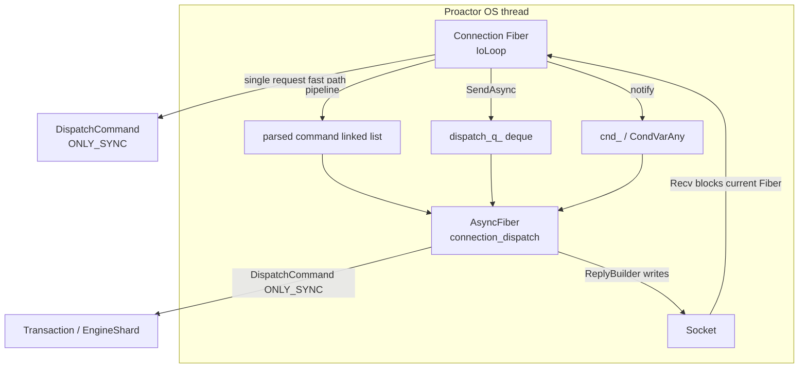

### 3.2 简单请求的快路径

当输入 buffer 中只有一条普通命令，而且连接没有订阅、没有 pending queue，V1 不启动
第二个 Fiber，直接在当前 Connection Fiber 中执行：

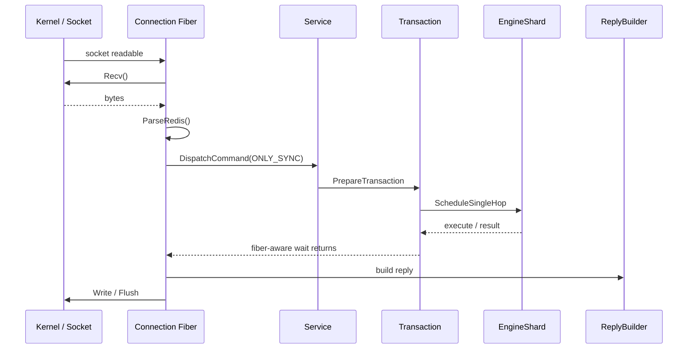

这里的“同步”只表示调用栈在当前 Connection Fiber 中连续执行；如果 Transaction 或 socket
写操作需要等待，等待的是 Fiber，不是整个 OS 线程。

### 3.3 pipeline 的生产者—消费者模型

V1 的 pipeline 将接收和执行拆成两个执行流：

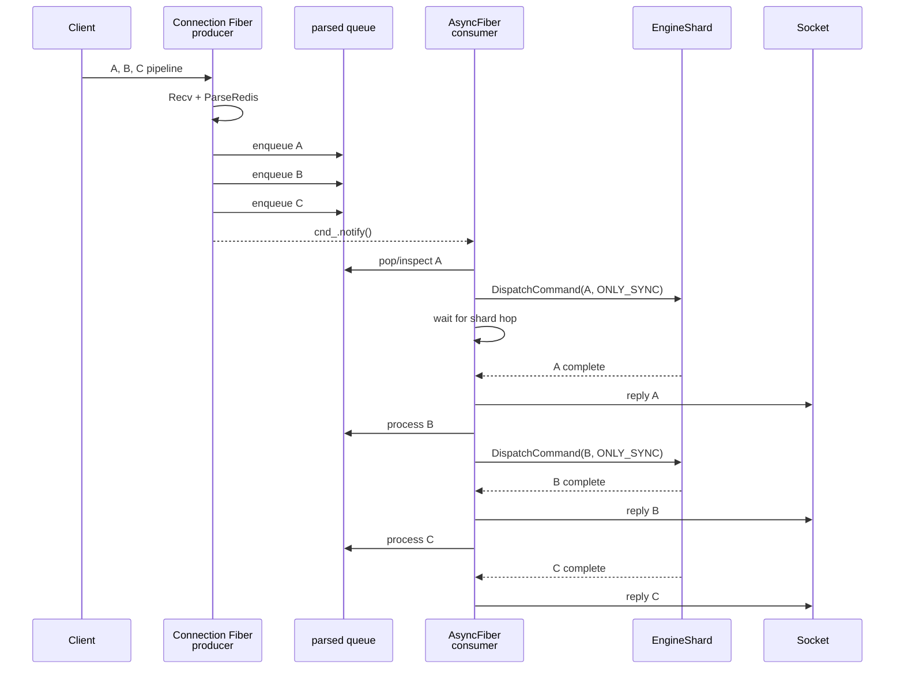

Connection Fiber 可以继续收包，但 `AsyncFiber` 本身通常用 `ONLY_SYNC` 逐条执行命令。因此
V1 的 pipeline 并行主要是“收包与执行并行”，而不是“同一连接的多个命令同时在 shard 上运行”。

### 3.4 V1 的两条队列

V1 后期已经将高流量数据路径和控制路径分开：

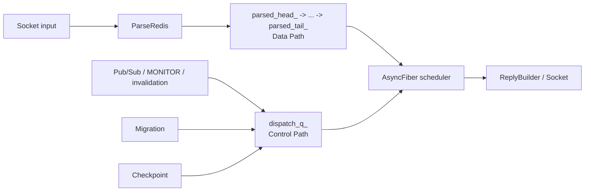

`parsed_head_` 链表还表达了命令生命周期：

```text
parsed_head_
    -> 已 dispatch、等待完成/回复的前缀
    -> parsed_to_execute_
    -> 已解析但尚未 dispatch 的后缀
    -> parsed_tail_
```

已完成的命令不能因为“任务结束”就立刻释放，因为回复仍必须按客户端请求顺序写出。

### 3.5 AsyncFiber 的调度策略

V1 的 AsyncFiber 每轮大致执行以下策略：

1. pipeline 足够长且可 squash 时，调用 `SquashPipeline`；
2. 否则调用 `ProcessPipelineCommandV1` 逐条执行；
3. control queue 有消息时，调用 `ProcessAdminMessage`；
4. 通过 `async_dispatch_quota`、`Yield` 或短暂等待，防止一条路径永久霸占 Fiber。

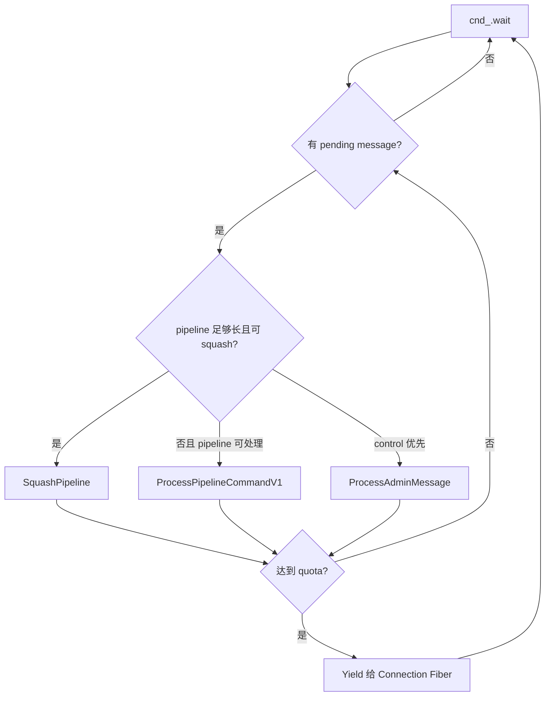

### 3.6 V1 为什么必须有第二个 Fiber

设想只剩 Connection Fiber：

```text
Connection Fiber -> Recv() -> 没有客户端输入 -> 挂起
```

这时下面这些任务没有执行者：

- 发布者已经把 Pub/Sub 消息投递到该连接；
- MONITOR 需要把事件发送给客户端；
- pipeline 中已经解析好的命令应该继续执行；
- checkpoint 需要等待或释放；
- migration 请求需要被处理；
- shutdown 需要唤醒并退出连接。

所以 V1 的第二个 Fiber 不是为了“让 C++ 更异步”，而是为了弥补下面这个结构性缺口：

> 主 Fiber 的等待条件只有 socket receive，而连接的工作集合实际上还包括 queue、shard、control message 和生命周期事件。

---

## 4. V1 的代价与它暴露出的设计问题

V1 的双 Fiber 方案是合理的补偿机制，但代价是每条活跃连接内部出现两个可能运行的执行者。

### 4.1 双 Fiber 共享状态

两个 Fiber 共享：

- `ConnectionContext`；
- `parsed_head_ / parsed_to_execute_ / parsed_tail_`；
- `dispatch_q_`；
- `ReplyBuilder`；
- socket 和连接生命周期；
- pipeline/control memory accounting。

因此必须维护 `sync_dispatch`、`async_dispatch` 和各种队列检查，避免一个 Fiber 在另一个
Fiber 可能 suspension 的窗口内破坏状态。

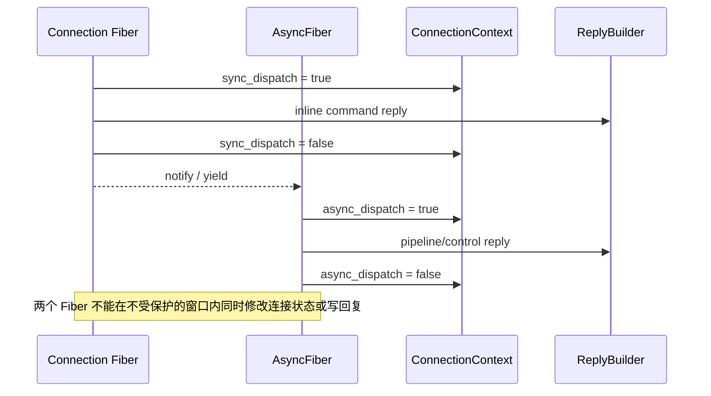

### 4.2 迁移必须先停止 AsyncFiber

V1 迁移时，不能只移动 Connection Fiber；必须保证第二个 Fiber 不再使用旧 Proactor 上的
socket、ReplyBuilder 或 thread-local accounting：

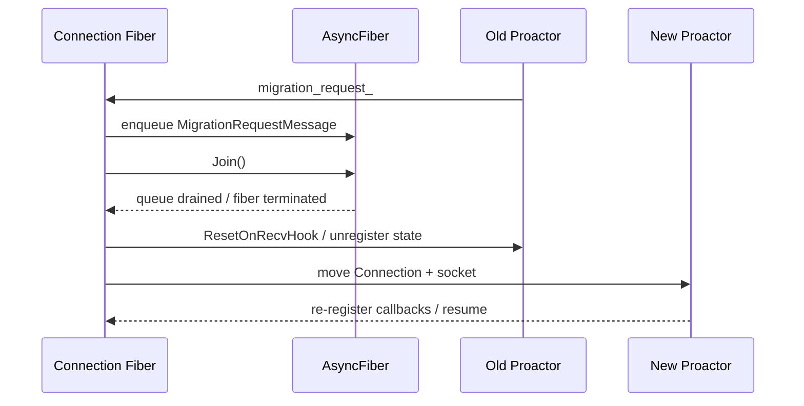

这也是为什么 V1 的 close/migration 路径需要显式 `JoinIfNeeded()`；V2 因为只有一个连接
Fiber，可以在主循环顶部直接处理 migration。

### 4.3 pipeline 反压是生产者和消费者之间的协议

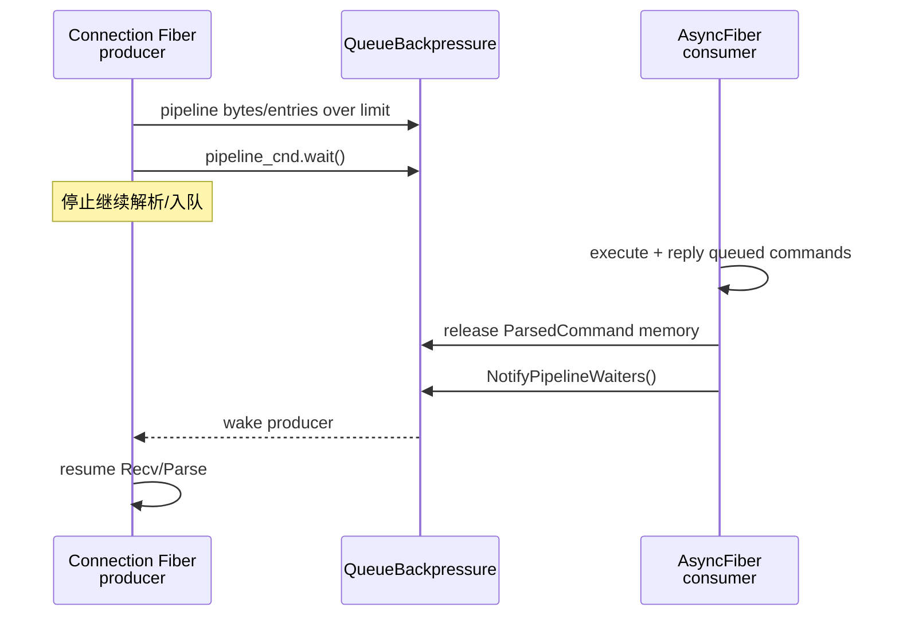

### 4.4 V1 的异步执行粒度有限

V1 中 AsyncFiber 消费 pipeline 时通常使用 `ONLY_SYNC`：

```text
AsyncFiber:
  dispatch A -> wait A -> reply A
  dispatch B -> wait B -> reply B
```

**这保证了回复顺序简单可靠，但不能充分利用“命令 A 正在等待远端 shard 时，命令 B 也可以先发射”的机会。（v2 引入协程就是为了让多个命令同时  inflight）**

---

## 5. V2：`IoLoopV2` 的详细设计

### 5.1 V2 的总体循环

V2 的主循环见 [`IoLoopV2`](../src/facade/dragonfly_connection.cc:3852)，其结构可以概括为：

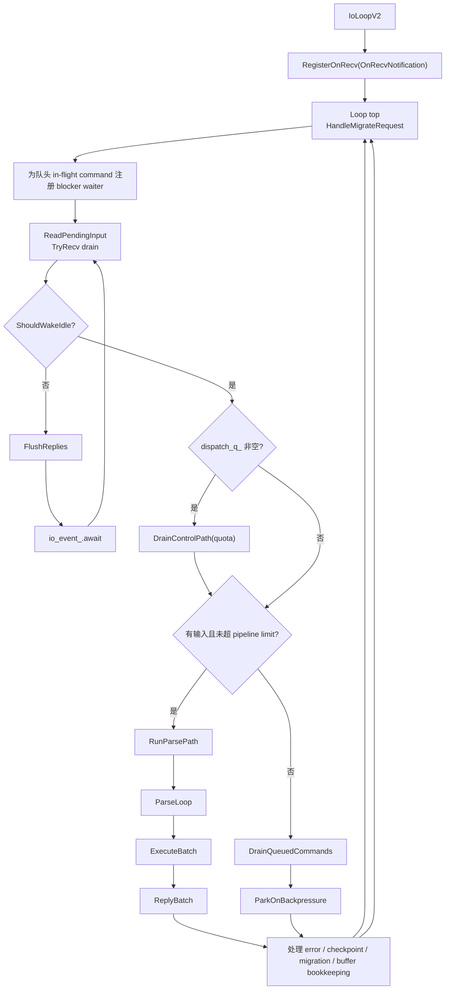

### 5.2 V2 的接收路径：回调只收包和通知，不执行整条命令链

V2 注册 `OnRecvNotification` 后，socket readiness 或 io_uring completion 会进入 Proactor
回调**（线程上下文执行）**。回调做的工作是：

1. 记录 `io_ec_` 或 `pending_input_`；
2. 通过 `	TryRecv` 将当前可读数据排入 `io_buf_`；
3. 必要时在安全的 park 点进行 parse-ahead；
4. 调用 `io_event_.notify()` 唤醒 Connection Fiber。

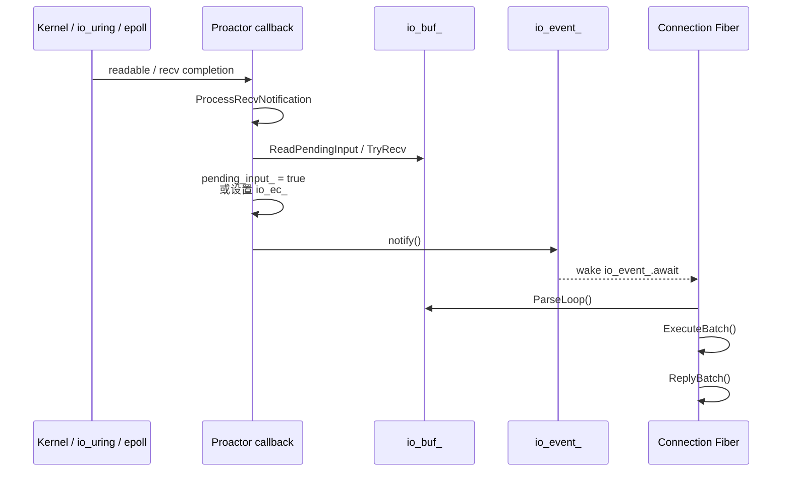

回调不会在 Proactor 上递归执行完整的命令处理；这样可以保持“socket 事件回调负责更新
输入状态，Connection Fiber 负责连接状态机”的边界。

### 5.3 V2 的统一唤醒条件

V2 通过 `ShouldWakeIdle()` 将原来分散给 Connection Fiber 和 AsyncFiber 的唤醒来源合并：

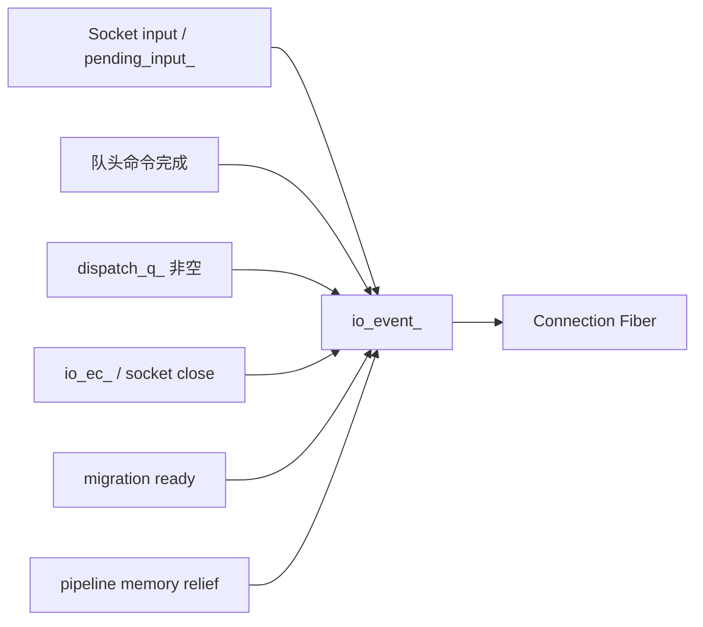

当没有任何工作时，V2 才会：

```text
FlushReplies()
fiber_park_spot_ = kIdleAwait
io_event_.await(ShouldWakeIdle)
```

所以 V2 的 Connection Fiber 不再“专门等 socket”，而是在等整个连接状态机的下一件事。

### 5.4 数据路径实现原理：RunParsePath 与 DrainQueuedCommands 的分流与协同

在 `IoLoopV2` 中，当经过控制路径排空（`DrainControlPath`）后，主循环进入核心数据处理阶段。此处的关键分支判断为：

```cpp
bool over_limit = IsOverPipelineLimit();
if (io_buf_.InputLen() == 0 || over_limit) {
  DrainQueuedCommands();
  if (over_limit)
    ParkOnBackpressure(&backpressure_waiter);
  parse_status = NEED_MORE;
} else {
  parse_status = RunParsePath();
}
```

#### 1. 统一的底层分发引擎：ExecuteBatch

在 `IoLoopV2` 的内部实现中，命令的实际调度执行**严格统一收敛到 `ExecuteBatch()` 接口**：

- 无论是走 `RunParsePath()` 还是 `DrainQueuedCommands()`，只要命令队列（`parsed_head_`）中有就绪待执行的命令，底层全部调用 `ExecuteBatch()` 分发到 `Transaction` 或 `EngineShard`，并调用 `ReplyBatch()` 处理回复与内存释放。
- 这一设计的核心在于：两条分支的差异**根本不在于“如何执行命令”**，而是在于**“当前是否允许从网络字节流中解析（生产）新的命令对象”**。

#### 2. RunParsePath 与 DrainQueuedCommands 的本质区别

| 处理路径                            | 生产阶段（Parse）                                                        | 消费与执行（ExecuteBatch）                         | 回复与释放（ReplyBatch）                             | 角色定位                             |
| :---------------------------------- | :----------------------------------------------------------------------- | :------------------------------------------------- | :--------------------------------------------------- | :----------------------------------- |
| **`RunParsePath()`**        | **执行**：从 `io_buf_` 读取字节并分配 `ParsedCommand` 挂入队列 | **执行**：分发就绪命令到 Transaction / Shard | **执行**：写回就绪回复并释放 `ParsedCommand` | **生产者 + 消费者**            |
| **`DrainQueuedCommands()`** | **跳过**：完全不调用任何协议解析器                                 | **执行**：只分发已经在队列中的已有命令       | **执行**：写回就绪回复并释放 `ParsedCommand` | **纯消费者**（只排空、不纳新） |

#### 3. 分支判定条件 `io_buf_.InputLen() == 0 || over_limit` 的深度剖析

该条件是保障 Dragonfly 在高并发事件循环中**既能推进异步完成事件，又能实施严格内存背压控流**的核心分流点：

- **分支场景 A：`io_buf_.InputLen() == 0`（网络无新数据，仅异步任务完成唤醒）**
  - **为什么网络无数据时协程仍会被唤醒？** Dragonfly 基于 shared-nothing 架构，跨 shard 的异步命令在远端执行完成后，通过 `cmd_completion_waiter` 触发 `io_event_.notify()` 唤醒当前 Connection Fiber。此时客户端可能正在等待前序命令响应而没有发送新请求，因此 `io_buf_.InputLen() == 0`。
  - **为什么必须走 `DrainQueuedCommands()`？** `ParseLoop()` 的前置条件包含断言 `DCHECK_GT(io_buf_.InputLen(), 0u);`，在无字节时调用解析器毫无意义且会引发断言失败。此时队列头部命令已经就绪（`CanReply() == true`），必须由 `DrainQueuedCommands()` 内的 `ReplyBatch()` 将回复发送给客户端，并由 `ExecuteBatch()` 驱动队列后方依赖它的命令继续执行。
- **分支场景 B：`over_limit == true`（触发 Pipeline 限制，流量背压）**
  - **为什么必须停止 `RunParsePath()`？** 客户端使用 Pipeline 批量突发写入时，`io_buf_` 中可能堆积数兆字节。若继续调用 `ParseLoop()`，解析器每识别出一条命令就会分配一个 `ParsedCommand` 对象及其参数数组和元数据。这种结构化对象会导致内存急剧放大（往往数倍到数十倍），带来极大的 OOM 风险。
  - **为什么走向 `DrainQueuedCommands()`？** 此时系统必须“闭闸控流”——强行切断新命令的生产，只通过 `DrainQueuedCommands()` 尽快把队列中已经入队的命令执行完毕并发送回复，释放其占用的内存。
  - **释放后的协同唤醒**：`DrainQueuedCommands()` 在结尾会记录内存释放量并调用 `NotifyIfMemReleased()`。一旦成功降低了当前线程的 `pipeline_queue_bytes`，会通过全局 `EventCount` 主动唤醒本线程上可能因为内存超标而挂起的其他连接。

---

## 6. V2 的命令级异步：替代 AsyncFiber 的关键

### 6.1 `ExecuteBatch` 的三种执行结果

V2 解析后先把命令放入 `ParsedCommand` 链表，再由 `ExecuteBatch()` 依次发射。

对于命令 `cmd`：

```text
cmd == parsed_head_       -> PREFER_ASYNC
cmd 在已有 in-flight 后面 -> ONLY_ASYNC
```

结果有三类：

| 结果            | 含义                                                 |
| --------------- | ---------------------------------------------------- |
| `OK`          | 命令完成，或已成功转为 deferred 执行                 |
| `ERROR/OOM`   | 命令已产生错误                                       |
| `WOULD_BLOCK` | 当前命令只支持同步执行，但它还不是可以安全阻塞的队头 |

`WOULD_BLOCK` 是一个重要的顺序保护：V2 不允许同步命令越过尚未完成的异步前缀。

### 6.2 `SingleHopAsync` 的执行过程

支持异步的命令通常通过 `co_await cmd::SingleHop(...)` 访问 shard。

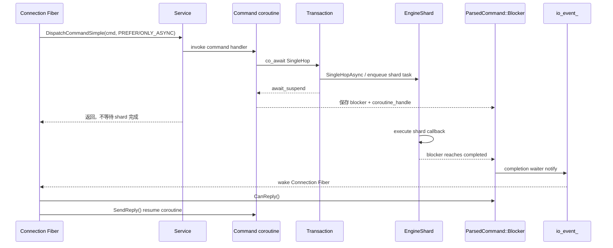

同步模式和异步模式使用同一套命令代码，但 `SingleHopWaiter` 的行为不同：

```text
非 deferred command：
  ScheduleSingleHop(callback)
  -> 当前 Connection Fiber 进行 Fiber-aware wait

deferred command：
  SingleHopAsync(callback)
  -> 不等待
  -> coroutine 在 await 点挂起
  -> ParsedCommand 持有 blocker 和 continuation
```

实现位于：

- [`Transaction::SingleHopAsync`](../src/server/transaction.cc:886)
- [`SingleHopWaiter::await_ready`](../src/server/cmd_support.cc:27)
- [`SingleHopWaiter::await_suspend`](../src/server/cmd_support.cc:50)

### 6.3 为什么这可以替代一个连接级消费者 Fiber

V1 中 AsyncFiber 的核心工作是：

```text
取出命令 -> 执行命令 -> 等 shard -> 回复 -> 取下一条命令
```

V2 把这段工作拆成两个部分：

```text
Connection Fiber：
  取出命令 -> 发射命令 -> 保存状态 -> 继续处理其他事件

EngineShard + coroutine：
  执行 shard -> 完成 blocker -> 恢复命令 continuation
```

所以 V2 不需要一个专门“卡在某条命令上”的 AsyncFiber。命令的等待状态被精确地附着在
对应的 `ParsedCommand` 上，而不是附着在一个长期运行的连接消费者上。

---

## 7. V2 如何保证 pipeline 回复顺序

### 7.1 执行顺序和回复顺序分离

V2 允许后面的命令先执行、先完成，但不允许后面的回复先写入 socket。

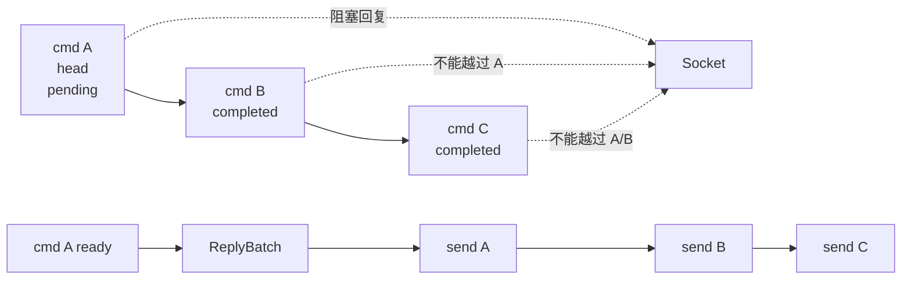

`ReplyBatch()` 只从 `parsed_head_` 开始消费连续 ready 的前缀：

```text
while (parsed_head_ 是 ready):
    SendReply(parsed_head_)
    parsed_head_ = parsed_head_->next
```

`ParsedCommand::CanReply()` 的保证是：

- payload 已经捕获完成；或
- blocker 已完成，可以恢复 coroutine。

对应实现见：

- [`ParsedCommand::CanReply`](../src/facade/parsed_command.cc:110)
- [`ParsedCommand::SendReply`](../src/facade/parsed_command.cc:117)
- [`ReplyBatch`](../src/facade/dragonfly_connection.cc:3196)

### 7.2 一个具体例子

客户端发送：

```text
SET a 1
GET b
PING
```

可能出现的内部状态：

```text
解析后：
  parsed_head_ -> SET -> GET -> PING
  parsed_to_execute_ 指向 SET

SET 发射后：
  SET  = deferred / pending
  parsed_to_execute_ 指向 GET

GET 发射后：
  GET  = deferred / pending 或 ready
  parsed_to_execute_ 指向 PING

PING 不支持 ONLY_ASYNC：
  返回 WOULD_BLOCK
  ExecuteBatch 停止，等待前面的异步前缀
```

即使 GET 比 SET 先完成，也必须等 SET 回复后才能发送 GET。这样 V2 在获得命令级并发的
同时，没有破坏 Redis pipeline 的 wire order。

---

## 8. V2 如何替代 AsyncFiber 的各项职责

### 8.1 能力映射总表

| V1 中 AsyncFiber 解决的问题           | V1 机制                               | V2 替代机制                                                       |
| ------------------------------------- | ------------------------------------- | ----------------------------------------------------------------- |
| 主 Fiber 阻塞在 Recv 时仍处理连接事件 | 第二个 Fiber 等`cnd_`               | `RegisterOnRecv`、control/completion 都通知 `io_event_`       |
| 消费 pipeline                         | AsyncFiber 逐条`ONLY_SYNC`          | `ExecuteBatch` 发射 `PREFER_ASYNC/ONLY_ASYNC` 命令            |
| 等待 shard hop                        | AsyncFiber 自己 Fiber-aware wait      | `SingleHopAsync` + `Blocker` + coroutine continuation         |
| 回复顺序                              | 消费者串行执行，天然简单              | `parsed_head_` + `CanReply()` + `ReplyBatch()` ready-prefix |
| Pub/Sub / MONITOR / invalidation      | `dispatch_q_` 唤醒 AsyncFiber       | `SendAsync` 入队并 `io_event_.notify()`，主循环 inline drain  |
| checkpoint                            | AsyncFiber 处理`CheckpointMessage`  | V2 主循环处理；in-flight 时放入`deferred_checkpoints_`          |
| migration                             | 发 migration message，Join AsyncFiber | 单 Fiber 在循环顶部处理`migration_request_`                     |
| pipeline 反压                         | producer 等`pipeline_cnd`           | `DrainQueuedCommands` 后订阅全局 EventCount，再等 `io_event_` |
| Pub/Sub 洪水下的公平性                | AsyncFiber quota/yield                | `DrainControlPath(quota)`，quota 到后转 data path               |
| 回复 flush                            | AsyncFiber 消费批次时 flush           | V2 在 idle park、反压或必要边界统一 flush                         |

### 8.2 control path：从“第二个消费者”变成“主循环阶段”

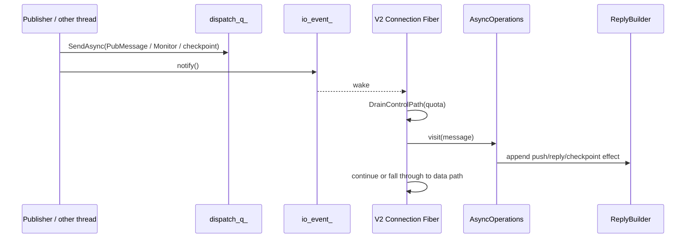

`AsyncOperations` 的消息处理代码可以在 V1/V2 共用，改变的是执行者：

```text
V1：AsyncFiber -> ProcessAdminMessage -> AsyncOperations
V2：Connection Fiber -> DrainControlPath -> ProcessControlMessages -> AsyncOperations
```

### 8.3 为什么 control path 仍需要 quota

V2 并不是把所有 control message 一次性排空。若 Pub/Sub 洪水持续到达，下面的循环会饿死客户端自己的输入：

```text
一直处理 Pub/Sub
  -> 不回到 ReadPendingInput
  -> 读不到 UNSUBSCRIBE / PING
  -> 客户端请求超时
```

因此 `DrainControlPath(quota)`：

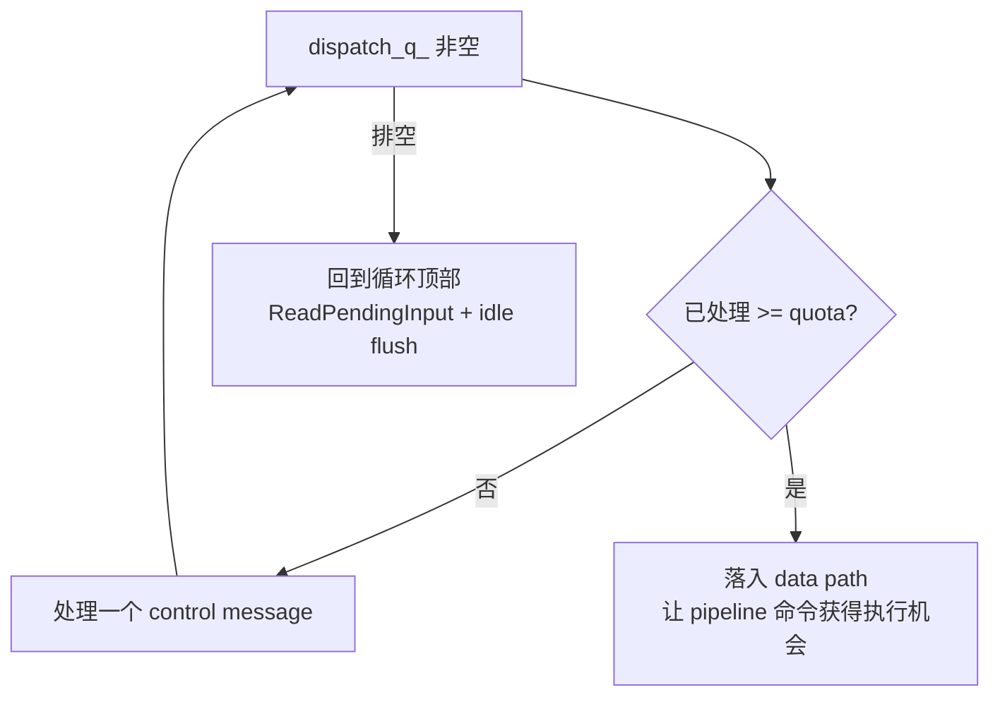

这套 quota 逻辑是 AsyncFiber 公平性策略的 V2 版本，而不是 V2 可以忽略公平性。

---

## 9. V2 的反压设计

### 9.1 V1 与 V2 的不同停车点

V1 反压时，直接在 pipeline_cnd.wait 处挂起，依靠本连接的 AsyncFiber 消费后调用 pipeline_cnd.notify_all 来唤醒。

V2 反压时，必须主循环提前拦截，先 Drian 排空已有命令释放内存，若仍超限才挂起。

**为什么 Drain 之后还会超限？**

1. **命令在途未完成（In-Flight）** ：命令已异步派发给远端 `EngineShard`，但结果尚未返回，无法提前释放命令内存。
2. **线程共享配额超标** ：超限指标按“当前 IO 线程所有连接总内存”计算，即使当前连接已尽力排空，邻居连接仍占满着配额。

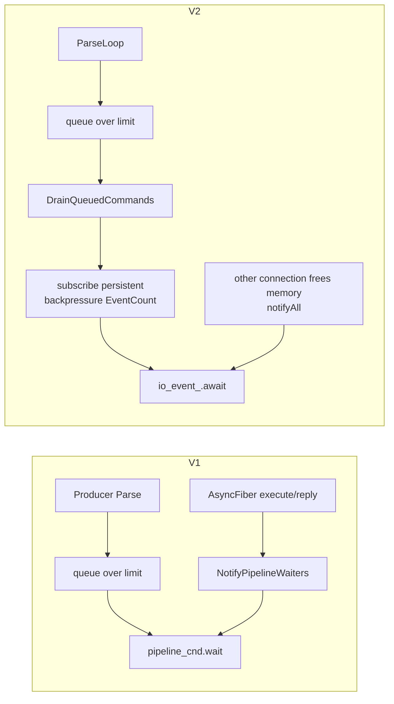

### 9.2 V2 为什么先 drain 再 park

V2 不能简单地“看到超限就睡觉”，因为当前连接队列中可能已经有可以执行和回复的命令。
正确顺序是：

1. 不再解析更多输入；
2. 执行已经排队且可执行的命令；
3. 发送已经 ready 的回复；
4. 重新检查内存是否已经低于限制；
5. 仍超限才订阅全局反压事件并 park。

这样，V2 的停车本身不会阻碍队列释放内存。

### 9.3 为什么使用持久订阅

反压解除可能发生多次，且第一次唤醒时条件可能仍未满足。V2 使用持久 EventCount 订阅，
并让 waiter callback 调用 `io_event_.notify()`，避免一次通知被消费后连接永久“失聪”。

### 9.4 全链路端到端多级拦截与反压体系

在 Pipeline 流量突发导致 `over_limit`（超过 `pipeline_buffer_limit` 或 `pipeline_queue_limit`）时，Dragonfly 并非简单地丢弃或报错，而是构建了一条从应用层层层推导至客户端发送端的端到端多级拦截体系：

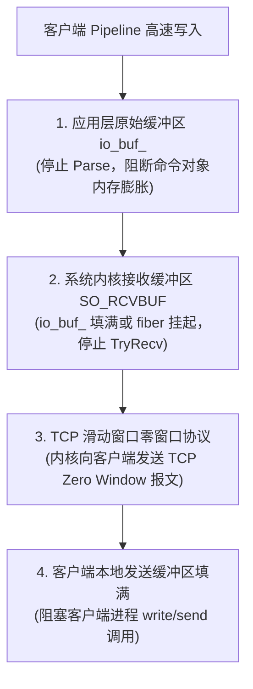

1. **第一级拦截：应用层原始字节缓冲区（`io_buf_`）**
   - 触发点：`IoLoopV2` 识别到 `IsOverPipelineLimit()` 为真，强行分流至 `DrainQueuedCommands()`，暂停调用 `ParseLoop()`。
   - 效果：已经通过 socket 读取到应用层的字节只作为紧凑的原始二进制流（Raw Bytes）留在 `io_buf_` 中。这从源头上掐断了向高开销结构体 `ParsedCommand` 的转变，避免了应用层内存被成倍甚至数十倍放大。
2. **第二级拦截：操作系统内核 Socket 接收缓冲区（`SO_RCVBUF`）**
   - 触发点：`io_buf_` 的剩余写入空间具有固定上限。一旦 `io_buf_.AppendBuffer().empty()`，[`ReadPendingInput()`](../src/facade/dragonfly_connection.cc:3531) 将无法写入并停止读取；或者当 `DrainQueuedCommands()` 排空后内存依然超限时，Connection Fiber 进入 [`ParkOnBackpressure()`](../src/facade/dragonfly_connection.cc:3815) 挂起，彻底停止调用 `socket_->TryRecv()`。
   - 效果：Dragonfly 进程不再从内核消费数据，后续客户端发送过来的 TCP 报文被操作系统滞留在内核的 Socket 接收缓冲区中。
3. **第三级反压：TCP 协议栈滑动窗口（TCP Zero Window）反压客户端**
   - 触发点：当 Linux 内核的 Socket 接收队列逐渐被填满时，Linux 内核的 TCP 协议栈根据滑动窗口流控协议，将向客户端回复的 ACK 报文中的接收窗口（`Receive Window / rcv_wnd`）收缩至 0，向客户端通告 Zero Window。
   - 效果：客户端操作系统的 TCP 协议栈收到零窗口通知后，强制停止向网络发送数据包；随后客户端本地的 Socket 发送缓冲区也被填满；最终使得客户端进程中的 `write()` / `send()` 调用被阻塞（或在非阻塞模式下返回 `EAGAIN` / `EWOULDBLOCK`）。

整个体系形成了一个闭环：**服务端内存吃紧→ 停止解析 $\to$ 停止读 Socket $\to$ 填满内核接收缓冲 $\to$ TCP 零窗口流控 $\to$ 客户端发送端被阻断**。这保证了在面对任何量级的 Pipeline 洪峰时，系统都能以极低的内存开销平稳运行，杜绝内存崩溃。

---

## 10. checkpoint、CLIENT PAUSE 与在途命令

### 10.1 V2 中“dispatch 返回”不等于“命令完成”

V2 的异步命令可能经历：

```text
DispatchCommandSimple 返回
    ↓
shard callback 仍在运行
    ↓
coroutine 尚未恢复
    ↓
reply 尚未写入 socket
```

因此不能只看 `sync_dispatch` / `async_dispatch` 两个瞬时 flag。V2 还需要：

```cpp
HasInFlightCommands() == (parsed_head_ != parsed_to_execute_)
```

### 10.2 checkpoint 的 V2 时序

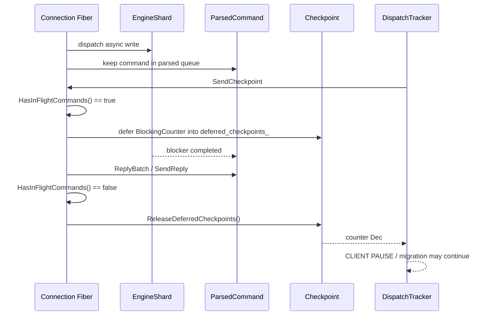

这保证 `CLIENT PAUSE WRITE`、REPLTAKEOVER、cluster migration 和 graceful shutdown 不会在
异步写真正落地前提前通过屏障。

### 10.3 回复写入期间仍算 in-flight

某些 suspended reply 在 `SendReply()` 中还可能继续做工作，例如从 tiered storage 读取数据。
因此 `ReplyBatch()` 在 `SendReply()` 返回之前保持 `parsed_head_` 不前移，使整个回复写窗口
都被 `HasInFlightCommands()` 覆盖。

---

## 11. blocking command 是 V2 的边界案例

V2 并不保证所有命令都能 deferred。

### 11.1 队头 blocking command

队头命令使用 `PREFER_ASYNC`。如果它不支持 async，允许它同步执行；如果它是 BLPOP 这类
blocking command，Connection Fiber 可能在 Fiber-aware barrier 上停车。

在进入阻塞前，V2 通过 `async_dispatch` 语义让 Service 先 flush 已经缓冲的 pipeline 回复，
避免出现：

```text
SET -> PING -> BLPOP

BLPOP 已经阻塞
但 SET/PING 回复还留在 ReplyBuilder buffer 中
```

### 11.2 非队头 blocking/sync-only command

如果前面已有异步命令在途，而后面的命令只支持同步执行：

```text
DispatchCommandSimple(cmd, ONLY_ASYNC)
    -> WOULD_BLOCK
    -> ExecuteBatch 停止
    -> 等前序命令成为 ready/head
    -> 再执行该同步命令
```

这不是性能缺陷，而是避免一个不能 deferred 的命令越过异步前缀、破坏回复顺序和连接状态。

### 11.3 重要边界

如果一个命令本身在 Connection Fiber 内执行了长时间同步/阻塞路径，那么该连接主状态机在它返回前不能像 V1 的双 Fiber 模型那样独立处理所有同连接控制消息。V2 的解决方式不是再偷偷创建一个 AsyncFiber，而是：

1. 尽可能把可支持的 shard 操作实现为 async command；
2. 对不能 async 的命令保持明确的同步边界；
3. 使用 Fiber-aware wait，保证只阻塞当前 Fiber，不阻塞整个 OS 线程；
4. 通过 socket error、blocking cancellation、shutdown 等外部路径解除等待。

所以“V2 不需要 AsyncFiber”成立的准确前提是：

> socket 接收已经事件化，普通 pipeline 命令可以 deferred；对于必须同步执行的命令，V2 接受它在该连接状态机中形成的同步边界。

---

## 12. V1/V2 设计对比图

### 12.1 等待模型对比

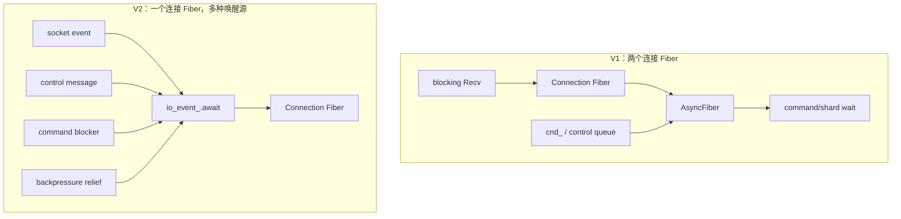

### 12.2 数据所有权对比

```mermaid
flowchart LR
    subgraph V1O[V1 ownership]
        A1[Connection Fiber] -->|写 parsed queue| Q1[parsed queue]
        A2[AsyncFiber] -->|读 parsed queue| Q1
        A2 -->|写 ReplyBuilder| R1[ReplyBuilder]
        A1 -->|简单命令也可能写| R1
        A1 -.->|flags/cnd 协调| A2
    end

    subgraph V2O[V2 ownership]
        B1[Connection Fiber] -->|parse/dispatch/reply| Q2[parsed queue]
        B1 -->|唯一连接级 writer| R2[ReplyBuilder]
        B2[Proactor callback] -->|仅更新 io_buf_/event state| Q2
        B3[EngineShard] -->|只完成 command blocker/payload| Q2
    end
```

### 12.3 生命周期对比

```mermaid
sequenceDiagram
    participant S as Socket event
    participant V1 as V1 Connection Fiber
    participant A as V1 AsyncFiber
    participant V2 as V2 Connection Fiber
    participant E as io_event_

    rect rgb(235, 245, 255)
      Note over S,A: V1
      S->>V1: Recv / parse
      V1->>A: enqueue + cnd notify
      A->>A: execute / wait / reply
      A-->>V1: producer may continue independently
    end

    rect rgb(235, 255, 240)
      Note over S,E: V2
      S->>E: OnRecvNotification -> notify
      E-->>V2: wake same Fiber
      V2->>V2: drain / parse / dispatch / reply
      V2->>E: await next event
    end
```

---

## 13. 一个“为什么 V2 可行”的不变量证明

V2 删除 AsyncFiber 后仍然安全，依赖下面几条不变量。

### 不变量 1：连接状态只有一个 Fiber 级 owner

Proactor callback 可以更新输入 buffer、错误状态和事件 epoch，但不会执行完整命令状态机。
`dispatch_q_` 的消费、Transaction 发射、ReplyBuilder 写入都由 Connection Fiber 负责。

### 不变量 2：异步命令不直接写 socket

异步 shard task 只能：

- 生成 deferred payload；或
- 完成 blocker，让 Connection Fiber 恢复 coroutine。

因此异步完成顺序不会直接变成 socket 写入顺序。

### 不变量 3：只有 ready 的队头前缀可以回复

`ReplyBatch()` 永远从 `parsed_head_` 开始，后面的 ready 命令必须等待前面的命令被回复。

### 不变量 4：in-flight 命令由队列生命周期表示

异步 dispatch 返回后，两个 dispatch flag 可以清零，但命令仍保留在
`parsed_head_ .. parsed_to_execute_` 区间内。checkpoint 和 shutdown 使用这个持久状态。

### 不变量 5：每一种外部事件都能唤醒同一个 Fiber

socket、control、completion、反压、migration 和 shutdown 都最终进入 `io_event_` 或其谓词
可观察状态，不需要另一个 Fiber 作为事件消费者。

---

## 14. 常见误读

### 误读 1：V1 的 AsyncFiber 是“异步 shard 执行线程”

不是。它是连接级第二个 Fiber，主要解决生产者/消费者和控制消息消费；V1 pipeline 消费者
通常以 `ONLY_SYNC` 调用命令。

### 误读 2：V2 单 Fiber 就意味着所有命令串行完成

不是。V2 的 dispatch 可以异步发射多个支持 async 的命令，完成可以乱序；只有回复严格按队头顺序发送。

### 误读 3：V2 的 Proactor callback 会直接执行命令

不是。callback 主要收包、设置状态、通知；命令状态机仍在 Connection Fiber 中执行。

### 误读 4：V2 不需要任何队列

不是。V2 仍然需要：

- `parsed_cmd_` 链表保存命令、参数、状态和顺序；
- `dispatch_q_` 保存 Pub/Sub、MONITOR、checkpoint、migration 等 control message；
- `deferred_checkpoints_` 保存仍不能释放的屏障。

变化的是队列不再由第二个长期 Fiber 消费，而是由主循环的不同阶段消费。

### 误读 5：只要 dispatch 返回就可以认为命令结束

不是。V2 的 async command 可能在 dispatch 返回后仍在 shard 上运行；必须等 blocker 完成、coroutine 恢复并且回复写出后，才能从 in-flight 队列中移除。

---

## 15. 源码阅读索引

建议按以下顺序对照源码：

1. 默认值和连接选择：
   [`Connection::OnConnectionStart/ConnectionFlow`](../src/facade/dragonfly_connection.cc:1404)
2. V1 快路径与入队：
   [`DispatchSingle`](../src/facade/dragonfly_connection.cc:1513)
3. V1 消费者：
   [`AsyncFiber`](../src/facade/dragonfly_connection.cc:2176)、
   [`ProcessPipelineCommandV1`](../src/facade/dragonfly_connection.cc:2141)
4. V2 收包通知：
   [`OnRecvNotification`](../src/facade/dragonfly_connection.cc:3457)、
   [`ReadPendingInput`](../src/facade/dragonfly_connection.cc:3531)
5. V2 主循环：
   [`IoLoopV2`](../src/facade/dragonfly_connection.cc:3852)
6. V2 pipeline：
   [`ExecuteBatch`](../src/facade/dragonfly_connection.cc:3031)、
   [`ReplyBatch`](../src/facade/dragonfly_connection.cc:3196)
7. V2 反压和 control path：
   [`DrainControlPath`](../src/facade/dragonfly_connection.cc:3769)、
   [`ParkOnBackpressure`](../src/facade/dragonfly_connection.cc:3815)
8. 命令级异步：
   [`SingleHopAsync`](../src/server/transaction.cc:886)、
   [`SingleHopWaiter`](../src/server/cmd_support.cc:27)
9. 回复状态：
   [`ParsedCommand::CanReply/SendReply`](../src/facade/parsed_command.cc:110)

---

# 16. 最终心智模型

可以把两代设计压缩成下面两张图。

### V1

```text
socket Recv 是主 Fiber 的阻塞点
        ↓
为了让连接继续处理其他事情
        ↓
增加 AsyncFiber
        ↓
生产者/消费者 + 两个 Fiber 的状态协调
```

### V2

```text
socket 接收改为 Proactor callback
        ↓
所有事件统一通知 io_event_
        ↓
一个 Connection Fiber 统一消费 control/data
        ↓
shard 等待改为 blocker + coroutine continuation
        ↓
命令可 deferred，回复仍按 parsed_head_ 有序发送
```

因此，V2 的本质不是“用一个循环替代两个循环”这么简单，而是同时完成了两次解耦：

1. 把 socket IO 等待从 Connection Fiber 的调用栈中解耦出来；
2. 把命令完成等待从连接级消费者 Fiber 中解耦出来。

解耦完成后，Connection Fiber 只需要承担它最适合承担的职责：维护连接状态、调度事件、
保证回复顺序和拥有 ReplyBuilder。
