# Dragonfly 主从复制图解：先认识对象，再跟着数据走

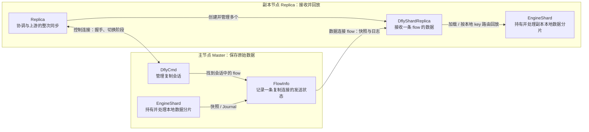

先看左右两台机器：主节点的 `DflyCmd` 管“往哪些副本发送”，副本节点的 `Replica` 管“怎样从上游接收”。数据通过多条 flow 传输，最终进入副本的本地 `EngineShard`。同一台机器在级联复制中可以同时扮演这两种角色。

本文按下面的顺序阅读；类名后先看中文职责，理解后再点源码。

- [0. 六个词与阅读路线](#reading-map)
- [1. 核心类图：谁持有谁](#object-model)
- [2. 两类连接：谁控制、谁传数据](#connections)
- [3. flow、Proactor、EngineShard 怎样对应](#flow-placement)
- [4. 主从两侧状态怎样一起变化](#sync-states)
- [5. 握手：对象和连接怎样创建](#handshake)
- [6. 全量同步：并发写入与阶段切换](#full-sync)
- [7–10. Journal、稳定同步、ACK、回放和事务](#journal-model)
- [11–14. 断线续传、大对象分块、多 flow 一致性](#resync)
- [15–16. fiber 调度与性能](#fiber-model)
- [17–23. 调用链、字段速查、异常、协议与源码索引](#source-guide)

> **源码范围**：基于当前工作区，HEAD 为 `0ab6e227bb1286a9bda7b0438c9ea3abaf633e60`（dev），包含本地源码状态。图中省略无关字段；“持有对象”“借用指针”“调用方法”“网络传输”会明确区分。源码链接以文件与函数名为入口，避免行号随修改失效。
>
> 本文主线为 Dragonfly → Dragonfly。Redis 上游的兼容路径单独放在第 20 章。

<a id="reading-map"></a>

## 0. 先认识六个词

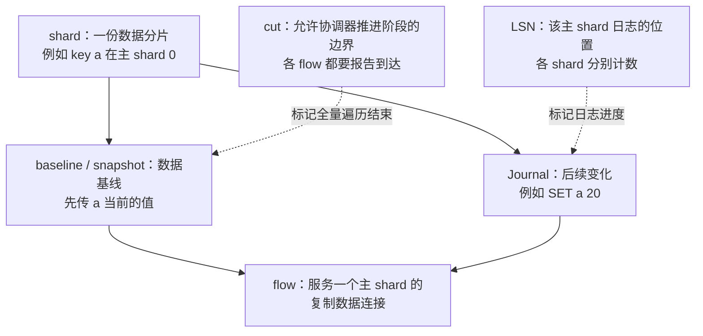

这里的 shard 是数据分片，flow 是传输通道，fiber 是执行代码的协程。三个词分别描述“数据放哪儿”“数据从哪儿过”“代码由谁运行”。

用一次复制的生命周期把它们连起来：

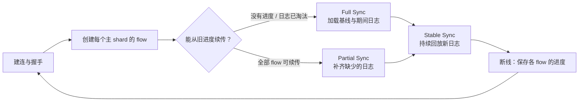

Full 是“先搬家底”，Stable 是“持续跟进”，Partial 是“断线后补缺口，再回到 Stable”。LSN 是每个主 shard 的进度，不能把不同 shard 的数字当成一个全局时间。

<a id="object-model"></a>

## 1. 先看核心数据结构：谁持有谁

### 1.1 主节点：DflyCmd 管理多个副本会话

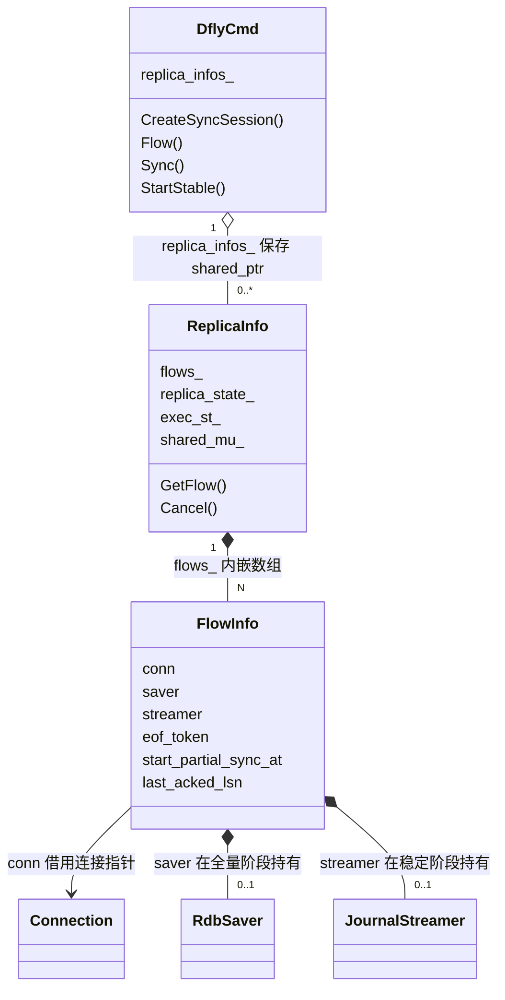

- 一个 `ReplicaInfo` 对应一个复制会话，以 `sync_id` 查找。主节点可以同时有多个会话。
- 一个会话有 N 个 `FlowInfo`；N 是**主节点 shard 数量**。
- `FlowInfo` 记录连接指针、发送器和 ACK 进度。它没有独立的数据库；`conn` 的生命周期由连接框架管理。
- `RdbSaver` 与 `JournalStreamer` 分别服务全量和稳定/部分同步阶段。字段存在不表示两个发送器同时工作。

例如主节点有 2 个 shard，同时向两个副本复制：

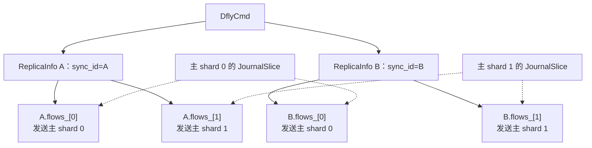

图中有 4 个发送 flow，但只有 2 份主 shard 数据、2 份对应的 Journal。每个副本有自己的 socket 和网络待发送缓冲。

源码：[dflycmd.h](../src/server/dflycmd.h) 的 `DflyCmd`、`ReplicaInfo`、`FlowInfo`；[dflycmd.cc](../src/server/dflycmd.cc) 的 `CreateSyncSession`、`SetupFlowConnection`。

### 1.2 副本节点：Replica 管理多个 DflyShardReplica

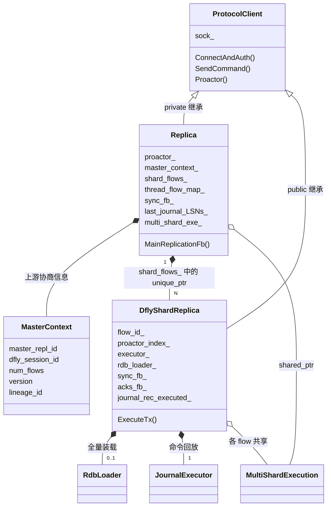

`Replica` 与 `DflyShardReplica` 都继承 `ProtocolClient`，因此它们**各自有 socket**。前者用控制连接推进整次同步；后者各自建立一条数据连接。

`DflyShardReplica::sync_fb_` 按阶段复用：先运行全量装载 fiber，结束后用于稳定读取 fiber；`acks_fb_` 在稳定阶段专门发送 ACK。`JournalReader` 和 `TransactionReader` 是稳定读取函数内的局部对象，不是上图遗漏的长期成员。

`MultiShardExecution` 由这些 flow 共享，负责特定 global command 的会合，例如 `FLUSHALL`。它不拥有数据库数据。

源码：[replica.h](../src/server/replica.h)、[protocol_client.h](../src/server/protocol_client.h)、[tx_executor.h](../src/server/journal/tx_executor.h)。

### 1.3 EngineShard 放在哪里：拥有数据的是本地分片

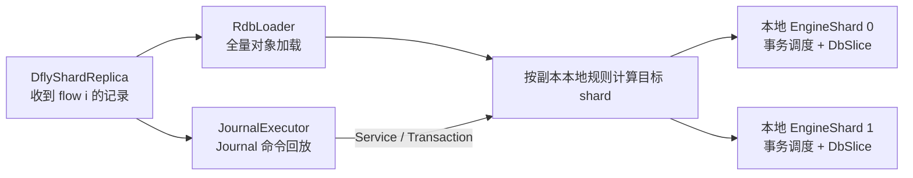

`DflyShardReplica` 的所有权树中没有 `EngineShard`。flow 来自主节点哪个 shard，与 key 应写入副本哪个 shard，是两个不同的计算；第 3 章会画出线程数不同的具体例子。

源码：[executor.cc](../src/server/journal/executor.cc) 的 `JournalExecutor::Execute`；[rdb_load.cc](../src/server/rdb_load.cc) 的 `FlushShardAsync`。

<a id="connections"></a>

## 2. 两类连接：谁发控制命令，谁传数据

### 2.1 一个上游、两个 shard：通常是 1 条控制连接 + 2 条 flow

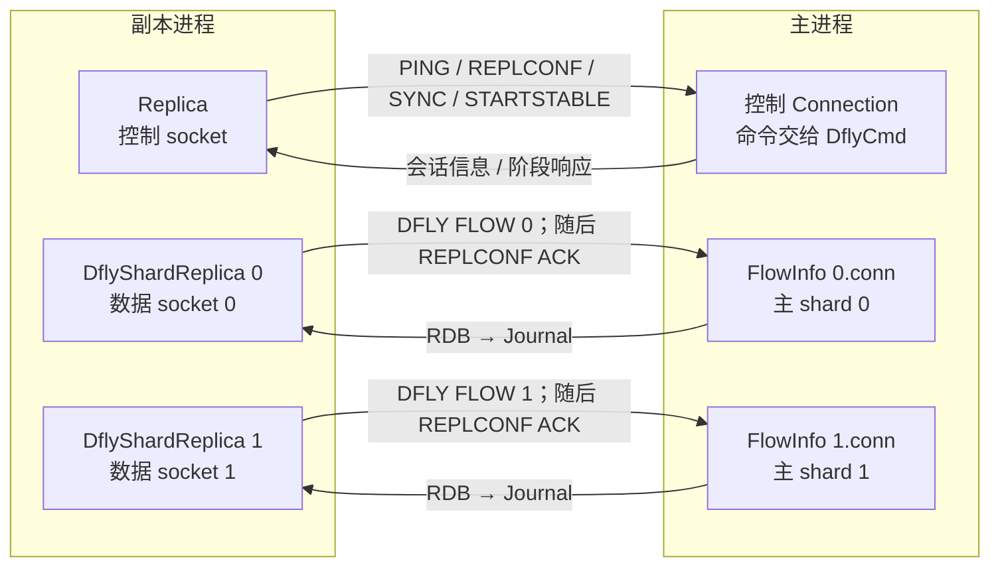

flow 是双向 TCP 连接：主到副本方向传数据，副本到主方向发 ACK。全量切到稳定会复用同一条 flow socket，改变的是读写数据的格式和执行它的 fiber。

`DflyCmd` 是命令处理/会话管理对象。图中的控制 Connection 调用它，并不表示 `DflyCmd` 自己持有一个专用控制 socket 或对应一条专属 fiber。

### 2.2 同一个 flow 在两个阶段使用哪些对象

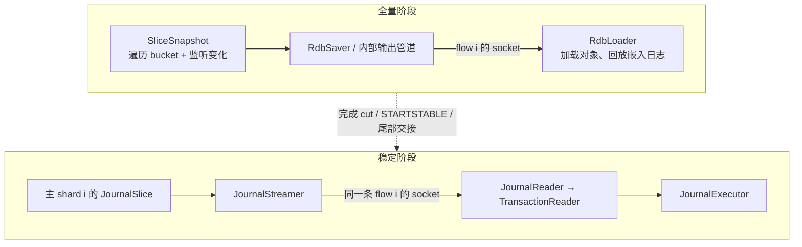

`RdbSaver` 通过内部实现组织 `SliceSnapshot` 和输出；`JournalSlice` 通过 consumer 接口通知监听者。consumer 在这里表示“接收 Journal 回调的对象”，不能直接理解为 shard queue 的 consumer fiber。

<a id="flow-placement"></a>

## 3. flow、Proactor、EngineShard 怎样对应

### 3.1 主节点绑定规则与副本分配规则

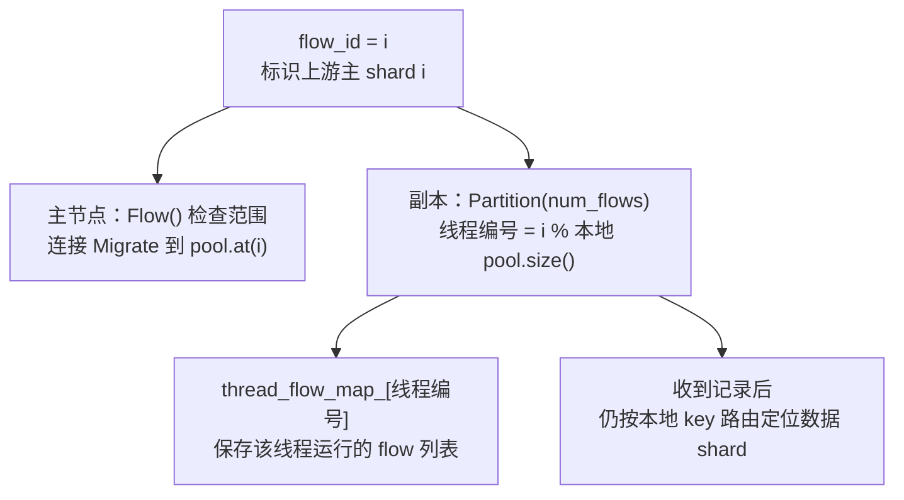

主侧一个 flow 服务一个主 shard。副本侧 `Partition` 按 **Proactor pool 大小**分配 flow；pool 大小不能一概替换为 `shard_set->size()`，某些配置还包含不持有 EngineShard 的线程。

源码：[dflycmd.cc](../src/server/dflycmd.cc) 的 `Flow`；[replica.cc](../src/server/replica.cc) 的 `Partition`、`InitiateDflySync`。

### 3.2 具体例子：主 4 个 shard，副本 2 个 Proactor

本例额外假设副本这 2 个 Proactor 各自承载一个 EngineShard。箭头表示**flow 的网络读取 fiber 放在哪里**：

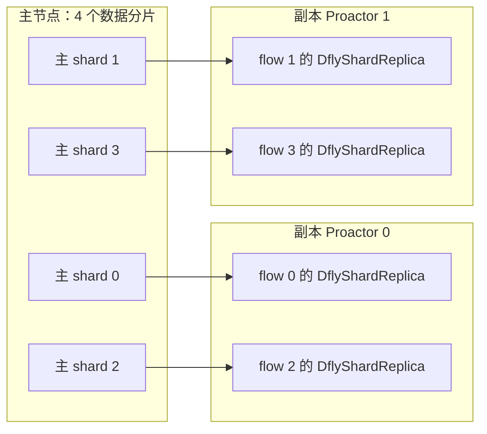

于是 `thread_flow_map_[0] = [0, 2]`，`thread_flow_map_[1] = [1, 3]`。一个 Proactor 调度多个复制 flow 的 fibers；这些 flow 不会各自再创建一个 EngineShard。

再看一个 key：**假设**某条记录属于 flow 2，但该 key 按副本当前配置应落在 shard 1：

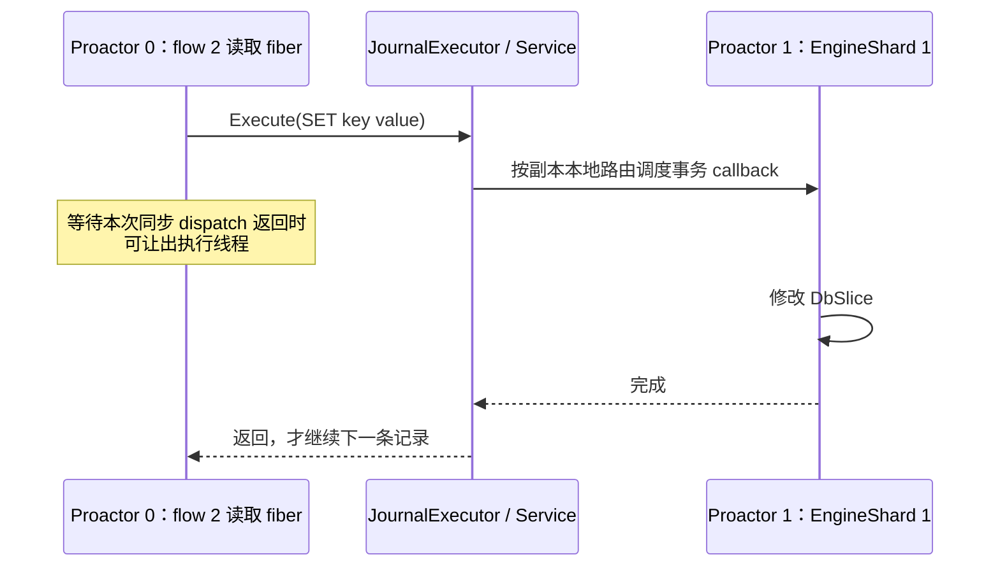

实际 key 到 shard 的映射以本地配置和路由代码为准，不能用上图的示例编号推导某个真实 key 的分片。

### 3.3 为什么 Replica 里需要 proactor_

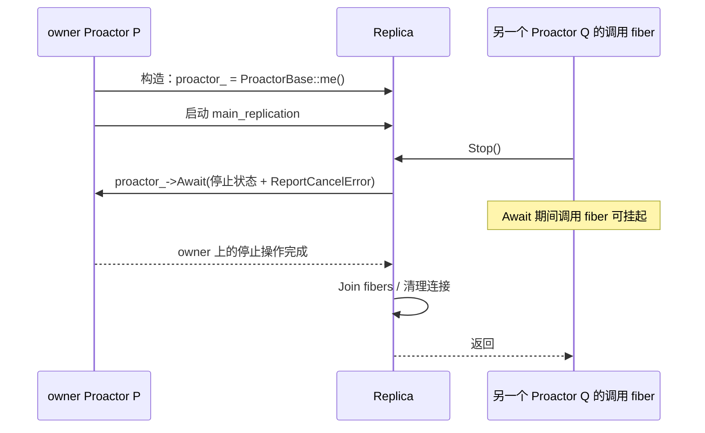

`proactor_` 保存 `Replica` 的 owner，方便 `Stop`、`GetSummary`、`GetClientInfo` 把操作投回正确线程；它是一个借用的 Proactor 指针，不会创建新线程。

另一个接口 `ProtocolClient::Proactor()` 从 `sock_->proactor()` 取值，要求 socket 存在。当前 `Pause` 和 `TakeOver` 使用这个接口。两者在正常连接状态下应一致，但取值来源与生命周期依赖不同。

`DflyShardReplica::proactor_index_` 则在 `StartSyncFlow` 执行时记录，用于检查该 flow 的读取/ACK 是否仍在指定线程。它和父对象的 `proactor_` 可以指向不同线程。

<a id="sync-states"></a>

## 4. 主从两侧状态怎样一起变化

### 4.1 主节点：一个 ReplicaInfo 的生命周期

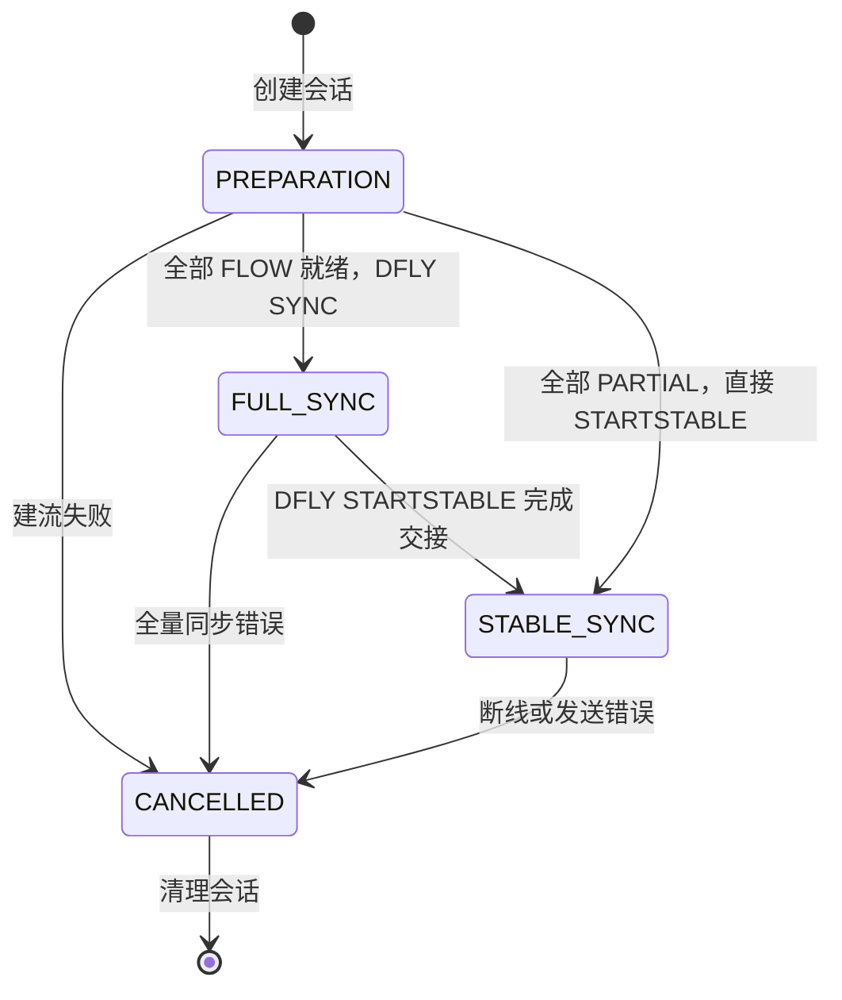

这些是 `DflyCmd::SyncState` 的枚举值。重连会重新协商会话，旧会话的 CANCELLED 不直接“回到 PREPARATION”。

### 4.2 副本：协调 fiber 观察到的阶段

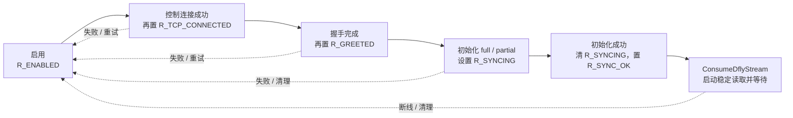

`Replica::state_mask_` 是**位掩码**；上图的方框是阅读阶段，不能当成互斥枚举逐个赋值。`passed_full_sync_` 表示是否已有可继续追日志的数据基线，断线不会直接清掉它；重新开始 full 时会置 false。

两侧“稳定”的含义也有区别：主端 STABLE_SYNC 表示已经启动 streamer；Partial 路径下它可能仍在补 backlog，不能由这个状态推断复制延迟为零。

<a id="handshake"></a>

## 5. 握手：对象和连接怎样创建

### 5.1 先创建会话，再建立各个 flow

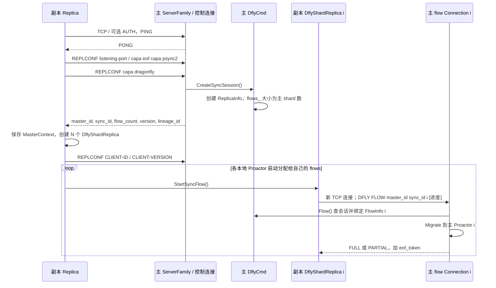

flow 注册命令带三个身份：`master_id` 校验上游实例，`sync_id` 找会话，`flow_id` 找会话里的主 shard 数据流。`eof_token` 在这里先协商，只有 FULL 的尾部才会再从数据流发送。

### 5.2 谁启动并行工作，谁等待

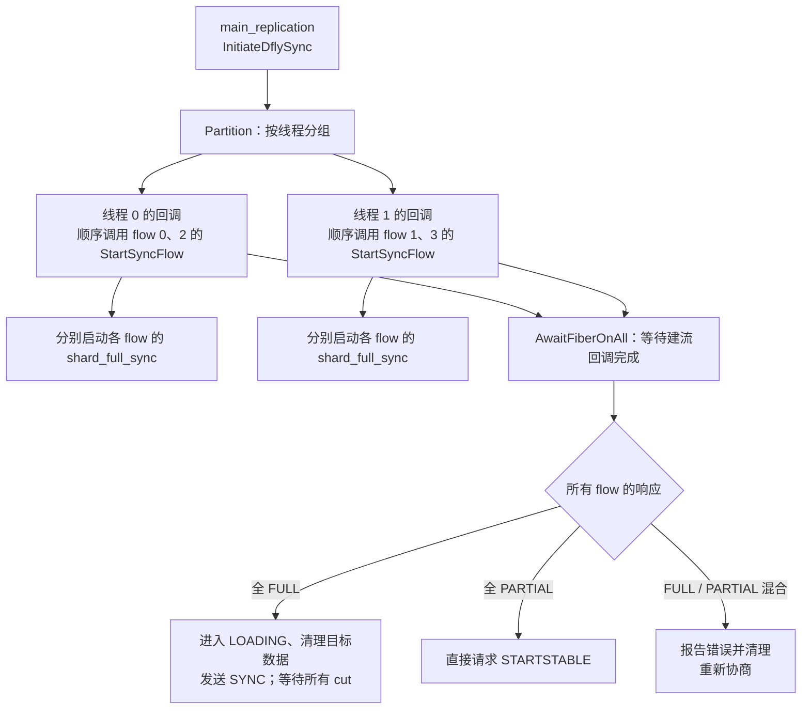

启动期间各线程回调可以并行，但**同一个回调内**对分配的 flow 是顺序调用 `StartSyncFlow`。全量装载 fiber 启动后独立推进，主协调 fiber 用 `BlockingCounter` 等待所有 flow 的 cut。等待一个 fiber 不会阻塞整个 OS 线程。

源码：[replica.cc](../src/server/replica.cc) 的 `InitiateDflySync`、`StartSyncFlow`；[dflycmd.cc](../src/server/dflycmd.cc) 的 `Flow`。

<a id="full-sync"></a>

## 6. Full Sync：一边搬数据，一边接住新的写入

### 6.1 先认清全量阶段参与的对象

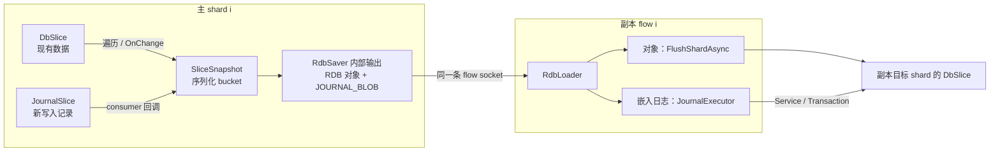

baseline 和同期日志在同一条 RDB 流里交错传输。副本装载时，RDB 对象走加载路径，`JOURNAL_BLOB` 中的命令走回放路径；两条路径都可能投递到其它本地 shard。

### 6.2 开始全量：先建立监听，再开始遍历

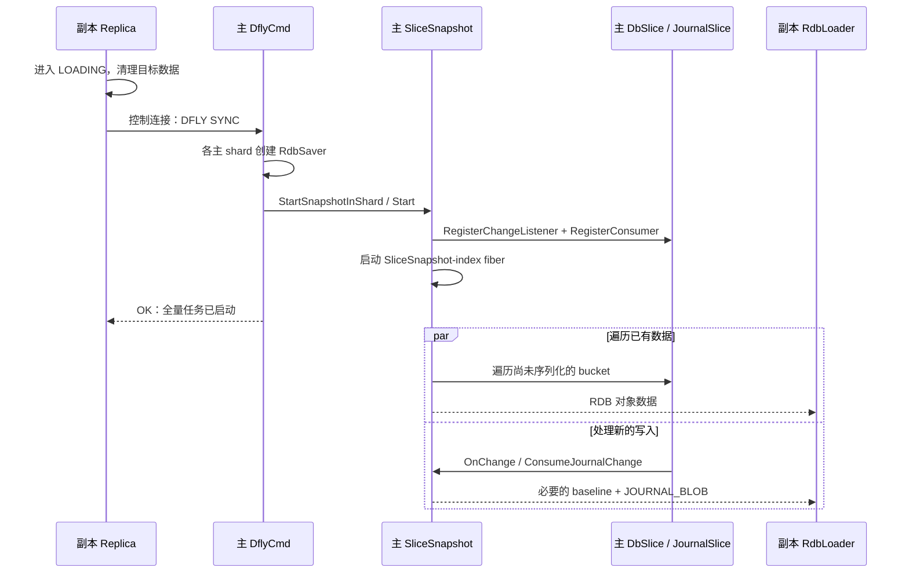

SYNC 的 OK 只表示全量任务已启动。等全量数据真的到达，需要后面的 cut；两件事由不同通知表达。

### 6.3 具体例子：遍历还没到 counter，就来了 INCR

假设 `counter=10`，它所在 bucket 尚未序列化，且没有 tiered value 等额外分支。普通受监听的 mutation 路径如下：

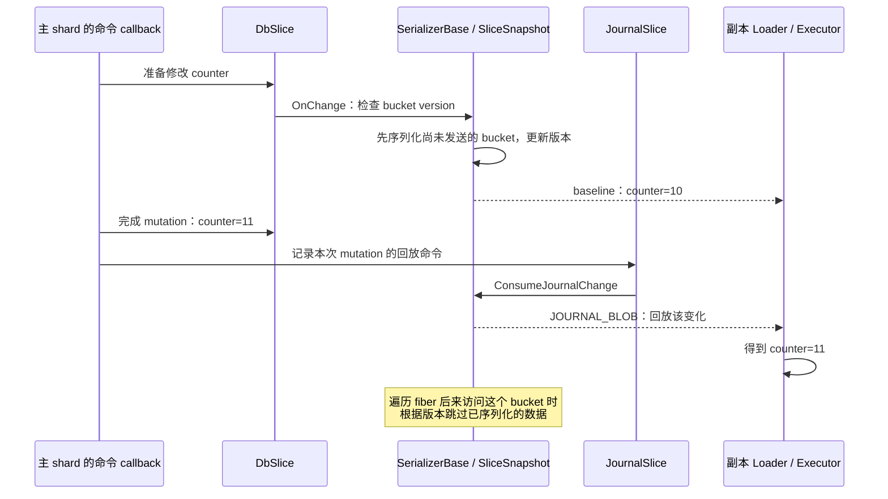

这里要保护的是该 mutation 路径的“基线先于变化”顺序。`ProcessBucket` 的版本判断、bucket 依赖等待和序列化逻辑共同避免重复遍历或未完成的数据被越过；它不是只检查一个全局开关。

源码同时保留 no-point-in-time 流程中“日志先到、后续 baseline 覆盖”的兼容说明，所以 `FullSyncDflyFb` 会设置 `SetOverrideExistingKeys(true)`。不能把这个局部顺序示例扩大为“整个副本在任意瞬间都是主库某一时刻的原子快照”。全量期间副本处于加载过程，完成标准是后面的切换协议。

源码：[serializer_base.cc](../src/server/serializer_base.cc) 的 `OnChange`、`ProcessBucket`；[replica.cc](../src/server/replica.cc) 的 `FullSyncDflyFb`。

### 6.4 关键时序：cut 到了，才请求主节点收尾

```mermaid
sequenceDiagram
  participant S as 主 SliceSnapshot / Saver
  participant L as 副本 flow i 的 RdbLoader
  participant R as 副本 main_replication
  participant D as 主 DflyCmd
  participant J as 主 JournalStreamer
  S-->>L: 遍历完成：FULLSYNC_END
  L->>L: FlushAllShards()
  L->>R: full_sync_cut_cb：sync_block.Dec()
  Note over S,L: cut 后，旧 full-sync 流仍能传 JOURNAL_BLOB
  R->>R: 全部 flow 到 cut，Wait 返回；PerformPostLoad
  R->>D: 控制连接：DFLY STARTSTABLE
  D->>S: 各 shard：StopFullSyncInThread()
  S->>S: Join snapshot，注销旧 Journal consumer
  S-->>L: JOURNAL_OFFSET + RDB EOF/checksum + eof_token
  D->>J: 同一交接流程内 StartStableSyncInThread()
  J->>J: 注册稳定 Journal consumer
  D-->>R: 控制连接：OK
  L->>L: 读完 RDB 尾部与 token，保存 offset / leftover
  R->>R: Join 全量 fibers，完成初始化
  R->>L: 后续启动 shard_stable_sync_read
  J-->>L: 从 leftover + socket 继续读取稳定 Journal
```

**STARTSTABLE 请求先于 offset/EOF token 的最终发送。** 协调 fiber 在所有 flow 的 `FULLSYNC_END` 之后发送请求；主端处理请求才结束旧流并启动新流。控制 socket 与数据 sockets 的消息到达可交错，不能要求副本先把 token 读完才发请求。

`DflyCmd::StartStable` 用 `Transaction::Guard` 包围各 shard 的停止旧流/启动新流操作，参与事务协调；不能把图中的两个函数抽离上下文，理解成任意两个互不保护的独立回调。

源码：[replica.cc](../src/server/replica.cc) 的 `InitiateDflySync`；[dflycmd.cc](../src/server/dflycmd.cc) 的 `StartStable`、`StopFullSyncInThread`；[snapshot.cc](../src/server/snapshot.cc) 的 `FinalizeJournalStream`。

### 6.5 三个边界分别回答不同问题

```mermaid
flowchart TB
  CUT["FULLSYNC_END<br/>这个 flow 的基线遍历已到 cut"]
  OFFSET["JOURNAL_OFFSET<br/>旧流结束处的日志位置"]
  TOKEN["RDB EOF/checksum + eof_token<br/>旧格式的数据流尾部已读完"]
  READ["leftover + socket<br/>交给稳定 JournalReader"]
  CUT -->|"副本汇合所有 cut，发送 STARTSTABLE"| OFFSET
  OFFSET --> TOKEN --> READ
```

- cut 让主协调 fiber 可以推进阶段；它不是整个 TCP 流的结束。
- offset 初始化 `journal_rec_executed_`，用于稳定读取、ACK 和之后续传。
- RDB EOF 与外部协商 token 分开：EOF 属于 RDB 格式，40 字节 token 在 RDB 尾部之后。
- 一次 socket read 可能多读到后续 Journal 字节，因此 `leftover_buf_` 必须交给下一阶段。

### 6.6 两种装载路径，不要混用它们的 barrier

```mermaid
flowchart LR
  RDB["全量 RDB stream"] --> OBJ["普通对象"]
  RDB --> BLOB["JOURNAL_BLOB"]
  OBJ --> LOAD["FlushShardAsync → AddOrUpdate"]
  BLOB --> EXEC["HandleJournalBlob → JournalExecutor"]
  NET["稳定 Journal stream"] --> JR["JournalReader → TransactionReader"]
  JR --> TX["ExecuteTx"]
  TX --> NORMAL["普通命令：直接回放"]
  TX --> GLOBAL["global：MultiShardExecution 会合"]
```

全量内嵌日志没有走稳定读取的 `MultiShardExecution`。例如当前 `HandleJournalBlob` 对 `FLUSHALL/FLUSHDB` 报不支持并让同步中止；不能把稳定阶段的 global barrier 直接套到全量加载中。

<a id="journal-model"></a>

## 7. Journal 日志机制

### 7.1 Journal 整体结构：一份 backlog，多个 consumer

```mermaid
classDiagram
  class JournalSlice {
    lsn_
    ring_buffer_
    journal_consumers_arr_
    max_age_ms_
    max_bytes_
    AddLogRecord()
    CallOnChange()
    CleanEntries()
  }
  class JournalItem {
    lsn
    time_ms
    data
  }
  class JournalConsumerInterface {
    ConsumeJournalChange()
    ThrottleIfNeeded()
  }
  class SliceSnapshot
  class JournalStreamer
  JournalSlice *-- "0..*" JournalItem : ring_buffer_ 保留日志
  JournalSlice --> "0..*" JournalConsumerInterface : 注册回调，借用监听者
  JournalConsumerInterface <|.. SliceSnapshot
  JournalConsumerInterface <|.. JournalStreamer
```

每个主 shard 有自己的 `JournalSlice`。`ring_buffer_` 保存已序列化日志，供重连续传；consumer 接口把新日志送到当前的快照或 streamer。注册 consumer 不会凭空创建一条专用 consumer fiber。

`JournalSlice::Init()` 默认 capacity 8192；真正的保留条件同时受时间和字节上限影响，且容量可在未超过 `max_bytes_` 时按平均 record 大小增长。清理发生在后续写入时，而不是由独立 GC 线程完成。

```mermaid
flowchart TD
  M["一次成功 mutation"] --> W["JournalWriter::Write"]
  W --> I["JournalItem { lsn, time_ms, data }"]
  I --> C["JournalSlice::CallOnChange"]
  C -->|"consumer 1"| SS["SliceSnapshot / JOURNAL_BLOB"]
  C -->|"consumer 2"| JS["JournalStreamer / socket"]
  I --> RB["ring_buffer_ backlog"]
  RB --> EV["按 age / bytes 淘汰"]
```

这张图对应三个不同生命周期，容易混淆的地方也在这里：

| 对象                 | 何时产生                                           | 保存多久                                         | 谁消费                                      |
| -------------------- | -------------------------------------------------- | ------------------------------------------------ | ------------------------------------------- |
| `JournalItem.data` | `JournalSlice::AddLogRecord()` 序列化时          | 先回调 consumer，再进入 backlog                  | full-sync consumer、stable/partial streamer |
| `ring_buffer_`     | 每个 shard 的 Journal 写入后                       | 直到超过时间/字节策略而被`CleanEntries()` 淘汰 | 断线 partial sync                           |
| 网络 pending buffer  | `JournalStreamer::ConsumeJournalChange()` 收到后 | 直到`AsyncWrite()` 完成                        | 当前 replica 的 flow socket                 |

### 7.2 Journal 数据结构表

| 数据结构                       | 字段                                                                           | 语义                                                          |
| ------------------------------ | ------------------------------------------------------------------------------ | ------------------------------------------------------------- |
| `journal::EntryBase`         | `txid, opcode, dbid, slot?, lsn`                                             | 生成端的逻辑记录；LSN 通常由`JournalSlice` 分配。           |
| `journal::Entry`             | `Payload{cmd,args}`                                                          | 非 owning 的 command/参数视图。                               |
| `journal::JournalItem`       | `lsn, time_ms, data`                                                         | backlog 中保存的二进制 journal bytes 及保留时间。             |
| `journal::JournalChangeItem` | `journal_item, cmd, slot?`                                                   | consumer 回调输入；`cmd/slot` 供 `RestoreStreamer` 筛选。 |
| `journal::ParsedEntry`       | `txid, opcode, dbid, slot?, lsn, cmd`                                        | `JournalReader` 解码结果。                                  |
| `FlowInfo`                   | `conn, saver?, streamer?, eof_token, start_partial_sync_at?, last_acked_lsn` | master 单 flow 的生命周期和进度。                             |
| `DflyShardReplica`           | `flow_id, journal_rec_executed_, rdb_loader_, executor_`                     | replica 单 flow 的读取/执行/ACK 状态。                        |

### 7.3 Journal wire record 实际格式

`JournalWriter`/`JournalReader` 是当前源码的唯一格式定义。整数使用 `WritePackedUInt` 的 packed encoding；不是固定 8 字节 little-endian。

逻辑格式如下（字段顺序与 `JournalWriter::Write(const Entry&)` 一致）：

```text
+----------------------+  可选：SELECT opcode + dbid（db 切换时自动注入）
| opcode (packed u8)   |  SELECT=6, COMMAND=10, PING=13, LSN=15
+----------------------+
| COMMAND: txid        |  packed u64
| COMMAND: reserved    |  packed u32，当前写入值 1，兼容旧格式
| num_strings          |  packed u64，等于 1 + 参数个数
| cmd_size             |  packed u64，命令名和参数原始字节总和
| len(cmd) + cmd bytes |
| len(arg0)+arg0 bytes |
| ...                  |
+----------------------+
```

不同 opcode 的实际字段：

| opcode         | 当前源码字段                                                                                |
| -------------- | ------------------------------------------------------------------------------------------- |
| `SELECT=6`   | packed`dbid`；`JournalReader` 更新内部 `dbid_` 后递归读取下一条。                     |
| `COMMAND=10` | packed`txid`、packed 保留字段、command payload。                                          |
| `PING=13`    | 无 payload。                                                                                |
| `LSN=15`     | packed`lsn`；用于稳定流周期性进度标记，不增加 master Journal LSN。                        |
| `EXPIRED=9`  | 枚举仍存在，但`JournalWriter` 当前不写该 opcode，`TransactionData` 仍保留兼容解析分支。 |

**当前格式中没有的字段**：每条 record 没有独立 timestamp、checksum、record length、version、shard id。timestamp 只在内存 `JournalItem::time_ms` 中用于淘汰；shard 由 socket/flow 隐含；checksum 属于外层 RDB footer（当前 `SendEofAndChecksum()` 写 0），不属于 Journal record。

### 7.3.1 Journal 在 RDB full-sync stream 中的外层封装

`RdbSerializer::WriteJournalEntry()` 和 `RdbLoaderBase::HandleJournalBlob()` 定义了当前外层结构：

```text
RDB_OPCODE_JOURNAL_BLOB = 210
    packed num_entries       // 当前 WriteJournalEntry 写入 1
    RDB string               // packed length + journal blob bytes

RDB_OPCODE_JOURNAL_OFFSET = 211
    uint64 little-endian journal_offset

RDB_OPCODE_FULLSYNC_END = 200
    8 bytes zero padding
```

full-sync stream 本身以 `REDIS%04d` magic 开始，AUX 字段之后是对象 opcode/数据、Journal blob 和 Dragonfly extensions，最后是 `RDB_OPCODE_EOF` + 8-byte checksum（当前写 0）。上述 `210/211/200` 只是在 RDB byte stream 中的扩展 opcode，不应与 `journal::Op::COMMAND=10` 混淆。

```mermaid
flowchart TB
  O["Full-sync RDB stream"] --> H["REDIS magic + AUX"]
  H --> B["RDB object baseline"]
  B --> JB["RDB_OPCODE_JOURNAL_BLOB = 210"]
  JB --> JR["inner Journal records: SELECT / COMMAND / PING / LSN"]
  JR --> CUT["RDB_OPCODE_FULLSYNC_END = 200"]
  CUT --> TAIL["仍可有 JOURNAL_BLOB<br/>等 STARTSTABLE 结束旧 consumer"]
  TAIL --> OFF["RDB_OPCODE_JOURNAL_OFFSET = 211"]
  OFF --> EOF["EOF + checksum field"]
```

| 层次               | 负责什么                                    | 不能与什么混为一谈                |
| ------------------ | ------------------------------------------- | --------------------------------- |
| 外层 RDB           | 传输 baseline、full-sync 边界、tagged chunk | 不是 Journal record 本身          |
| `JOURNAL_BLOB`   | 把一段 Journal bytes 嵌入 RDB stream        | 不是新的 Journal opcode           |
| 内层 Journal       | 传输 command、SELECT、PING、LSN             | 没有独立 checksum/length/shard id |
| `JOURNAL_OFFSET` | 宣告进入 stable 前的 per-flow LSN           | 不是一个要回放的 mutation         |

### 7.4 真实逻辑示例

以下示例不是伪造的二进制，而是对源码字段的逻辑展开：

```text
Entry {
  txid   = 42
  opcode = COMMAND (10)
  dbid   = 0
  slot   = 123
  payload.cmd  = "SET"
  payload.args = ["user:100", "Alice"]
}

JournalWriter bytes (逻辑字段，不展示 packed UInt 的具体字节)：
  [opcode=10]
  [txid=42]
  [reserved=1]
  [num_strings=3]
  [cmd_size=16]
  [len=3,  "SET"]
  [len=8,  "user:100"]
  [len=5,  "Alice"]

JournalSlice 保存：
  JournalItem { lsn = 17, time_ms = <write time>, data = 上述二进制串 }
```

如果 `dbid` 从上条记录变化，`JournalWriter` 会先写 `[SELECT=6][dbid]`，该 SELECT 不会单独增加 `JournalSlice` 的 LSN；同一个 `JournalItem.data` 可以包含 SELECT 和 COMMAND 两个逻辑 entry。

### 7.5 Journal 生成、缓存与生命周期

```mermaid
flowchart TD
  A["mutation callback finished"] --> B{"explicit journal?"}
  B -->|yes| C["RecordJournal"]
  B -->|no| D["LogAutoJournalOnShard"]
  C --> E["journal::RecordEntry"]
  D --> E
  E --> F["JournalSlice::AddLogRecord"]
  F --> G["assign LSN and serialize"]
  G --> H["notify consumers"]
  H --> I["push ring buffer"]
  I --> J["evict by age or bytes"]
```

`JournalSlice::CallOnChange()` 先向 consumer 回调，再把 item 放进 ring buffer。这样 consumer 可以直接写 socket；若 consumer 因 backpressure 阻塞，写入路径也会受到 `ThrottleIfNeeded()` 的反馈。`JournalSlice::SetFlushMode(false)`/`DisableFlushGuard` 用于在一组 record 内禁止中途 flush/preemption，恢复时统一触发 throttle。

## 8. Stable Sync：日志怎样发送，ACK 怎样返回

### 8.1 一条 flow 中有两条方向相反的链路

```mermaid
sequenceDiagram
  participant C as 主节点命令 callback
  participant J as 主 JournalSlice
  participant S as 主 JournalStreamer
  participant R as 副本 shard_stable_sync_read
  participant A as 副本 shard_acks
  participant F as 主 flow Connection / FlowInfo
  C->>J: RecordEntry：序列化并分配 LSN
  J->>S: ConsumeJournalChange(item)
  S->>S: pending_buf_.Push + 尝试 AsyncWrite
  S-->>R: flow socket：Journal bytes
  R->>R: JournalReader → TransactionReader
  R->>R: ExecuteTx；成功后 executed 进度加 1
  R->>A: 唤醒 ACK 等待条件
  A->>F: 同一 flow socket：REPLCONF ACK 进度
  F->>F: 更新 last_acked_lsn
```

读取 fiber 负责回放命令，ACK fiber 读取成功回放后的进度并发送确认。它们共享一个 `DflyShardReplica` 和一条 flow socket，不是一条命令新建一个 fiber。

主节点普通写命令不等待副本 ACK 才完成。ACK 用来观察复制落后程度，并服务显式等待/接管等流程；网络反压则可能让主节点写路径挂起，两者应分开理解。

### 8.2 consumer 是回调对象，发送由缓冲与异步 I/O 推进

```mermaid
flowchart TB
  START["StartStableSyncInThread<br/>创建 JournalStreamer"] --> REG["Start：注册 Journal consumer"]
  REG --> IN["新 Journal 回调<br/>ConsumeJournalChange"]
  IN --> BUF["Write：进入 pending_buf_"]
  BUF --> BUSY{"已有 in-flight write？"}
  BUSY -->|"有"| WAIT["保留 FIFO 缓冲<br/>完成回调后再发送"]
  BUSY -->|"无"| SMALL{"未达到发送阈值？"}
  SMALL -->|"是"| TIMER["periodic writer<br/>稍后强制发送小批次"]
  SMALL -->|"否"| SEND["AsyncWrite"]
  TIMER --> SEND
  SEND --> DONE["OnCompletion<br/>清 in-flight，弹出已发缓冲"]
  DONE --> BUSY
```

同一个 flow 只保留一个 in-flight write，防止后写的字节越过前一批。`replication_dispatch_threshold` 默认 1500 bytes，配合周期 writer，兼顾批量发送和小流量延迟。

`ConsumeJournalChange` 会在有记录到来且时间条件满足时追加 `LSN` 校验记录（源码判断与上次相隔超过约 3 秒），不能把它理解为“空闲时每 3 秒必发”。这个额外校验记录不增加主 Journal 的 LSN。

源码：[streamer.cc](../src/server/journal/streamer.cc) 的 `Start`、`Write`、`AsyncWrite`、`OnCompletion`、`StalledDataWriterFiber`。

### 8.3 慢副本如何把压力传回来

```mermaid
flowchart LR
  NET["副本读得慢 / 网络拥塞"] --> BUF["该 flow pending bytes 增长"]
  BUF --> LIMIT{"达到 output limit？"}
  LIMIT -->|"是"| TH["Journal consumer 的 ThrottleIfNeeded"]
  TH --> SUSP["调用方 fiber 等待缓冲下降<br/>可影响主 shard 写入延迟"]
  SUSP --> TIME{"超时前恢复？"}
  TIME -->|"恢复"| GO["继续写入与发送"]
  TIME -->|"超时"| ERR["ExecutionState 报错<br/>取消该复制会话"]
```

每个副本的每个 flow 有独立 streamer/缓冲，但这不等于“慢副本完全不影响其它客户端”。`JournalSlice` 会调用 consumer 的 `ThrottleIfNeeded`，所以压力可以传回当前主 shard 的写路径；挂起的是 fiber，底层线程仍可运行其它就绪 fiber。

关键配置是 `replication_stream_output_limit` 与 `replication_timeout`。backlog 则是另一份缓冲，专门支持断线续传，见第 12 章。

### 8.4 具体例子：LSN=17 执行完后，为什么 ACK 可以是 18

下图假设稳定边界的进度为 17，并且接下来是一条 COMMAND：

```mermaid
flowchart LR
  M["主：分配记录 LSN=17<br/>GetLsn 随后为 18"] --> R["副本：执行这条 COMMAND"]
  R --> OK{"执行成功？"}
  OK -->|"是"| INC["journal_rec_executed_<br/>17 → 18"]
  INC --> ACK["shard_acks 发 ACK 18<br/>续传时请求从 18 开始"]
  OK -->|"取消 / 未成功"| KEEP["不前进<br/>不能跳过未完成的记录"]
```

`journal_rec_executed_` 是“初始 offset + 成功处理的记录数”，初始值为 1；在正常顺序流里，可把它看成**下一条想接收的位置**，不是“刚执行完那条记录的编号”。源码注释也提醒它按执行计数推进，不能在所有乱序情形下简单等同于某条输入记录的字段。

`COMMAND` 成功后进度加 1；`PING` 也推进计数，并促使 ACK；`LSN` 只校验、不推进。ACK 的发送由 `replication_acks_interval`、记录数阈值（当前判断为超过上次 ACK 1024 条）或 PING 触发。

源码：[replica.cc](../src/server/replica.cc) 的 `StableSyncDflyReadFb`、`StableSyncDflyAcksFb`；[tx_executor.cc](../src/server/journal/tx_executor.cc) 的 `NextTxData`。

## 9. Journal Replay：由哪个 fiber 执行，怎样修改数据

### 9.1 先看函数层次：只有读/执行完成，才进入下一轮

```mermaid
flowchart TB
  F["shard_stable_sync_read fiber"]
  F --> R["JournalReader::ReadEntry<br/>解码 wire bytes"]
  R --> T["TransactionReader::NextTxData<br/>整理 TransactionData，校验位置"]
  T --> OP{"opcode"}
  OP -->|"LSN"| CHECK["只检查位置"]
  OP -->|"PING"| PING["推进进度 / 提醒 ACK"]
  OP -->|"COMMAND"| EX["DflyShardReplica::ExecuteTx"]
  EX --> GLOBAL{"IsGlobalCmd？"}
  GLOBAL -->|"否"| EXEC["JournalExecutor::Execute"]
  GLOBAL -->|"是"| BARRIER["MultiShardExecution<br/>会合后选一个 flow 执行"]
  BARRIER --> EXEC
  EXEC --> SERVICE["Service::DispatchCommand<br/>ONLY_SYNC"]
  SERVICE --> TX["本地 Transaction / shard 路由"]
  TX --> DB["目标 EngineShard / DbSlice"]
```

`ONLY_SYNC` 表示调用者要等本次 dispatch 返回；内部仍可能跨 shard 调度、挂起当前 fiber。它既不保证“数据只在 flow 所在线程修改”，也不表示执行期间禁止协程切换。

`JournalExecutor` 创建的上下文带 `is_replicating=true`、`journal_emulated=true`、`skip_acl_validation=true`，并使用 `CapturingReplyBuilder(ReplyMode::NONE)`。它复用命令实现来回放数据，无需给上游返回每条命令的普通客户端响应。

### 9.2 具体例子：两个 flow 都收到 txid=42 的 FLUSHALL

```mermaid
sequenceDiagram
  participant F0 as flow 0 的读取 fiber
  participant X as MultiShardExecution：txid=42
  participant F1 as flow 1 的读取 fiber
  participant DB as 副本 Service / 所有目标 shard
  F0->>X: 首次插入，block.Dec()
  F0->>X: block.Wait()：等待其它 flow
  F1->>X: 找到同项，block.Dec()
  Note over F0,F1: 所有 flow 到达，block 放行
  F0->>X: 第一次 barrier.Wait()
  F1->>X: 第一次 barrier.Wait()
  Note over F0,F1: 执行前会合完成
  F1->>X: 第二次 barrier.Wait()：等执行结束
  F0->>DB: 插入者执行一次 FLUSHALL
  DB-->>F0: 执行完成
  F0->>X: 第二次 barrier.Wait()
  Note over F0,F1: 两者才可以处理后续记录
  F0->>X: counter 减 1
  F1->>X: counter 减 1；最后离开的 flow 擦除项
```

图中假设 flow 0 先插入，所以它执行命令；实际执行者由 `InsertTxToSharedMap` 的插入结果决定。当前 `IsGlobalCmd` 只识别 `FLUSHDB`、`FLUSHALL` 和 `DFLYCLUSTER FLUSHSLOTS`。

普通 `SET`、`HSET` 或拆分后的跨 shard 命令不进入这套全 flow barrier。`txid` 相同本身不足以让副本自动恢复一个完整的 MULTI/EXEC 事务。

源码：[replica.cc](../src/server/replica.cc) 的 `ExecuteTx`；[tx_executor.cc](../src/server/journal/tx_executor.cc) 的 `InsertTxToSharedMap`、`IsGlobalCmd`。

### 9.3 回放与本地 Journal、过期删除

```mermaid
flowchart LR
  M["上游 Master"] --> R["当前副本：接收并回放"]
  R --> DATA["更新当前副本数据"]
  DATA --> J["若本地 Journal 已启用<br/>命令路径可产生本地日志"]
  J --> SUB["当前副本的下游副本"]
```

`journal_emulated` 是回放上下文标记，不能据此断言“永远不写本地 Journal”。级联复制、接管与相关配置可能开启本地 Journal；`StartJournalAtOwnLSN` 用于延续进度，稳定读取也专门处理本地 Journal 的 PING。应按实际命令路径和本地 Journal 是否启用判断。

TTL 仍要按具体操作理解：RDB loader 可丢弃过期对象，主节点过期删除可记录为 `DEL`，`PEXPIREAT` 等回放命令也由命令实现处理。这里复用数据库更新逻辑，不能笼统称为“关闭所有过期逻辑与回调”。

## 10. Transaction 与 Journal

### 10.1 Transaction 模型

`transaction.h` 说明：MULTI/EVAL 在同一个 `Transaction` 上复用接口，执行时反复 `MultiSwitchCmd` → `InitByArgs` → command callback；原子模式包括 `LOCK_AHEAD`/`GLOBAL`，另有 `NON_ATOMIC` 和 multi squashing。

```mermaid
flowchart LR
  A["MULTI"] --> B["queue commands"]
  B --> C["EXEC validates WATCH, keys and mode"]
  C --> D["Transaction::StartMulti*"]
  D --> E["MultiSwitchCmd + InitByArgs"]
  E --> F["ScheduleInternal"]
  F --> G["shard mutation"]
  G --> H["RecordJournal or auto journal"]
  H --> I["one JournalSlice per shard"]
  I --> J["replica flow"]
```

| 客户端阶段                  |  Master 是否改数据 | 是否产生 Journal COMMAND | Replica 侧对应动作                 |
| --------------------------- | -----------------: | -----------------------: | ---------------------------------- |
| `MULTI`                   |                 否 |                       否 | 不会收到`MULTI` Journal record   |
| 队列中的`SET/INCR/HSET`   |           暂不执行 |                       否 | 只保存在`StoredCmd` 队列         |
| `EXEC` 调度               |       开始执行队列 | 由每条成功 mutation 决定 | 按 flow 收到最终 mutation command  |
| 显式`RecordJournal()`     | 是/已完成 mutation |                       是 | `JournalExecutor` 重放该 command |
| `LogAutoJournalOnShard()` |   是/成功 callback |                       是 | 用`txid` 保留关联信息            |
| 失败 mutation               |     未形成成功状态 | 自动 journaling 路径跳过 | Replica 不会重放这条失败命令       |

### 10.1.1 事务与 Journal 的最小闭环

```mermaid
flowchart TD
  Q["StoredCmd 队列"] --> E["Service::Exec"]
  E --> TX["Transaction::MultiSwitchCmd"]
  TX --> SH["对应 shard callback"]
  SH --> OK{"mutation 成功?"}
  OK -->|"否"| SKIP["不写 auto Journal"]
  OK -->|"是"| REC["RecordJournal / LogAutoJournalOnShard"]
  REC --> CMD["COMMAND record + txid"]
  CMD --> REPLAY["Replica JournalExecutor"]
```

### 10.2 MULTI/EXEC 是否立即写 Journal？

- `Service::Multi()` 只把 `exec_info.state` 设为 `EXEC_COLLECT` 并回复 OK，不执行 mutation，也没有 `RecordEntry` 调用。
- 队列阶段 `StoreInMultiBlock()` 只保存 `StoredCmd`，并累计 `exec_info.is_write`。
- `Service::Exec()` 在校验 WATCH、跨 DB、CROSSSLOT 后决定 multi mode，执行队列，最后清理/解锁。
- 具体命令在 shard callback 完成后进入 `Transaction::LogAutoJournalOnShard()`（`transaction.cc:718-721`），或者命令实现显式调用 `RecordJournal()`。

所以 **MULTI 和 EXEC 控制帧不作为 Journal COMMAND 写入**；成功 mutation 产生 command record，失败的 command 在 auto-journal 路径中因 `result.status != OpStatus::OK` 被跳过。

```mermaid
sequenceDiagram
  participant C as Client
  participant S as Service
  participant T as Transaction
  participant SH as EngineShard
  participant J as JournalSlice
  participant R as Replica flow
  C->>S: MULTI
  S->>S: exec_info = EXEC_COLLECT
  S-->>C: OK
  C->>S: SET, INCR, HSET
  S->>S: StoreInMultiBlock
  S-->>C: QUEUED
  C->>S: EXEC
  S->>T: StartMulti* + MultiSwitchCmd per command
  T->>SH: ScheduleInternal / shard callback
  SH->>SH: mutate DbSlice
  SH->>J: RecordJournal or LogAutoJournalOnShard
  J-->>R: command record carrying txid
  R->>R: JournalReader -> ExecuteTx
  S-->>C: EXEC result array
```

### 10.3 txid 能关联记录，但没有 BEGIN/COMMIT 帧

```mermaid
flowchart LR
  TX["主节点 Transaction<br/>txid=42"] --> A["主 shard 0 的 COMMAND<br/>txid=42"]
  TX --> B["主 shard 1 的 COMMAND<br/>txid=42"]
  A --> F0["副本 flow 0 独立回放"]
  B --> F1["副本 flow 1 独立回放"]
  F0 -.-> LIMIT["普通 COMMAND：没有通用跨 flow 提交点"]
  F1 -.-> LIMIT
```

当前 Journal opcode 包括 `SELECT/EXPIRED/COMMAND/PING/LSN`，没有独立 `BEGIN/COMMIT`。同一主事务可以给多个记录附上同一个 txid，但当前副本只对 `IsGlobalCmd()` 识别的命令按 txid 会合。

所以要区分“主节点如何原子调度事务”和“副本在中间时刻能否原子看到整个事务”。ACK 是各 flow 的追赶进度，也不会补出一个通用事务提交协议。

### 10.4 显式 command journaling 与 command squashing

命令族中很多 mutation 在 `src/server/*_family.cc` 调用 `RecordJournal(op_args, ...)`，写入的是回放所需的最终命令/参数，例如 `SET`、`MSET`、`SADD`、`HSET`、`RESTORE`、`PEXPIREAT`、`DEL`。`Transaction::LogAutoJournalOnShard()` 只对 `CommandId::IsJournaled()` 且成功的命令自动记录，并对多 shard command 使用 `GetShardArgs(shard_id)`，避免把不属于该 shard 的 key 发送到该 flow。

Multi command squasher 可把多个 single-shard command 合并执行，但 `Transaction::RunSquashedMultiCb()` 仍在 callback 后调用 `LogAutoJournalOnShard()`；因此 squashing 改变调度/批处理，不改变“成功 mutation 才进 Journal”的原则。

### 10.5 Lua

`Service::EvalInternal()` 创建 `ScriptInfo`，根据脚本 keys 推导 `MultiMode`，可能走 single-shard squash 或多 shard transaction。脚本通过 `CallFromScript()` dispatch 内部 Redis commands；这些 command 的 family 实现调用 `RecordJournal()`，而 `EVAL` 本身在 command registry 中是 `NOSCRIPT|VARIADIC_KEYS`，不是普通 `JOURNALED` mutation。

因此当前源码支持的安全表述是：**Lua 写操作以脚本内部实际 mutation command 的 Journal 记录为主，而不是把 Lua 字节码作为一个特殊 Journal opcode。** 脚本执行失败时，已经成功并显式记录的前序 mutation 是否保留取决于脚本所处 multi mode；源码没有一个统一的 `SCRIPT_BEGIN/ROLLBACK` Journal record。

### 10.6 多 Key / 跨 shard

- 普通跨 shard command 在 master 的 transaction scheduler 中按 shard callback 执行，每个 shard 的 Journal 只携带本 shard args。
- `txid` 保留跨 shard 关联。
- `DflyShardReplica::ExecuteTx()` 只有 `TransactionData::IsGlobalCmd()`（`FLUSHDB`、`FLUSHALL`、`DFLYCLUSTER FLUSHSLOTS`）进入 `MultiShardExecution` 的 block/barrier。
- 对其它跨 shard command，源码没有在 `ExecuteTx()` 中建立同样的全 flow barrier；其一致性来自 master 调度、每 shard Journal 顺序以及最终所有 flow 都消费到相应 txid record。

这一区别必须保留：不能把“每个 Redis MULTI 都在 replica 上重新构造一个完整事务”写成当前实现事实。replica 是按 Journal command 回放，只有 global command 有明确的跨 flow rendezvous。

### 10.7 事务调用链表

| 阶段     | 类/函数                                                                     | 文件                                  | 事实                                                |
| -------- | --------------------------------------------------------------------------- | ------------------------------------- | --------------------------------------------------- |
| MULTI    | `Service::Multi`                                                          | `src/server/main_service.cc:2001`   | 设置`EXEC_COLLECT`，不写 Journal。                |
| 入队     | `StoreInMultiBlock`                                                       | `src/server/main_service.cc:900`    | 保存`StoredCmd`、标记是否含 write。               |
| EXEC     | `Service::Exec`                                                           | `src/server/main_service.cc:2562`   | WATCH/CROSSSLOT/mode 校验并驱动执行。               |
| 模式     | `Transaction::StartMultiGlobal/StartMultiLockedAhead/StartMultiNonAtomic` | `src/server/transaction.cc:447-482` | 初始化 multi mode。                                 |
| 切命令   | `Transaction::MultiSwitchCmd`                                             | `src/server/transaction.cc:488`     | 更新 command、清理 shard args、递增序号。           |
| 调度     | `Transaction::ScheduleInternal`                                           | `src/server/transaction.cc:731`     | 将 hop 调度到 shard。                               |
| 自动日志 | `Transaction::LogAutoJournalOnShard`                                      | `src/server/transaction.cc:1613`    | 成功 mutation 后形成 payload。                      |
| 写日志   | `Transaction::LogJournalOnShard`                                          | `src/server/transaction.cc:1651`    | 调用`journal::RecordEntry(txid_, COMMAND, ...)`。 |
| 显式日志 | `RecordJournal`                                                           | `src/server/tx_base.cc:55`          | 命令实现写最终 mutation command。                   |
| 回放     | `DflyShardReplica::ExecuteTx`                                             | `src/server/replica.cc:1242`        | 单 shard 直接执行，global command 做 flow barrier。 |

<a id="resync"></a>

## 11. 三种同步方式怎样选择

```mermaid
flowchart TD
  R["建连时给各 flow 携带旧进度"] --> C["主节点分别检查该 flow 的 backlog"]
  C --> ALL{"副本汇总所有 FLOW 响应"}
  ALL -->|"全 FULL"| F["清理目标数据<br/>RDB baseline + 期间日志"]
  F --> CUT["所有 cut → STARTSTABLE<br/>读 offset / RDB 尾部"]
  CUT --> S["Stable：持续读新 Journal"]
  ALL -->|"全 PARTIAL"| P["STARTSTABLE<br/>从各自进度补 backlog"]
  P --> LIVE["追到当前位置，注册实时 consumer"]
  LIVE --> S
  ALL -->|"混合 FULL / PARTIAL"| E["拒绝混合初始化<br/>取消本轮并重新协商"]
```

Full 需要数据基线；Partial 使用已有基线补缺口；Stable 描述后续持续跟进。主端响应 PARTIAL 还不等于追赶已经完成，传输途中也可能因 backlog 丢失而失败。

| 路径    | 数据来源               | 副本执行对象                | 进入持续跟进前的条件                       |
| ------- | ---------------------- | --------------------------- | ------------------------------------------ |
| Full    | RDB 对象与内嵌 Journal | RdbLoader / JournalExecutor | 所有 cut、STARTSTABLE 交接、读完旧格式尾部 |
| Partial | 各主 shard 的 backlog  | JournalReader / ExecuteTx   | 连续补到当前 LSN，并注册实时 consumer      |
| Stable  | 新产生的 Journal       | JournalReader / ExecuteTx   | 持续执行并推进每 flow ACK                  |

## 12. 断连与重同步：拿进度去找缺少的日志

### 12.1 先看进度保存在谁身上

```mermaid
flowchart LR
  F0["flow 0<br/>JournalExecutedCount = 18"] --> V["Replica.last_journal_LSNs_<br/>示例：[18, 31]"]
  F1["flow 1<br/>JournalExecutedCount = 31"] --> V
  V --> RE["同一 Replica 重连<br/>各 flow 带自己的请求 LSN"]
  V --> STOP["Stop 返回 LastMasterSyncData<br/>id 为 lineage_id，另带 LSN vector"]
  STOP --> SF["ServerFamily.last_master_data_<br/>后续复制初始化使用"]
```

`ConsumeDflyStream` 错误处理会取消其它 flows 和 global 等待实体，等待 flow 停止后保存进度。保存的是已执行进度，不是 socket 已读字节数，避免把收到但未执行的数据误当成完成。

本图数字是第 8.4 节的计数约定：例如进度 18 表示重连续传从 18 请求。不同 flow 的 18 和 31 不需要相等。

### 12.2 具体例子：请求 18，主端还留着 15 到 22

```mermaid
flowchart LR
  OLD["已淘汰：1..14"] -.-> BUF["backlog 保留：15..22<br/>GetLsn = 23"]
  REQ["副本请求：18"] --> CHECK{"18 在 backlog 中？"}
  BUF --> CHECK
  CHECK -->|"在"| PART["PARTIAL：发送 18..22"]
  PART --> POS["下一位置 = 23"]
  POS --> REG["确认追到 GetLsn<br/>注册实时 consumer"]
  REG --> LIVE["之后产生 23、24…<br/>由回调持续发送"]
```

另两个结果也很直观：请求 23 时已经追上，可以直接接实时流；请求 14 时缺少的记录已被淘汰，主端选择 FULL。

实际条件是 `GetLsn() == requested_lsn || IsLSNInBuffer(requested_lsn)`。内存 backlog 同时受时间和字节策略影响，配置为 `shard_repl_backlog_time_ms` 与 `shard_repl_backlog_max_bytes`。

### 12.3 Partial 的传输：先追旧记录，再监听新记录

```mermaid
sequenceDiagram
  participant R as 副本 Replica / flow
  participant D as 主 DflyCmd
  participant S as 主 JournalStreamer
  participant J as 主 JournalSlice
  R->>D: 各数据连接：DFLY FLOW ... requested_lsn
  D->>J: IsLSNInPartialSyncBuffer
  D-->>R: PARTIAL + 协商 token
  Note over R: 确认全部 flow 都是 PARTIAL
  R->>D: 控制连接：DFLY STARTSTABLE
  D->>S: StartStableSyncInThread
  S->>S: Start：暂不注册实时 consumer
  D-->>R: OK
  loop periodic writer 的 MaybePartialStreamLSNs
    S->>J: GetEntry(lsn)
    S-->>R: 顺序发送 backlog
  end
  S->>J: 确认本地游标等于当前 GetLsn
  S->>J: RegisterConsumer
  J->>S: 后续写入的回调
  S-->>R: 新记录
```

确认“追到当前位置”和注册 consumer 在主 shard 的执行上下文中衔接，保护 backlog 与实时通知之间不漏记录。若追赶时日志又被淘汰，游标无法追上 `GetLsn`，`MaybePartialStreamLSNs` 会报告错误，不能跳过缺口继续宣称同步成功。

### 12.4 FULL、混合响应、换主，分别怎样处理

```mermaid
flowchart TB
  RESP["各 flow 握手结果"] --> TYPE{"汇总"}
  TYPE -->|"全 FULL"| F["清理目标数据 → DFLY SYNC"]
  F --> CUT["收到所有 FULLSYNC_END"]
  CUT --> REQ["发送 STARTSTABLE"]
  REQ --> TAIL["主端收尾旧流<br/>offset + RDB EOF + token"]
  TAIL --> S["副本 Join 全量 fibers<br/>进入稳定读取"]
  TYPE -->|"全 PARTIAL"| P["走 12.3 的补日志路径"]
  TYPE -->|"一部分 FULL"| ERR["拒绝混合初始化<br/>报告错误并清理"]
```

换主时还要检查身份，不能只比较数字：

- 同一直接上游使用单 flow 的 `[lsn]`；上游 repl id 变化时旧进度按当前协商逻辑清理，或由 `break_replication_on_master_restart` 中止。
- VER5+ 的相关换主/级联路径可携带 `[last_master_id lsn-vec]`，主端校验 lineage 等条件后才选择对应位置。
- `LastMasterSyncData` 的 vector 长度不匹配新 flow 数时丢弃这份续传依据；“新旧数量不同”本身不能用取模补出有效 LSN。
- 级联复制受到 `experimental_cascaded_partial_sync` 等配置限制。协议能力与当前开关必须同时满足。

源码：[replica.cc](../src/server/replica.cc) 的 `ConsumeDflyStream`、`InitiateDflySync`、`StartSyncFlow`；[dflycmd.cc](../src/server/dflycmd.cc) 的 `Flow`；[streamer.cc](../src/server/journal/streamer.cc) 的 `MaybePartialStreamLSNs`。

## 13. Tagged Chunks 复制机制

### 13.1 当前实现

`serialization_tagged_chunks` 默认 `true`（`src/server/snapshot.cc:33-34`）。`SliceSnapshot::Start()` 仅在 `SnapshotFlush::kAllow` 的 replication flow 中调用 `serializer_->SetTagEntries(flag)`。`MemBufController` 为跨 flush 的 data entry 分配 `EntryId`，tag header 是：

```text
[RDB_OPCODE_TAGGED_CHUNK: 1 byte = 224]
[stream_id: 4 bytes little-endian uint32]
[payload_length: 4 bytes little-endian uint32]
[payload bytes]
```

这 9 字节 envelope 与 Journal record 格式无关，属于 RDB snapshot stream framing。

### 13.2 Loader 重组

`RdbLoaderBase::ActiveTaggedChunk` 保存当前 stream id 和剩余 payload；`RdbLoader::StreamState` 保存首 chunk 的 key、db、object type、pending read 和 settings。首 chunk 包含正常 RDB object type/key；后续 chunk 只有 payload。`LoadKeyValPair()` 在首 chunk 未完成时把状态存入 `stream_states_`，`LoadValueChunk()` 按 stream id 继续，最终 `CreateObjectOnShard()` 完成对象。

```mermaid
flowchart LR
  O["大型 RDB object"] --> C1["首 chunk：opcode + stream_id + length + object header"]
  C1 --> C2["后续 chunk：stream_id + length + payload"]
  C2 --> C3["RdbLoader::ActiveTaggedChunk"]
  C3 --> C4["RdbLoader::StreamState"]
  C4 --> C5["LoadValueChunk"]
  C5 --> C6["CreateObjectOnShard"]
```

| 读取状态        | Loader 保存什么                | 结束条件                                   |
| --------------- | ------------------------------ | ------------------------------------------ |
| 首 chunk 未完成 | key、db、object type、settings | 收到该 stream 的剩余 payload               |
| 后续 chunk      | `stream_id`、剩余长度        | 当前 chunk payload 消费完                  |
| 对象完成        | 组装后的 value/object          | `CreateObjectOnShard()` 投递到目标 shard |

### 13.3 新旧格式对比

| 维度         | 未启用 tagged chunks                                | 当前 tagged chunks                                                                                                                            |
| ------------ | --------------------------------------------------- | --------------------------------------------------------------------------------------------------------------------------------------------- |
| 大对象 flush | 依赖 entry 不被拆分或使用 legacy buffer 约束        | entry 可跨多个 flush，后续片段有 stream id/长度。                                                                                             |
| 并发/交错    | `SerializerBase::stream_mu_` 需要保持逻辑流不交错 | envelope 让 loader 可按 id 恢复；源码注释仍强调 DEL 不能在对象 baseline 尚未完成时语义性地插入。是否实际加锁取决于`OptionalMutex` 与 flag。 |
| wire header  | 普通 RDB opcode                                     | 多出`224 + id + length`。                                                                                                                   |
| replica 重组 | 直接按 RDB parser 顺序                              | `stream_states_` 保存每个未完成对象。                                                                                                       |
| 兼容开关     | `serialization_tagged_chunks=false`               | 测试`replication_test.py` 与 `replication_specific_test.py` 同时覆盖 true/false。                                                         |

**不能从源码得出的结论**：当前代码没有证明 tagged chunks 会“减少 shard-wide lock”或必然改善 P99；能确认的是它允许大型 entry 分段、支持交错 buffer 解析，并减少大对象一次性内存压力。

## 14. 多 shard 并行复制与一致性

### 14.1 并行点

- `InitiateDflySync()` 在 `shard_set->pool()->AwaitFiberOnAll` 中启动所有 flow。
- 每个 master flow 的 `RdbSaver` 归属该 shard，写自己的 socket。
- replica 用 `thread_flow_map_` 将 flow fiber 分配到本地 proactor。
- Journal/ACK/lag 都是 per-shard。

### 14.2 顺序保证层次

```mermaid
flowchart TB
  A["同一主 shard 的 Journal"] --> B["LSN 顺序"]
  B --> C["同一 flow 的 FIFO 网络写"]
  C --> D["副本 stable_read 顺序回放"]
  D --> E["成功后推进 executed LSN"]
  E --> F["ACK 给主 FlowInfo"]
  G["global command 的同一 txid"] --> H["所有 flow 到齐"]
  H --> I["barrier 前会合"]
  I --> J["一个 flow 执行"]
  J --> K["barrier 后再处理后续"]
```

这张图把两条规则分开：普通记录靠单 shard Journal 和单 flow FIFO 保序；global command 额外依靠跨 flow barrier。不能因为两类记录都带 txid，就把它们当成同一种同步机制。

| 层次               | 保证方式                                                                                 |
| ------------------ | ---------------------------------------------------------------------------------------- |
| 单 shard Journal   | `JournalSlice::lsn_++`、`CallOnChange` 顺序、ring buffer 连续 LSN。                  |
| 同一 flow 网络     | `JournalStreamer` 只有一个 inflight write，`PendingBuf` FIFO。                       |
| full → stable cut | `FULLSYNC_END` callback + `BlockingCounter`，全部 flow 到 cut 后才 `STARTSTABLE`。 |
| global command     | 同 txid 在 flow 上登记`MultiShardExecution`，block/barrier 前后各一次。                |
| partial catch-up   | 先读取 backlog，再注册 consumer。                                                        |
| 多 shard 普通事务  | 各 shard command 记录带同 txid；源码没有对所有非-global command 做统一 replica barrier。 |

### 14.3 “最终一致”边界

在没有错误且所有 flow 都最终消费完对应 Journal 的前提下，replica 每个 shard 的状态追上 master；global flush 类命令通过 flow barrier 保证不会有 flow 先执行下一条命令。对于普通跨 shard transaction，本文只宣称源码可见的 txid 关联和 per-shard 顺序，不宣称 replica 在任意中间观察点具备全局原子可见性。

<a id="fiber-model"></a>

## 15. 网络、线程与 fiber：对象并不等于执行线程

### 15.1 一次同步中的 fiber 生命周期

```mermaid
flowchart TB
  MAIN["Replica.sync_fb_<br/>main_replication：总协调"]
  MAIN --> FULL["每个 flow 的 sync_fb_<br/>shard_full_sync"]
  FULL --> JOIN["全量 fiber 退出并 Join"]
  JOIN --> READ["同一成员用于新的 fiber<br/>shard_stable_sync_read"]
  READ --> ACK["同一 flow 的 acks_fb_<br/>shard_acks"]
  READ --> EX["循环：读记录 → ExecuteTx → 前进"]
  ACK --> SEND["循环：发送 ACK → 等时间或唤醒"]
  MAIN -.->|"错误处理、取消、Join"| READ
  MAIN -.->|"统一停止"| ACK
```

`sync_fb_` 是 fiber 句柄成员，全量与稳定阶段复用这个成员，并不是两个阶段永久共用同一条执行栈。PARTIAL 路径跳过 `shard_full_sync`，直接进入稳定读取。

显式命名的主协调 fiber 由 `StartMainReplicationFiber` 创建，叫 `main_replication`；`EnableReplication` 还有 `MakeFiber` 的启动分支，不应推断所有入口都使用同一个显式名字。

### 15.2 同一个 Proactor 也能承载多个复制 flow

```mermaid
sequenceDiagram
  participant F0 as 同一 Proactor：flow 0 读取 fiber
  participant P as Proactor / fiber 调度器
  participant F2 as 同一 Proactor：flow 2 读取 fiber
  participant S as 远端本地 shard 的 callback
  P->>F0: 运行 flow 0
  F0->>S: 分发目标 shard 操作
  F0-->>P: 等本次 dispatch，挂起
  P->>F2: 运行已经就绪的 flow 2
  F2->>F2: 读取并回放本 flow 记录
  F2-->>P: 无数据，等待 socket
  S-->>P: flow 0 的操作完成，唤醒
  P->>F0: 恢复；返回 ExecuteTx 后读下一条
```

图中的 flow 0、2 能交替推进，但同一个 OS 线程同一时刻只执行一段代码；不同 Proactor 的线程才可以同时运行。`ONLY_SYNC` 保留一条 flow 内“本次返回后再读下一条”的调用顺序，挂起时其它 fibers 仍能进展。

### 15.3 主端 Journal consumer 由谁调用

```mermaid
flowchart LR
  C["当前主 shard 的写入执行上下文<br/>例如 shard queue 或本地 inline fiber"]
  C --> J["JournalSlice::AddLogRecord"]
  J --> CALLBACK["调用注册的 consumer 对象"]
  CALLBACK --> SS["SliceSnapshot::ConsumeJournalChange"]
  CALLBACK --> ST["JournalStreamer::ConsumeJournalChange"]
  ST --> IO["提交异步写；完成回调推进缓冲"]
  TIMER["periodic writer fiber"] -->|"补发小批次 / Partial backlog"| ST
```

这里 consumer 是对象接口。它与 `shard_queue_<sid>/0` 那类队列消费 fiber 属于不同层次；Journal 回调可以由产生写入的当前 fiber 直接调用，`DflyCmd` 也不是每条日志的执行 fiber。

| 角色                         | 当前源码中的 fiber / 上下文               |
| ---------------------------- | ----------------------------------------- |
| 副本总协调                   | `main_replication`（显式命名入口）      |
| 副本 flow 全量               | `shard_full_sync`                       |
| 副本 flow 稳定读取与回放入口 | `shard_stable_sync_read`                |
| 副本 flow ACK                | `shard_acks`                            |
| 主端 bucket 遍历             | `SliceSnapshot-<proactor index>`        |
| 主端周期发送与 Partial 追赶  | `fiber_periodic_journal_writer_<index>` |
| 主端 Journal consumer 通知   | 当前调用 Journal 写入的执行上下文         |
| 真正修改副本数据             | 本地事务调度选中的目标 shard 执行路径     |

源码：[replica.cc](../src/server/replica.cc)、[snapshot.cc](../src/server/snapshot.cc)、[streamer.cc](../src/server/journal/streamer.cc)、[journal_slice.cc](../src/server/journal/journal_slice.cc)。

## 16. 性能设计取证

| 优化                    | 源码依据                                                                                      | 真实作用                                        |
| ----------------------- | --------------------------------------------------------------------------------------------- | ----------------------------------------------- |
| per-shard replication   | `FlowInfo` vector、`flow_id` migrate、thread-local Journal                                | 避免全局 Journal/网络锁，允许 flow 并行。       |
| snapshot + Journal 并行 | `SliceSnapshot::RegisterChangeListener` + `RegisterConsumer`                              | 遍历期间不暂停写入，变化被序列化进同一流。      |
| async write             | `JournalStreamer::AsyncWrite`/`FiberSocketBase::AsyncWrite`                               | 发送与 Journal consumer 解耦，单 flow FIFO。    |
| bounded backlog         | age/bytes flags + circular buffer                                                             | 约束 partial sync 内存，代价是离线过久转 FULL。 |
| packed integer          | `JournalWriter::Write(uint64_t)`                                                            | 减少 record 控制字段体积。                      |
| command serialization   | `CmdSerializer` 将大 set/hash/list 拆为 `SADD/HSET/RPUSH`，不支持拆分的类型用 `RESTORE` | 大 value 可分段、兼容回放。                     |
| tagged chunks           | `MemBufController` + `RdbLoader::stream_states_`                                          | 大对象跨 flush，减少单 buffer 连续性要求。      |
| backpressure            | `ThrottleIfNeeded`, `replication_stream_output_limit`, `replication_timeout`            | 慢 replica 最终被断开，而不是无限增长。         |
| no reply replay         | `CapturingReplyBuilder::NONE`                                                               | 回放不构造客户端响应。                          |

当前发送链路存在复制：`ConsumeJournalChange(const JournalChangeItem&)` 把 `data` 传给按值接收 `std::string` 的 `Write`。因此不能把整个复制路径称为 zero-copy。

<a id="source-guide"></a>

## 17. 关键源码调用链

### 17.1 建连与握手

```mermaid
flowchart TD
  A["ServerFamily::Replicate"] --> B["Replica::Start"]
  B --> C["ConnectAndAuth"]
  C --> D["Replica::Greet"]
  D --> E["REPLCONF capa dragonfly"]
  E --> F["ServerFamily::ReplConf"]
  F --> G["DflyCmd::CreateSyncSession"]
  G --> H["HandleCapaDflyResp"]
  H --> I["ConfigureDflyMaster"]
  I --> J["InitiateDflySync"]
```

### 17.2 Full sync：沿控制交接检查调用链

```mermaid
flowchart TB
  A["Replica::InitiateDflySync"] --> B["StartSyncFlow → DflyCmd::Flow<br/>注册所有数据连接"]
  B --> C["SendNextPhaseRequest: SYNC"]
  C --> D["DflyCmd::Sync<br/>StartFullSyncInThread"]
  D --> E["RdbSaver::StartSnapshotInShard<br/>SliceSnapshot::Start"]
  E --> F["副本 RdbLoader<br/>FULLSYNC_END → cut callback"]
  F --> G["Replica：所有 cut 到齐<br/>SendNextPhaseRequest: STARTSTABLE"]
  G --> H["DflyCmd::StartStable"]
  H --> I["StopFullSyncInThread<br/>FinalizeJournalStream → offset / EOF / token"]
  I --> J["StartStableSyncInThread<br/>JournalStreamer::Start"]
  J --> K["副本读完旧流尾部并 Join<br/>ConsumeDflyStream 启动稳定读取"]
```

对象的数据流看第 6.1 节，跨连接的详细时序看第 6.4 节。上图的相邻函数可能跨机器或通过协议触发，不是单线程上的普通函数调用栈。

### 17.3 Journal record

```mermaid
flowchart LR
  A["command mutation"] --> B["RecordJournal or LogAutoJournalOnShard"]
  B --> C["Transaction::LogJournalOnShard"]
  C --> D["journal::RecordEntry"]
  D --> E["JournalSlice::AddLogRecord"]
  E --> F["JournalWriter::Write"]
  F --> G["JournalSlice::CallOnChange"]
  G --> H["JournalStreamer::ConsumeJournalChange"]
  G --> I["SliceSnapshot::ConsumeJournalChange"]
```

### 17.4 Replay

```mermaid
flowchart LR
  A["flow socket"] --> B["PrefixSource"]
  B --> C["JournalReader::ReadEntry"]
  C --> D["TransactionReader::NextTxData"]
  D --> E["DflyShardReplica::ExecuteTx"]
  E --> F["JournalExecutor::Execute"]
  F --> G["Service::DispatchCommand(ONLY_SYNC)"]
  G --> H["Replica DbSlice mutation"]
```

## 18. 核心数据结构与状态表

| 结构                                     | 所在文件                                | 关键字段/状态                                                                         |
| ---------------------------------------- | --------------------------------------- | ------------------------------------------------------------------------------------- |
| `MasterContext`                        | `src/server/replica.h:34`             | `master_repl_id`, `dfly_session_id`, `num_flows`, `version`, `lineage_id`。 |
| `LastMasterSyncData`                   | `src/server/replica_types.h`          | `id` + 每 master shard 一个 `last_journal_LSNs`。                                 |
| `Replica::State`                       | `src/server/replica.h:45`             | enabled/connected/greeted/syncing/sync_ok 位掩码。                                    |
| `DflyCmd::SyncState`                   | `src/server/dflycmd.h:112`            | PREPARATION/FULL_SYNC/STABLE_SYNC/CANCELLED。                                         |
| `FlowInfo`                             | `src/server/dflycmd.h:38`             | socket、saver、streamer、partial 起点、ACK。                                          |
| `MultiShardExecution::TxExecutionSync` | `src/server/journal/tx_executor.h:19` | barrier、counter、blocking counter。                                                  |
| `RdbLoader::ActiveTaggedChunk`         | `src/server/rdb_load.h:283`           | stream id、remaining payload。                                                        |
| `RdbLoader::StreamState`               | `src/server/rdb_load.cc:2358`         | key、db、type、pending read、settings。                                               |

## 19. 异常清理与主动接管

### 19.1 出错时，必须释放哪些等待

```mermaid
flowchart TB
  ERR["socket 错误 / 超时 / ExecutionState 取消"]
  ERR --> M["主端 ReplicaInfo::Cancel"]
  ERR --> R["副本错误处理"]
  M --> MC["标记 CANCELLED<br/>关闭 flow socket、调用 cleanup"]
  MC --> JOIN["取消 saver / streamer<br/>等待相关任务结束、移除会话"]
  R --> SOCK["Shutdown socket<br/>使阻塞读写返回"]
  R --> CUT["取消 full-sync cut counter"]
  R --> G["取消 global block / barrier"]
  SOCK --> RJ["Join flow fibers"]
  CUT --> RJ
  G --> RJ
  RJ --> SAVE["稳定阶段保存成功回放进度<br/>进入重连协商"]
```

不同阶段安装的 handler 不同，图展示的是需要释放的等待类别。取消 socket 让 I/O 返回，取消 counter/barrier 让协调等待返回，Join 才能确认任务不再访问旧对象。

例如一个 flow 停在 `FLUSHALL` 的 barrier 上，另一个 flow 断线了：只关闭第一个 flow 的 socket 还不够，因为它正在等 barrier，必须同时取消 global 等待实体。

| 场景                      | 关键处理                         | 恢复方向                       |
| ------------------------- | -------------------------------- | ------------------------------ |
| 初始建连失败              | 协调循环重新 DNS/TCP             | 重试握手                       |
| Full 期间断开             | 取消 loader/saver 和 cut 等待    | 重新协商，不能假设半份基线有效 |
| Stable 期间断开           | 停止 flows，保存成功回放进度     | 日志可用则 Partial             |
| Partial 追赶时日志丢失    | 报告缺口错误                     | 重新协商                       |
| 全量嵌入 FLUSHALL/FLUSHDB | loader 当前报不支持              | 中止并重启同步                 |
| pending 超限且等待超时    | 向写入路径施加反压，随后取消会话 | 重连，视 backlog 决定方式      |

源码：[dflycmd.cc](../src/server/dflycmd.cc) 的 `ReplicaInfo::Cancel`、flow cleanup；[replica.cc](../src/server/replica.cc) 的 `InitiateDflySync` / `ConsumeDflyStream` error handler；[tx_executor.cc](../src/server/journal/tx_executor.cc) 的 `CancelAllBlockingEntities`。

### 19.2 主动 Takeover：先追齐，再提升角色

```mermaid
sequenceDiagram
  participant U as 管理客户端
  participant R as 副本 ServerFamily / Replica
  participant M as 原主 DflyCmd
  participant F as 原主各 flow / 副本 ACK fibers
  U->>R: REPLTAKEOVER timeout
  R->>R: StartJournalAtOwnLSN；确认 full_sync_done
  R->>M: 控制连接：DFLY TAKEOVER timeout sync_id
  M->>M: 校验 STABLE_SYNC，切入 TAKEN_OVER
  M->>M: 取消 blocking 命令，等待已有 dispatch 收尾
  M->>F: 各 shard 暂停过期推进，写 PING 促使 ACK
  F-->>M: ACK 追上各 shard 当前 GetLsn
  alt 在超时前成功追齐
    M-->>R: OK
    R->>R: Stop 复制、保存进度、切为主节点角色
    R-->>U: OK
    Note over M: 随后尝试等待其它副本追齐<br/>非真实 cluster 模式关闭原主；cluster 路径处理 slots
  else 排空 dispatch 或追赶超时
    M->>M: 恢复 ACTIVE，清理路径恢复过期
    M-->>R: 错误
    R-->>U: 接管失败
  end
```

这个流程确实需要等 ACK。它与普通写命令“执行后异步复制”的路径不同，先限制旧主继续推进数据，再确认新主已接收完整进度。

这是可通信双方的**主动接管**流程。旧主突然宕机时，选主、重新配置连接等外部动作不能从这张图自动推导；数据能否续传仍取决于 lineage、flow 进度和 backlog。

源码：[server_family.cc](../src/server/server_family.cc) 的 `ReplTakeOver`；[replica.cc](../src/server/replica.cc) 的 `TakeOver`；[dflycmd.cc](../src/server/dflycmd.cc) 的 `TakeOver`、`WaitReplicaFlowToCatchup`。

## 20. 版本与实现差异

### 20.1 当前源码可验证的版本演进

`src/server/version.h` 只给出 Dragonfly 内部协议版本行为：

| `DflyVersion` | 源码注释中的能力                                              |
| --------------- | ------------------------------------------------------------- |
| `VER1`        | 1.4–1.10；replica ACK、`REPLCONF capa dragonfly`。         |
| `VER2`        | 1.11+；limited partial sync。                                 |
| `VER3`        | ACL with user replication。                                   |
| `VER4`        | periodic lag checks。                                         |
| `VER5`        | different-master partial sync。                               |
| `VER6`        | 1.37+；per-shard search index AUX、HNSW replication opcodes。 |
| `CURRENT_VER` | 当前等于`VER6`。                                            |

源码没有提供“RDB + replication buffer → snapshot + journal stream → tagged chunks”的完整历史时间线，因此本文不把该叙述写成已验证的发布版本表。可以确认的当前差异是：

- Redis master 路径：`Replica::InitiatePSync()`，当前代码注释写明 `CONTINUE` partial replication not supported yet。
- Dragonfly master 路径：`REPLCONF capa dragonfly` 后使用 `DFLY FLOW/SYNC/STARTSTABLE`、per-shard Journal LSN。
- tagged chunks：当前 flag 默认启用，`DflyVersion::VER6` 还控制 HNSW/search AUX，不等同于 tagged chunks 的版本号。

### 20.2 Redis PSYNC 与 Dragonfly DFLY 协议对比

| 项目               | Redis 兼容路径                                                          | Dragonfly 路径                                                    |
| ------------------ | ----------------------------------------------------------------------- | ----------------------------------------------------------------- |
| 建连               | PING/REPLCONF/PSYNC                                                     | 同样 Greet，但额外`capa dragonfly`。                            |
| shard              | 单流                                                                    | master shard 数量个 flow。                                        |
| offset             | 字节 offset（`repl_offs_`）                                           | per-shard Journal LSN。                                           |
| full stream        | RDB + Redis command stream                                              | RDB extensions + Journal blobs + stable JournalStreamer。         |
| partial            | 当前`ParseReplicationHeader` 遇 `CONTINUE` 返回 not supported       | `DFLY FLOW` + per-shard backlog。                               |
| transaction replay | Redis stream 中 MULTI/EXEC 被 replica 简化为跳过控制帧、逐命令 dispatch | Dragonfly Journal 带 txid；global command 在 flow 上 rendezvous。 |

## 21. 测试与源码交叉验证

当前测试目录对本文结论有直接佐证：

- `tests/dragonfly/replication_test.py`：`serialization_tagged_chunks` true/false、full sync 并发 mutation、LIST double-apply 回归、Lua、expiry、multi-replica。
- `tests/dragonfly/replication_specific_test.py`：大对象中断重试、chunked filter、HNSW、网络 disruption。
- `tests/dragonfly/replication_resilience_test.py`：same-master partial、master rotation、cascaded partial、backlog stale 后 full sync。
- `src/server/journal/journal_test.cc`：backlog 按 capacity/time/bytes 清理及增长。
- `src/server/rdb_test.cc`：tagged chunk 及 RDB loader 行为。

这些测试可以作为继续阅读源码的入口，但测试名称本身不替代实现；本文的格式和调用链仍以 `.cc/.h` 为准。

## 22. 按问题查源码

- “类在哪里，谁持有谁？”：[replica.h](../src/server/replica.h)、[dflycmd.h](../src/server/dflycmd.h)、[protocol_client.h](../src/server/protocol_client.h)。
- “握手、flow 分配、重连怎么做？”：[replica.cc](../src/server/replica.cc)、[dflycmd.cc](../src/server/dflycmd.cc)、[replica_types.h](../src/server/replica_types.h)。
- “全量如何接住写入？”：[snapshot.cc](../src/server/snapshot.cc)、[serializer_base.cc](../src/server/serializer_base.cc)。
- “RDB 格式、分块和加载在哪？”：[rdb_save.cc](../src/server/rdb_save.cc)、[rdb_load.cc](../src/server/rdb_load.cc)、[rdb_extensions.h](../src/server/rdb_extensions.h)。
- “日志记录、LSN、backlog 在哪？”：[types.h](../src/server/journal/types.h)、[journal.cc](../src/server/journal/journal.cc)、[journal_slice.cc](../src/server/journal/journal_slice.cc)。
- “Journal wire 格式和异步发送在哪？”：[serializer.cc](../src/server/journal/serializer.cc)、[streamer.cc](../src/server/journal/streamer.cc)。
- “谁回放，谁等 barrier？”：[executor.cc](../src/server/journal/executor.cc)、[tx_executor.cc](../src/server/journal/tx_executor.cc)。
- “事务何时写日志？”：[transaction.cc](../src/server/transaction.cc)、[tx_base.cc](../src/server/tx_base.cc)。
- “角色提升和版本能力在哪？”：[server_family.cc](../src/server/server_family.cc)、[version.h](../src/server/version.h)。

## 23. 再看一遍整体：对象、数据、进度

```mermaid
flowchart TB
  subgraph CTRL["协调层"]
    RC["副本 Replica"] <-->|"控制连接：阶段请求"| DC["主 DflyCmd / ReplicaInfo"]
  end
  subgraph MASTER["主 shard i"]
    DB["DbSlice"] -->|"遍历 / 变更监听"| SS["SliceSnapshot + RdbSaver"]
    DB -->|"命令路径记录变化"| J["JournalSlice"]
    J -->|"全量期间"| SS
    J -->|"稳定期间"| ST["JournalStreamer"]
  end
  SS --> FLOW["会话中的 flow i<br/>独立数据 socket"]
  ST --> FLOW
  FLOW --> F["副本 DflyShardReplica i"]
  RC -.->|"管理"| F
  DC -.->|"管理 FlowInfo"| FLOW
  F --> LOAD["RdbLoader / JournalReader<br/>按阶段解析"]
  LOAD --> APPLY["对象加载 / JournalExecutor<br/>本地 key 路由"]
  APPLY --> TARGET["副本目标 EngineShard / DbSlice"]
  F --> ACK["shard_acks<br/>发送成功处理后的进度"]
  ACK --> FI["主 FlowInfo.last_acked_lsn"]
```

现在可以用下面几组关系对照源码：

- `DflyCmd → ReplicaInfo → FlowInfo`：主端会话与发送资源。
- `Replica → DflyShardReplica`：副本协调器与各条接收 flow。
- `Proactor → fibers`：执行位置；`EngineShard / DbSlice`：本地数据归属。
- `FULLSYNC_END → STARTSTABLE → offset / 旧流尾部`：阶段交接顺序。
- `JournalReader → TransactionReader → ExecuteTx → JournalExecutor`：稳定回放链路。
- 单 flow 顺序、global barrier、各 flow ACK：分别解决流内顺序、特定全局命令会合、已处理进度，三者职责不同。

第一次阅读如果能回答“哪个对象持有 socket”“哪个 fiber 正在等什么”“这个 key 最后写到哪个本地 shard”，再看字段表和源码就有了定位依据。
