# Dragonfly 事务实现原理：Shard、Key Lock、TxQueue 与执行顺序

本文是一份面向源码阅读的 Dragonfly 事务设计导读，重点解释：

- Dragonfly 为什么让普通 Redis 命令也经过 Transaction；
- 一个命令如何从连接 fiber 被分发到 shard；
- key lock、shard lock、IntentLock 和 TxQueue 分别负责什么；
- 事务如何确定执行顺序，如何处理冲突、跨 shard 和多 hop；
- 单命令、MULTI/EXEC、Lua、阻塞命令以及 command squashing 的关系；
- 代码中的“事务”为什么不等同于关系数据库中带 undo/rollback 的通用事务。

本文讨论的是 Dragonfly 的内部执行模型。源码中的 Transaction 是并发控制和跨
shard 执行的统一抽象；Redis 用户看到的 MULTI/EXEC 只是这种抽象的一种使用方式。

相关源码和已有文档：

- [src/server/transaction.h](../src/server/transaction.h)
- [src/server/transaction.cc](../src/server/transaction.cc)
- [src/core/intent_lock.h](../src/core/intent_lock.h)
- [src/server/table.h](../src/server/table.h)
- [src/server/db_slice.cc](../src/server/db_slice.cc)
- [src/server/engine_shard.cc](../src/server/engine_shard.cc)
- [src/server/main_service.cc](../src/server/main_service.cc)
- [docs/transaction.md](transaction.md)
- [docs/df-share-nothing.md](df-share-nothing.md)

---

## 1. 先给结论

### 1.1 Transaction 的真正含义

在 Dragonfly 中：

```text
普通 GET/SET
    = 一个短生命周期、通常只有一个 hop 的内部 Transaction

MSET/RENAME/MGET
    = 一个命令内部可能跨多个 key、多个 shard 或多个 hop 的 Transaction

MULTI/EXEC
    = 一个包含多个 Redis 命令、生命周期更长的 multi-transaction
```

因此，Transaction 更接近：

```text
跨 shard 执行计划
    + key/shard 并发控制
    + transaction queue 排序
    + callback 调度
    + 完成同步
    + journal/tracking 生命周期
```

它不是“只有 MULTI/EXEC 才会创建的对象”。

### 1.2 key lock 不是一个原子布尔值

Dragonfly 的 key lock 不是：

```cpp
std::atomic<bool> locked;
```

实际结构是：

```text
每个 shard、每个 DB：

    LockTable
      └── LockFp -> IntentLock
                         ├── shared intent count
                         └── exclusive intent count
```

IntentLock 记录的是“有哪些待执行事务想读/写这个 key”，而不是某个事务的
owner。真正的执行顺序由 TxQueue 和 TxId 决定。

### 1.3 逻辑上所有声明的 key 都参与控制，但物理上不一定登记锁

命令的 key 会经过 DetermineKeys、映射到 shard，并参与冲突检查。

但是单 shard、无竞争、立即结束的常见命令可以走 optimistic fast path：

```text
检查 LockTable
    ↓
确认没有冲突
    ↓
直接执行 callback
    ↓
完成
```

这条路径甚至不会向 LockTable 插入临时的 IntentLock 记录。

---

## 2. 需要先区分的三个概念

### 2.1 Redis 协议层事务

用户可以写：

```text
MULTI
SET user:1 Alice
INCR counter
EXEC
```

这里的语义是：

- MULTI 开始收集命令；
- 中间命令通常只返回 QUEUED，不立即执行；
- EXEC 时才执行收集的命令；
- 冲突命令不能插入到整个 EXEC 序列中间。

### 2.2 Dragonfly 内部 Transaction

任何需要访问 shard 数据、参与 shard 顺序控制的命令，都可以创建内部
Transaction：

```text
GET key
    ↓
Transaction
    ↓
确定 key、DB、shard
    ↓
检查/登记 IntentLock
    ↓
进入 shard queue 或直接执行
```

### 2.3 一个命令和多个命令

“一个 Redis 命令”不代表“一个简单内存访问”：

- MSET 可能同时写多个 shard；
- RENAME 可能先读取，再删除/写入；
- BLPOP 可能先检查，再进入阻塞等待，再被唤醒；
- SORT ... STORE 可能先读取源集合，再写目标 key；
- Lua 脚本可能执行一串命令。

Transaction 把这些操作统一成一个可调度、可排序、可完成的执行单元。

---

## 3. Dragonfly 的总体架构

Dragonfly 是 shared-nothing 架构。每个 shard 有自己的数据和调度状态，并由一个
owner thread 负责访问。

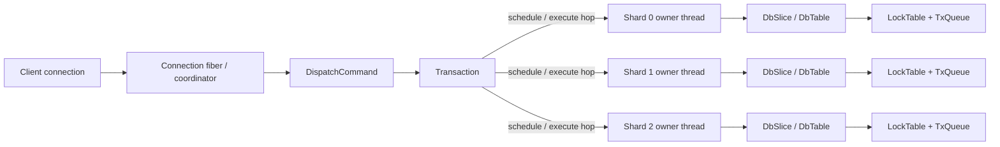

> * DbTable：一张具体 DB 的底层数据表。
>
> - DbSlice：一个 shard 上的数据库切片，负责管理多个 DbTable，并提供读写、过期、淘汰、事务锁等操作。
>   关系是：
>
> 	EngineShard #0
>   		├── default Namespace -> DbSlice #0
>   		├── tenant-a Namespace -> DbSlice #0
>   		└── tenant-b Namespace -> DbSlice #0
>
> 	EngineShard #1
>   		├── default Namespace -> DbSlice #1
>   		├── tenant-a Namespace -> DbSlice #1
>   		└── tenant-b Namespace -> DbSlice #1
>
> 	所以，DbTable(DB 0) 只表示某个 shard 上 DB 0 的那部分数据；完整的逻辑 DB 0 是所有 shard 上对应 DbTable 的集合。
> 	具体职责：
> 	类型	主要内容
> 	DbTable	PrimeTable 键值存储、过期表、事务锁、WATCH 信息、单库统计
> 	DbSlice	DbTableArray、分片级内存统计、版本号、过期/淘汰、增删查接口、快照/迁移回调
>
> 这样设计的目的是单机/主备实现 redis cluster 模式。

连接 fiber 不直接访问 shard 数据。它负责：

1. 解析命令；
2. 创建或复用 Transaction；
3. 计算 key 和 shard；
4. 向相关 shard 发送调度/执行消息；
5. 等待 callback 完成；
6. 组织回复。

在等待 shard 的过程中，通常只是当前 fiber 被挂起，底层 OS thread 仍然可以运行
其他 fiber。

### 3.1 shard 不是一张逻辑表

更准确的类比是“水平分区”：

```text
逻辑数据库 DB 0
    ├── Shard 0 上的一部分 key
    ├── Shard 1 上的一部分 key
    └── Shard 2 上的一部分 key

逻辑数据库 DB 1
    ├── Shard 0 上的一部分 key
    ├── Shard 1 上的一部分 key
    └── Shard 2 上的一部分 key
```

每个 shard 内部仍然有多个 DB table。锁表属于具体 DB table，所以同一个
fingerprint 在 DB 0 和 DB 1 中是两把不同的逻辑锁。

### 3.2 一个 shard 内部有什么

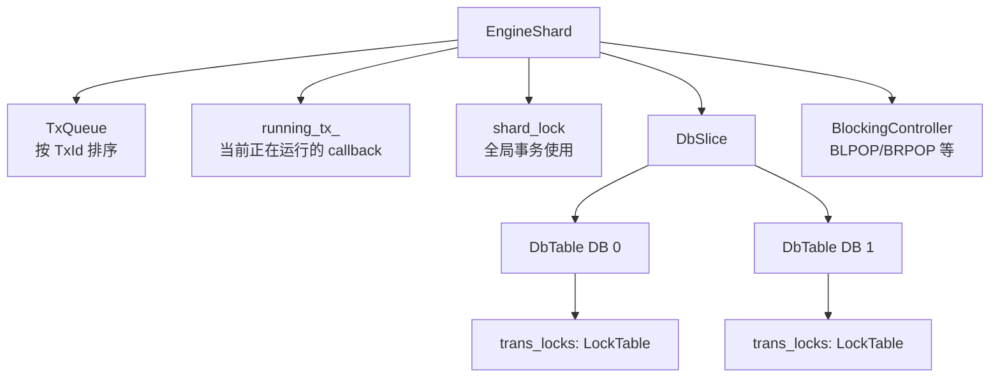

几个组件职责不同：

| 组件               | 主要职责                                     |
| ------------------ | -------------------------------------------- |
| Transaction        | 保存一个命令/多命令操作的全局执行状态        |
| PerShardData       | 保存该 Transaction 在某个 shard 上的局部状态 |
| IntentLock         | 记录读/写意向数量，帮助判断冲突              |
| LockTable          | LockFp 到 IntentLock 的映射                  |
| TxQueue            | 冲突事务的执行顺序                           |
| TxId               | 让不同 shard 对跨 shard 事务使用同一逻辑顺序 |
| shard_lock         | 全局事务的 shard 级屏障                      |
| running_tx_        | 当前 shard 正在执行的 callback               |
| run_barrier_       | coordinator 等待多个 shard 完成 hop          |
| BlockingController | 阻塞命令的 watch、唤醒和超时                 |

---

## 4. 从命令到 Transaction

### 4.1 CommandId 如何判断一个命令是否需要 Transaction

CommandId::IsTransactional() 的核心逻辑是：

```cpp
if (first_key_ > 0 ||
    (opt_mask_ & CO::GLOBAL_TRANS) ||
    (opt_mask_ & CO::NO_KEY_TRANSACTIONAL))
  return true;

return (kind_mask_ & EVAL_CTRL) || (kind_mask_ & EXEC);
```

因此，下面几类命令会进入 Transaction：

1. 有明确 key 的命令：GET、SET、DEL、MGET 等；
2. GLOBAL_TRANS 命令；
3. NO_KEY_TRANSACTIONAL 命令；
4. EVAL/EVALSHA；
5. EXEC。

MULTI 和 DISCARD 主要是协议控制命令，不是普通数据访问 Transaction。

### 4.2 PrepareTransaction：创建或复用

命令分发时，PrepareTransaction() 做两件事：

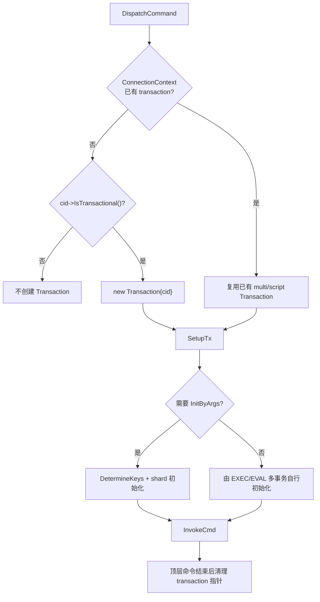

代码层面的关键区别是：

```cpp
if (dfly_cntx->transaction) {
  // 例如 EXEC 或脚本中已经存在的 Transaction，子命令复用顶层命令的 transaction
  dfly_cntx->transaction->MultiSwitchCmd(cid);
} else if (cid->IsTransactional()) {
  // 顶层普通命令
  res.reset(new Transaction{cid});
}
```

这带来一个非常重要的统一性：

```text
普通 SET handler:
    cmd_cntx->tx() 指向 SET 自己的 Transaction

EXEC 中的 SET handler:
    cmd_cntx->tx() 指向整个 EXEC 共用的 multi Transaction
```

命令 handler 不需要知道调用场景。

### 4.3 CommandContext 与 Transaction 的关系

CommandContext 主要保存：

- reply builder；
- connection context；
- 当前 CommandId；
- 当前命令参数；
- Transaction 指针。

它是“命令执行上下文”。

Transaction 主要保存：

- namespace 和 DB；
- 当前 command id；
- key 参数和 fingerprint；
- active shard；
- TxId；
- lock mode；
- callback；
- multi 状态；
- hop barrier；
- transaction queue 状态。

```text
CommandContext
    ├── cid_
    ├── tail_args_
    ├── reply builder
    └── tx_  ───────────────┐
                            │
                    Transaction
                      ├── key/shard metadata
                      ├── lock metadata
                      ├── queue metadata
                      ├── callback
                      └── multi metadata
```

---

## 5. key 如何被识别、分片和转换成锁

### 5.1 DetermineKeys

Transaction 初始化时调用 DetermineKeys()，得到命令中哪些参数是 key。

典型情况：

```text
GET key
    key index = [0]

MSET k1 v1 k2 v2
    key indices = [0, 2]

EVAL script 2 key-a key-b arg
    key indices = 根据 numkeys 解析

XREAD STREAMS k1 k2 id1 id2
    key indices = STREAMS 后半段的前一半
```

命令元数据会描述：

- first key；
- last key；
- key step；
- variadic keys；
- store destination 等特殊 key。

如果 key 没有被命令元数据正确声明，Transaction 就无法自动保护它。

### 5.2 key 到 shard

key 通过 Shard(key, shard_count) 计算所属 shard。

逻辑上：

```text
key
  ↓ hash / cluster slot / tag
ShardId
```

例如：

```text
"user:1"      → Shard 0
"user:2"      → Shard 1
"counter:1"   → Shard 0
```

一个多 key 命令会建立如下结构：

```text
MSET user:1 Alice user:2 Bob counter:1 10

Shard 0:
    user:1 / counter:1

Shard 1:
    user:2
```

### 5.3 LockTag 与 fingerprint

key 不直接作为锁表 key，而是先转换为 LockTag，再计算 64 位 LockFp：

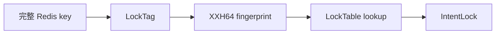

默认情况下：

```text
LockTag("user:1") = "user:1"
```

启用 hashtag locking 时，可能只使用大括号中的 tag：

```text
user:{42}:profile  → LockTag "42"
user:{42}:orders   → LockTag "42"
```

这样两个 key 会有意共享同一个锁粒度。

### 5.4 KeyLockArgs

Transaction::GetLockArgs(shard) 生成：

```cpp
struct KeyLockArgs {
  DbIndex db_index;
  absl::Span<const LockFp> fps;
};
```

它告诉某个 shard：

```text
请在 DB db_index 中，为这一组 fingerprint 注册访问意向。
```

跨 shard 的 Transaction 会给每个 shard 一组局部 fingerprint：

```text
Transaction T
    Shard 0 → [fp-a, fp-c]
    Shard 1 → [fp-b]
    Shard 2 → []
```

同一个事务中重复出现的 fingerprint 会去重，避免计数被重复增加。

---

## 6. IntentLock：key 锁的核心数据结构

### 6.1 数据结构

IntentLock 只有两个计数器：

```cpp
unsigned cnt_[2] = {0, 0};
```

其中：

```text
cnt_[SHARED]    读意向数
cnt_[EXCLUSIVE] 写意向数
```

一个 key 在 LockTable 中的状态可以表示为：

```text
LockTable[fp(key)] = {
    shared_count,
    exclusive_count
}
```

### 6.2 读写兼容矩阵

```text
                         新事务
                   SHARED       EXCLUSIVE
已有状态
无意向               兼容          兼容
SHARED               兼容          冲突
EXCLUSIVE            冲突          冲突
```

对应代码层面的状态：

| 状态       | 含义                     |
| ---------- | ------------------------ |
| [S=0, X=0] | 没有待执行事务访问该 key |
| [S>0, X=0] | 多个读意向，可以共享     |
| [S=0, X=1] | 一个写意向，没有竞争     |
| [S>0, X=1] | 读写冲突                 |
| [S=0, X>1] | 多个写意向冲突           |

### 6.3 Acquire 的关键语义

核心代码逻辑可以概括为：

```cpp
bool Acquire(Mode m) {
  ++cnt_[m];                 // 无论是否冲突，先记录意向

  if (cnt_[opposite_mode])
    return false;            // 有相反模式，不能立即运行

  return m == SHARED || cnt_[EXCLUSIVE] == 1;
}
```

这意味着 Acquire() 不是传统 mutex 的 try_lock()。

它实际做的是：

```text
登记访问意向
    +
返回当前是否可以立即执行
```

如果返回 false，意向仍然已经登记，Transaction 通常会进入 TxQueue 等待。

### 6.4 例子：读读

初始：

```text
[S=0, X=0]
```

T1 执行 GET key：

```text
Acquire(SHARED)
[S=1, X=0]
返回 true
```

T2 也执行 GET key：

```text
Acquire(SHARED)
[S=2, X=0]
返回 true
```

读和读不冲突。

### 6.5 例子：读写

T1 执行：

```text
GET key
[S=1, X=0]
```

T2 执行：

```text
SET key value
```

T2 登记后：

```text
[S=1, X=1]
Acquire(EXCLUSIVE) 返回 false
```

T2 的意向没有消失，而是进入 transaction queue，等待前面的冲突事务完成。

### 6.6 例子：写写

T1：

```text
SET key v1
[S=0, X=1]
返回 true
```

T2：

```text
SET key v2
[S=0, X=2]
返回 false
```

T2 必须等待 T1。

### 6.7 IsContended

IsContended() 的判定是：

```cpp
return (cnt_[EXCLUSIVE] > 1) ||
       (cnt_[EXCLUSIVE] == 1 && cnt_[SHARED] > 0);
```

因此：

```text
[S=10, X=0]  → 不冲突
[S=0,  X=1]  → 不冲突
[S=2,  X=1]  → 冲突
[S=0,  X=2]  → 冲突
```

“一个孤立的写意向”不算 contention；它可以安全地执行。

### 6.8 IntentLock 不保存 owner

它不保存：

```text
owner transaction id
waiter list
condition variable
```

它只保存数量：

```text
shared intent count
exclusive intent count
```

谁先执行由 TxQueue 决定。可以理解为：

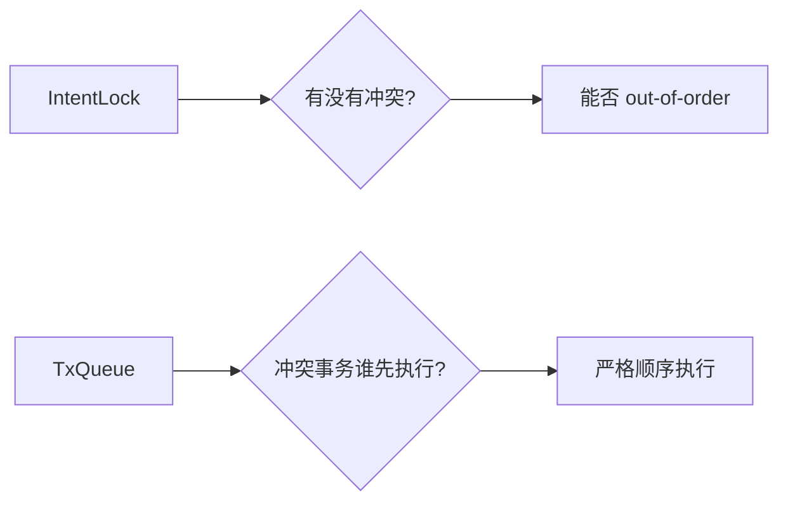

### 6.9 为什么计数器不需要 atomic

每个 shard 的 LockTable 只由该 shard owner thread 访问：

```text
Shard 0 thread
    ├── Shard 0 data
    ├── Shard 0 LockTable
    └── Shard 0 TxQueue
```

所以 IntentLock::cnt_ 是普通整数。

需要 atomic 的是跨线程状态，例如：

- PerShardData::is_armed；
- barrier 计数；
- 某些 blocking/wakeup 标志。

> is_armed = false
> 当前 shard 没有等待领取的 hop
> is_armed = true
> coordinator 已经准备好该 shard 的执行数据，
> shard 可以领取并执行这次 hop

这正是 shared-nothing 的关键收益之一：尽量把共享状态留在 shard 内部。

### 6.10 指纹碰撞

由于锁表使用 64 位 fingerprint，极低概率下两个不同 key 可能碰撞：

```text
key-a → fp-X
key-b → fp-X
```

结果是两个无关 key 被当成有冲突，降低并发度，但不会让数据语义错误：

```text
性能损失，而不是正确性损失
```

---

## 7. key lock、shard lock 和 running_tx_ 的区别

这三者经常被混淆。

### 7.1 key lock

范围：

```text
某个 DB 中的某个 key fingerprint
```

用途：

- 发现读写冲突；
- 判断能否 out-of-order；
- 让访问相同 key 的事务保持顺序。

实现：

```text
DbTable.trans_locks
    └── LockFp -> IntentLock
```

### 7.2 shard lock

范围：

```text
整个 shard
```

用于：

- FLUSHDB、FLUSHALL 等全局操作；
- 无法提前知道全部 key 的全局事务；
- 某些脚本和管理命令。

全局事务会在相关 shard 上获取 shard-level lock：

```text
Shard 0: shard_lock = EXCLUSIVE
Shard 1: shard_lock = EXCLUSIVE
Shard 2: shard_lock = EXCLUSIVE
```

这会阻止其他普通事务在这些 shard 上执行，因此并发度低于 key lock。

### 7.3 running_tx_

running_tx_ 表示：

```text
当前 shard 的 callback 正在运行哪个 Transaction
```

它不是锁表，也不是 transaction queue。

它解决的是另一类问题：

```text
同一个 shard 一次只能有一个 callback 真正处于执行中。
```

当 inline callback 意外挂起时，新的调度者可以通过 running_tx_ 发现这个
中途执行的事务，并为它懒登记 key lock。

### 7.4 对比表

| 机制        | 粒度            |     是否保存 owner | 是否决定顺序 | 主要目的               |
| ----------- | --------------- | -----------------: | -----------: | ---------------------- |
| IntentLock  | key fingerprint |                 否 |         间接 | 冲突检测、并发优化     |
| TxQueue     | shard 上的事务  |       保存事务节点 |           是 | 冲突事务排序           |
| shard_lock  | 整个 shard      | 由 shard lock 管理 |           是 | 全局事务屏障           |
| running_tx_ | 当前 callback   |                 是 |           否 | 防止 callback 并发重叠 |

---

## 8. TxId 和 TxQueue：事务执行顺序的来源

### 8.1 为什么仅靠 key lock 不够

假设两个跨 shard 事务：

```text
T1: 操作 key-a (Shard 0) 和 key-b (Shard 1)
T2: 操作 key-b (Shard 1) 和 key-c (Shard 2)
```

如果每个 shard 独立决定顺序，可能出现：

```text
Shard 0: T1 → T2
Shard 1: T2 → T1
Shard 2: T2 → T1
```

跨 shard 事务对同一个 key 的观察顺序会不一致。

### 8.2 TxId

需要排序的 Transaction 会取得一个单调递增的 TxId：

```text
op_seq → 100 → 101 → 102 → ...
```

跨 shard 的同一个 Transaction 在所有相关 shard 上使用同一个 TxId。

```text
T1.TxId = 100
T2.TxId = 101

Shard 0: [T1(100), T2(101)]
Shard 1: [T1(100), T2(101)]
Shard 2: [T1(100), T2(101)]
```

这样每个 shard 都能建立相同的逻辑顺序。

### 8.3 单 shard 事务的 TxId 延迟分配

单 shard、无竞争命令通常不需要进入 TxQueue，因此不需要立刻取得 TxId。

> 疑惑：如果单 shard 事务无冲突时可以不进入 TxQueue，那么如何通过 TxQueue 来对事务进行排序呢？

只有在以下情况才需要真正进入排序流程：

- 多 shard；
- 单 shard 但有竞争；
- 需要多 hop；
- 不能走 optimistic fast path。

这是为了避免所有普通 GET/SET 都争抢全局原子计数器。

### 8.4 TxQueue

每个 shard 有一个 TxQueue：


Transaction 调度成功后，会在每个 active shard 的 TxQueue 中插入一个节点。

它最终在最后一个 hop 中：

1. 从 TxQueue 删除；
2. 释放 key lock 或 shard lock；
3. 更新 shard 的 committed transaction 状态；
4. 推动后续事务。

### 8.5 late arrival 和重新调度

分发到不同 shard 的消息到达顺序不一定相同：

```text
Coordinator:
    给 Shard 0 发送 T1(100)、T2(101)
    给 Shard 1 发送 T1(100)、T2(101)

消息到达：
    Shard 0: T2 先到，T1 后到
    Shard 1: T1 先到，T2 后到
```

如果 T1 到达时可以安全插入队列前面，则重排为：

```text
[T1(100), T2(101)]
```

但如果后来的 T1 与已经占据位置的 T2 在 key 上发生冲突，安全重排可能
无法完成。调度阶段会取消本次尝试，重新取得 TxId 再调度。

重要区别：

```text
调度失败时可以重试
正式执行开始后不做通用 rollback
```

### 8.6 out-of-order

严格按照 TxQueue 头部逐个执行会损失并发。例如：

```text
T1: SET key-a
T2: SET key-b
```

如果两个 key 不同，锁表没有冲突，T2 可以被标记为 OUT_OF_ORDER。

这意味着：

```text
T1 在队列前面
T2 的 key 与队列前面的事务不冲突
    ↓
T2 可以提前执行
```

注意 out-of-order 不是“完全无序”：

- 有冲突的 key 仍然必须遵守顺序；
- 同一 shard 同一时刻仍然只有一个 callback 真正在执行；
- 只有锁表证明安全时才允许提前。

---

## 9. Transaction 生命周期

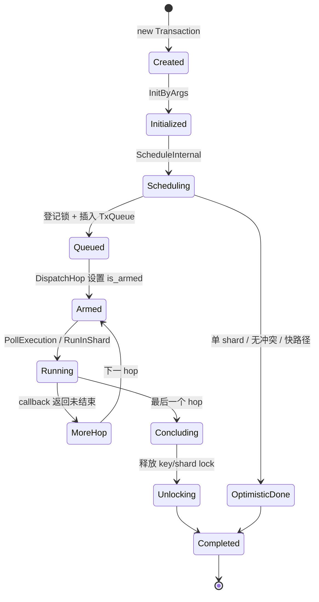

### 9.1 初始化

```text
保存 namespace、DB、命令参数
    ↓
DetermineKeys
    ↓
计算每个 key 的 shard
    ↓
计算 LockTag/Fingerprint
    ↓
建立 per-shard argument slices
    ↓
记录 active shards
```

### 9.2 调度

```text
确定 lock mode
    ↓
在各 shard 检查/登记 IntentLock
    ↓
判断能否 optimistic 或 out-of-order
    ↓
必要时取得 TxId
    ↓
插入 TxQueue
    ↓
标记 Transaction 已调度
```

### 9.3 执行

```text
coordinator:
    arm active shards
    post PollExecution
    wait run_barrier

shard:
    检查 transaction 是否可运行
    调用 RunInShard
    执行 callback
    完成后减少 barrier
```

### 9.4 完成

```text
从 TxQueue 移除
    ↓
释放 key IntentLock 或 shard_lock
    ↓
清理 running_tx_
    ↓
通知阻塞队列/后续事务
    ↓
coordinator 被唤醒
```

---

## 10. 单 shard 普通命令：最快路径

下面是一个无竞争 SET key value 的典型时序。

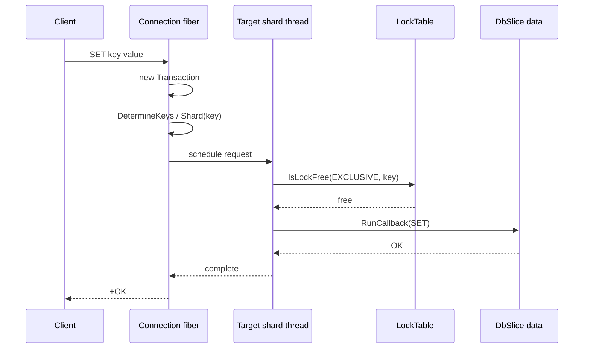

这条路径的特点：

- 只涉及一个 shard；
- key 没有冲突；
- callback 不会挂起；
- 可能不分配 TxId；
- 可能不插入 TxQueue；
- 可能不创建实际 LockTable 项；
- 直接在调度阶段执行 callback。

这就是为什么“所有普通命令都用 Transaction”不等于“所有命令都很重”。

### 10.1 快路径为什么只检查不登记

如果命令已经确定可以连续完成：

```text
检查锁表
    ↓
没有冲突
    ↓
同一个 shard owner thread 连续执行并完成
```

中间没有必要让其他事务观察一个只存在几个指令周期的锁表项。

### 10.2 快路径的安全边界

inline callback 如果发生可挂起操作，会产生一个问题：

```text
Transaction Z 的 callback 在 coordinator fiber 中途挂起
Shard queue fiber 不知道 Z 仍在执行
```

如果另一个事务此时访问相同 key，可能产生错误并发。

因此 CanRunInlined() 会拒绝包含潜在挂起点的 callback。若竞争者确实
遇到一个正在执行但尚未登记锁的事务，调度逻辑会通过 running_tx_ 为它
懒登记 key lock。

---

## 11. 单 shard 有竞争：锁表 + TxQueue

假设两个客户端同时操作相同 key：

```text
C1: SET counter 1
C2: INCR counter
```

时序可以简化为：

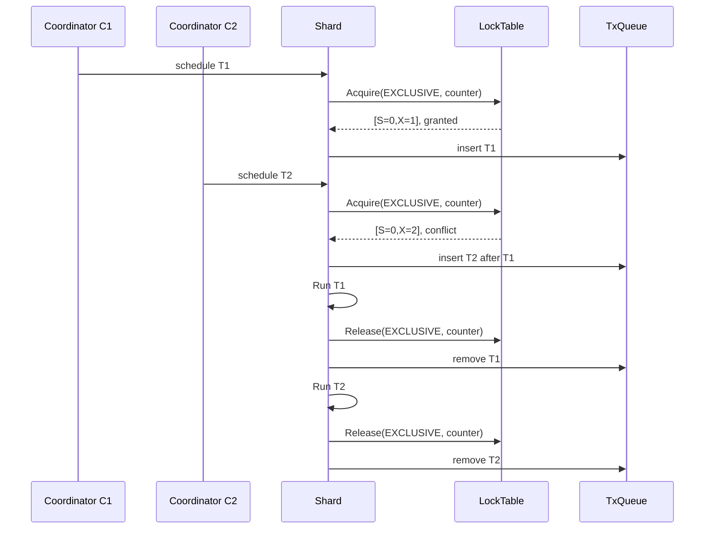

此时：

```text
LockTable 负责发现 T1/T2 冲突
TxQueue    负责决定 T1 在 T2 前面
Shard      负责保证 callback 不同时运行
```

## 12. 不同 key：允许并发或 out-of-order

假设：

```text
T1: SET key-a
T2: SET key-b
```

两者属于同一个 shard，但 fingerprint 不同：

```text
fp(key-a) → [S=0, X=1]
fp(key-b) → [S=0, X=1]
```

没有 key-level contention。

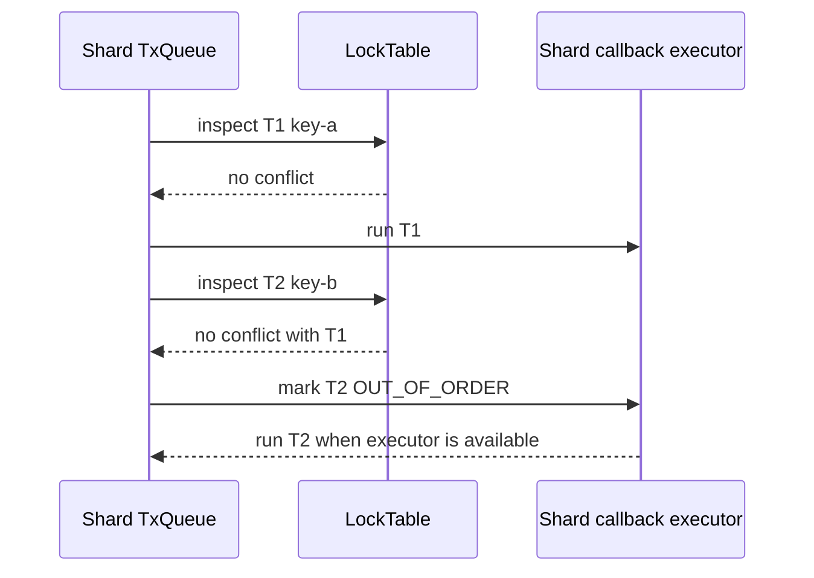

这不代表两个 callback 在同一个 shard 上真正同时运行。它表示 T2 不必因为
T1 在队列前面而被 key 冲突阻塞。

---

## 13. 跨 shard 命令：MSET 示例

假设：

```text
MSET a 1 b 2

a → Shard 0
b → Shard 1
```

### 13.1 调度阶段

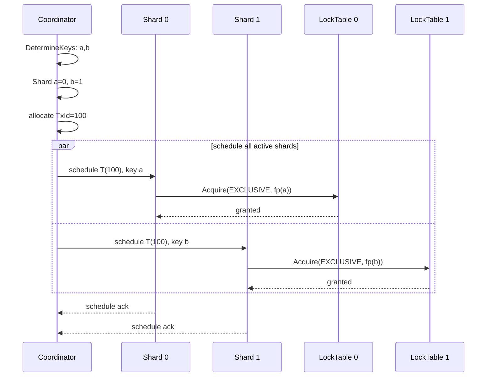

### 13.2 执行阶段

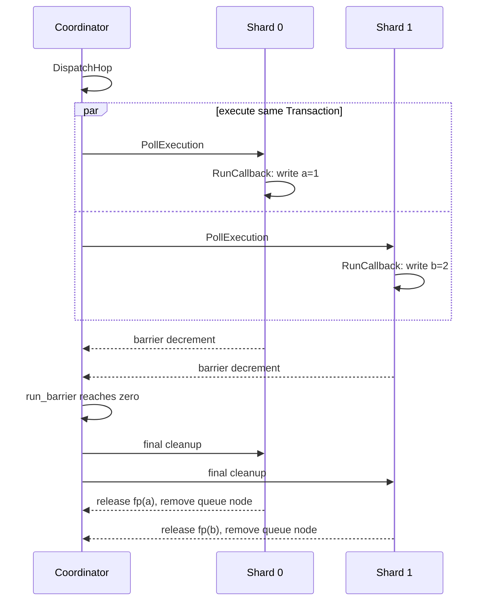

从物理实现看，两个 shard 的写入可以并行；从客户端可观察语义看，整个
MSET 对冲突访问表现为一个不可被拆开的操作。

### 13.3 为什么普通 MGET 也必须经过 Transaction

如果 MGET 绕过事务控制，它可能出现：

```text
MSET a=1 b=2 正在执行

MGET a b
    读取到 a=1
    读取到 b=旧值
```

因此即使 MGET 自身只是读，也必须参与：

- shard 路由；
- SHARED intent；
- 与 MSET 的 EXCLUSIVE intent 冲突；
- 跨 shard 顺序协调。

---

## 14. 多 hop 命令：RENAME 示例

跨 shard 的 RENAME 可以抽象为：

```text
RENAME src dst

src → Shard 0
dst → Shard 1
```

可能需要：

```text
Hop 1:
    读取 src
    检查 dst

Coordinator:
    处理检查结果

Hop 2:
    删除 src
    在 dst 写入对象
```

### 14.1 时序图

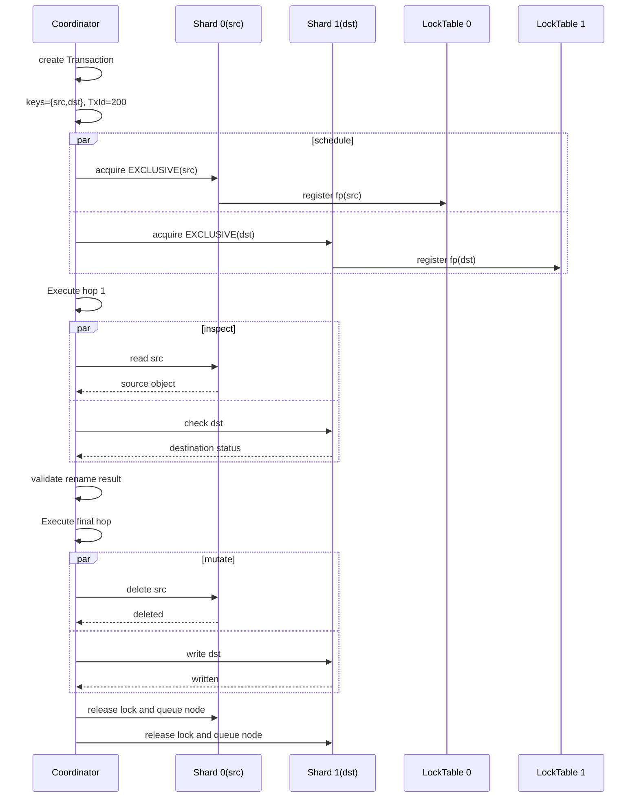

### 14.2 如果 hop 之间释放锁会怎样

错误实现可能是：

```text
1. 读取 src
2. 释放锁
3. 其他客户端修改 src
4. 删除 src
5. 将旧对象写入 dst
```

这会引入 TOCTOU（检查和使用之间状态变化）问题。

正确做法是：

```text
第一个 hop 到最后一个 hop 之间保持 Transaction 的顺序和锁状态
最后一个 hop 完成后才释放
```

---

## 15. MULTI/EXEC 的实现

### 15.1 MULTI 阶段只收集

```text
MULTI
SET a 1
GET b
DEL c
EXEC
```

中间命令一般走：

```text
StoreInMultiBlock
    ↓
exec_info.body
    ↓
回复 QUEUED
```

它们不会像普通顶层命令那样立即创建短生命周期 Transaction 来执行数据操作。

### 15.2 EXEC 阶段创建 multi Transaction

EXEC 执行时：

1. 检查 MULTI 状态；
2. 收集所有 stored commands 的 key；
3. 检查 cluster cross-slot；
4. 判断是否包含脚本、全局命令等；
5. 决定 multi mode；
6. 创建/初始化 multi Transaction；
7. 顺序执行 body 中的命令；
8. 最后调用 UnlockMulti()。

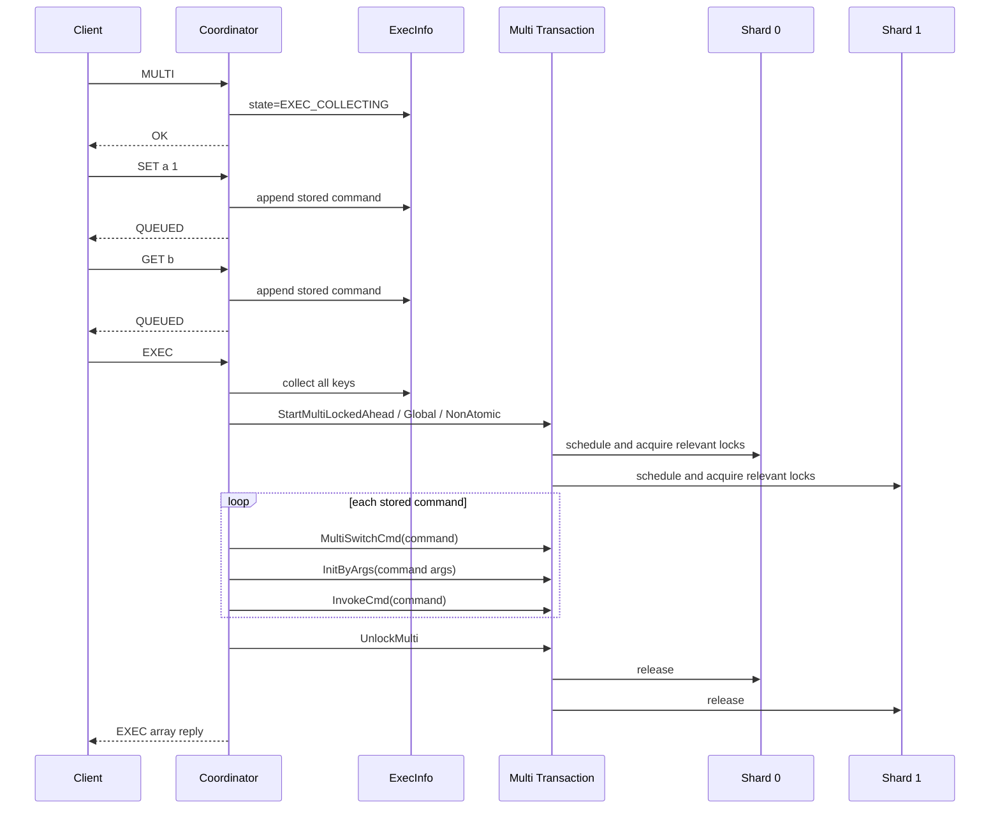

### 15.3 MultiSwitchCmd 做什么

每个 stored command 执行前会调用 MultiSwitchCmd()：

```text
切换当前 command id
清理当前命令的 argument slices
重新设置 active shard
重新计算当前命令的 key fingerprints
```

在 atomic multi 模式中，它会保留已经提前获得的 multi key locks。

在 non-atomic 模式中，它会重置调度状态，让每个命令像 pipeline 中的独立操作
重新调度。

### 15.4 三种 multi mode

#### LOCK_AHEAD

```text
提前收集所有声明 key
提前取得 key intents
执行多个命令期间保持这些锁
```

这是已知 key 的原子 MULTI/EXEC 或声明 key 的 Lua 脚本常用的模式。

#### GLOBAL

```text
锁住所有相关 shard
```

用于全局命令或无法安全知道访问 key 集合的场景。

代价是会降低整个系统的并发度。

#### NON_ATOMIC

```text
每个命令单独调度和执行
```

它复用了 Transaction 接口，但不保证多个命令之间的原子性，更接近 pipeline。

### 15.5 MULTI/EXEC 的“原子”不等于通用 rollback

Dragonfly 的原子性主要保证：

```text
其他冲突命令看不到 EXEC 内部命令之间的中间状态
```

它不表示：

```text
EXEC 中任何一个命令失败，之前所有修改都自动撤销
```

这和 Redis MULTI/EXEC 的运行期错误语义是一致的。

---

## 16. Lua 与 Transaction

Lua 脚本也是 multi-transaction 的一种。

脚本可能有：

- 明确声明的 key；
- 动态访问的 key；
- 读写命令；
- 多个内部 hop；
- blocking/async 相关限制。

大致决策逻辑：

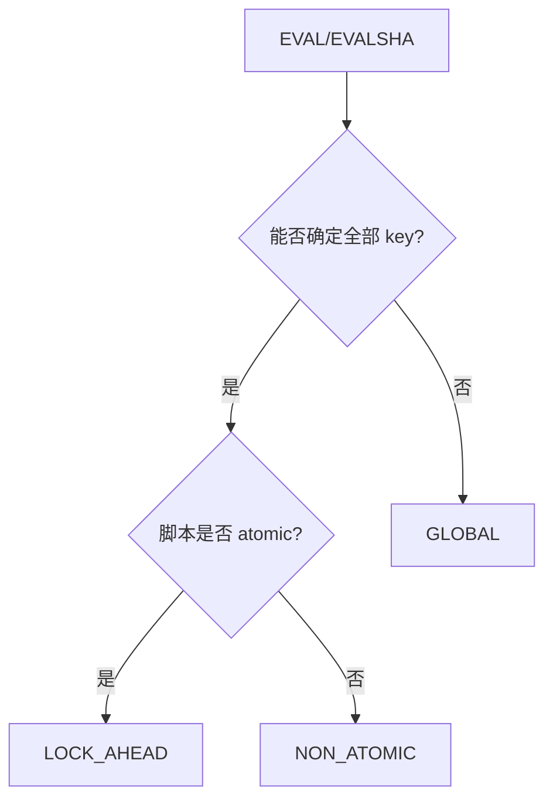

脚本内部调用普通 Redis 命令时，这些命令可以复用当前脚本 Transaction：

```text
Lua Transaction
    ├── SET
    ├── GET
    ├── INCR
    └── ...
```

脚本中还会预借用 interpreter，避免执行期间因 interpreter 资源不足而阻塞，
导致已经持有 key lock 的事务和其他事务互相等待。

---

## 17. Blocking 命令：BLPOP 的特殊生命周期

阻塞命令比普通 multi-hop 更复杂，因为 Transaction 可能在等待期间保留
对 key 的顺序控制。

以：

```text
BLPOP list-a list-b 0
```

为例：

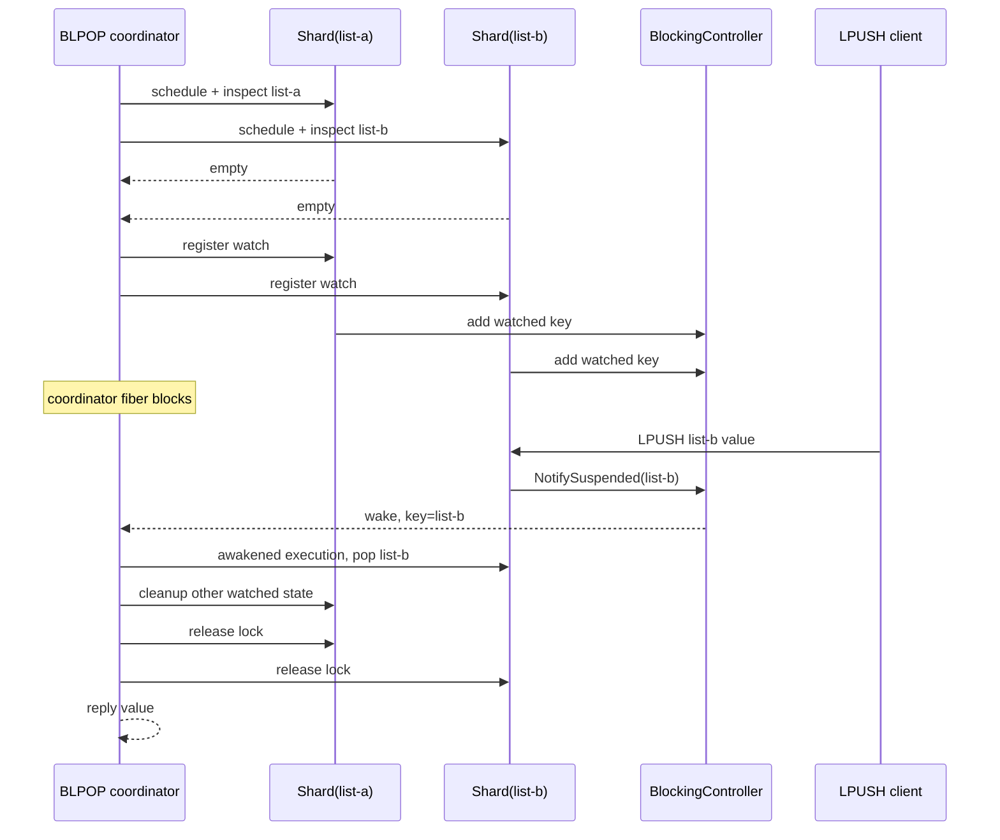

关键点：

1. 初始检查仍然经过 Transaction；
2. 所有 key 都为空时，Transaction 进入 watched 状态；
3. 它可能从普通 TxQueue 中移除，但保持必要的 key 顺序状态；
4. 其他事务修改 watched key 时触发通知；
5. 被唤醒的事务使用 AWAKED_Q 优先路径；
6. 最终 pop/cleanup 完成后释放锁。

这说明 Transaction 不只是“一次函数调用”，它还可以表示一个跨 fiber、
跨时间段的等待状态。

---

## 18. Command squashing

MULTI/EXEC 中逐条执行命令会有两个成本：

```text
每个命令都要一次跨线程 hop
多个 shard 不能充分并行
```

Command squashing 会把连续的单 shard 命令按目标 shard 分组：

```text
原始顺序：
    1. SET a       → Shard 0
    2. SET b       → Shard 1
    3. INCR c      → Shard 0
    4. GET d       → Shard 1

压缩后：
    Shard 0: SET a, INCR c
    Shard 1: SET b, GET d
```

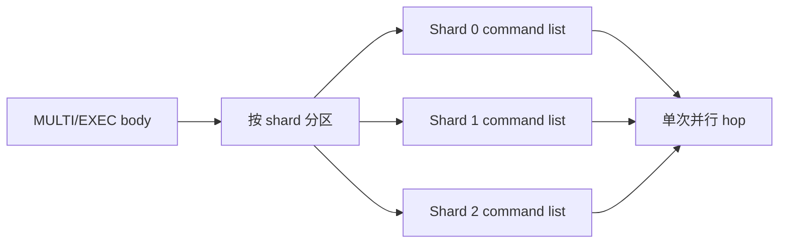

实现中会使用：

- parent Transaction：SQUASHER；
- 每个目标 shard 的 stub Transaction：SQUASHED_STUB。

stub 提供普通命令 handler 所期待的 Transaction 接口，但不重复做完整调度。
parent 负责跨 shard 的整体协调。

这再次体现了统一接口的价值：

```text
命令 handler 不需要知道自己是在普通命令、EXEC、Lua 还是 squashed stub 中运行。
```

---

## 19. 一个完整冲突例子：MSET 与 GET

假设：

```text
MSET a 1 b 2
    a → Shard 0
    b → Shard 1

MGET a b
    a → Shard 0
    b → Shard 1
```

### 19.1 MSET 先调度

```text
Shard 0:
    fp(a) → [S=0, X=1]

Shard 1:
    fp(b) → [S=0, X=1]
```

### 19.2 MGET 后调度

```text
Shard 0:
    fp(a) → [S=1, X=1]  冲突

Shard 1:
    fp(b) → [S=1, X=1]  冲突
```

MGET 不能在 MSET 中间读取。

最终只有两种合法效果：

```text
MGET 完全发生在 MSET 之前
```

或者：

```text
MGET 完全发生在 MSET 之后
```

不会看到：

```text
a 已经是新值
b 还是旧值
```

### 19.3 如果是不同 key

```text
MSET a 1 b 2
GET x
```

如果 x 不等于 a/b，且 fingerprint 不冲突，那么 GET 可以与 MSET 并发，
即使它们位于同一个 shard。

---

## 20. 一个完整顺序例子：两个跨 shard 事务

假设：

```text
T1: SET a=1, SET b=1
    a → Shard 0
    b → Shard 1

T2: SET b=2, SET c=2
    b → Shard 1
    c → Shard 2
```

取得：

```text
T1.TxId = 100
T2.TxId = 101
```

各 shard 的队列必须保持相同的逻辑顺序：

```text
Shard 0: T1(100)
Shard 1: T1(100) → T2(101)
Shard 2: T2(101)
```

Shard 1 上 b 存在冲突，所以 T2 不能越过 T1。

如果消息乱序：

```text
Shard 1 先收到 T2，再收到 T1
```

调度代码会尝试按 TxId 重排；如果发现重排会与已经存在的冲突锁不安全，
则取消本次调度并重新安排。

**注意：这里需要某个事务所有的分片子命令都就绪了，才可以开始执行，否则冲突时要取消调度会很繁琐。**

---

## 21. 锁的获取、使用和释放时机

### 21.1 普通单 hop

```text
InitByArgs
    ↓
ScheduleInShard
    ↓
Acquire IntentLock
    ↓
RunCallback
    ↓
Release IntentLock
```

### 21.2 普通多 hop

```text
Init
    ↓
Schedule
    ↓
Acquire
    ↓
Run hop 1
    ↓
Run hop 2
    ↓
Run final hop
    ↓
Release
```

### 21.3 Atomic multi

```text
StartMultiLockedAhead
    ↓
提前取得全部 multi key intents
    ↓
命令 1
    ↓
命令 2
    ↓
命令 3
    ↓
UnlockMulti
```

### 21.4 Global

```text
StartMultiGlobal
    ↓
所有相关 shard Acquire(shard_lock)
    ↓
执行命令/脚本
    ↓
所有 shard Release(shard_lock)
```

### 21.5 Blocking

```text
检查 key
    ↓
注册 watch
    ↓
等待
    ↓
被唤醒或超时
    ↓
完成/清理
    ↓
释放
```

---

## 22. 这套设计解决了什么问题

### 22.1 统一 shard 路由

命令不需要自己实现：

```text
key → shard → owner thread
```

### 22.2 避免跨 shard 的中间状态

MSET、MGET、RENAME 等多 key 命令可以表现为一个严格有序操作。

### 22.3 让普通命令正确参与大事务

普通 GET/SET 如果绕过事务控制，会读到 MULTI/MSET/RENAME 的中间状态。

### 22.4 避免多 shard 顺序不一致

统一 TxId 让所有 shard 对跨 shard 事务使用同一逻辑顺序。

### 22.5 让无冲突 key 并发

IntentLock 不仅用于阻塞，也用于证明：

```text
这些事务访问的 key 没有冲突，可以 out-of-order。
```

### 22.6 支持多阶段命令

同一 Transaction 可以跨多个 hop 保持排序和锁状态。

### 22.7 支持阻塞和唤醒

BLPOP 等命令可以把 Transaction 生命周期延伸到等待、唤醒和清理。

### 22.8 将性能优化放在统一框架内部

同一套 Transaction 接口支持：

- optimistic fast path；
- inline execution；
- out-of-order；
- command squashing；
- multi transaction；
- global transaction；
- blocking transaction。

---

## 23. 与关系数据库事务的对应关系

可以做下面的近似类比：

| Dragonfly            | 关系数据库中的近似概念 |
| -------------------- | ---------------------- |
| shard                | 水平分区/tablet        |
| key fingerprint      | 行/索引记录的锁标识    |
| SHARED IntentLock    | 共享锁意向             |
| EXCLUSIVE IntentLock | 排他锁意向             |
| TxQueue              | 分区内事务调度顺序     |
| TxId                 | 跨分区逻辑事务序号     |
| shard_lock           | 分区级/表级锁          |
| multi Transaction    | 用户事务的执行上下文   |

但不要把它完全等同于关系数据库：

Dragonfly 重点解决的是：

```text
内存数据结构 + shared-nothing + fiber + 跨 shard 严格排序
```

它不提供一个通用的：

```text
BEGIN
任意 SQL
undo log
ROLLBACK
```

式执行模型。

### 23.1 Dragonfly 有哪些强保证

对于支持事务协调的操作，它追求：

- strict serializability；
- 多 key 原子可见性；
- 冲突访问的确定顺序；
- 跨 shard 操作的统一逻辑顺序。

### 23.2 Dragonfly 没有把什么作为通用能力

- 任意命令的通用 undo/rollback；
- 通用 MVCC snapshot；
- 多隔离级别；
- 运行期错误后的整组命令回滚；
- 把任意程序逻辑自动转换成可回滚事务。

因此：

```text
它在“冲突命令如何排序、如何隔离”上很强，
但在“任意业务操作失败后如何恢复”上不是关系数据库式通用事务。
```

---

## 24. 读源码时建议按这个顺序

### 第一步：看命令是否进入 Transaction

```text
src/server/command_registry.cc
    CommandId::IsTransactional
```

### 第二步：看 key 如何被解析

```text
src/server/transaction.cc
    DetermineKeys
    Transaction::InitByArgs
    Transaction::InitByKeys
```

### 第三步：看普通命令如何创建 Transaction

```text
src/server/main_service.cc
    PrepareTransaction
    DispatchCommand
```

### 第四步：看 key lock 如何登记

```text
src/server/transaction.cc
    Transaction::ScheduleInShard

src/server/db_slice.cc
    DbSlice::Acquire
    DbSlice::Release

src/core/intent_lock.h
    IntentLock::Acquire
    IntentLock::Check
    IntentLock::IsContended
```

### 第五步：看顺序如何推进

```text
src/server/transaction.cc
    ScheduleInternal
    DispatchHop
    RunInShard
    UnlockMulti

src/server/engine_shard.cc
    PollExecutionInternal
```

### 第六步：看 MULTI/EXEC 如何复用

```text
src/server/main_service.cc
    StartMulti
    Service::Exec
    MultiSwitchCmd
    UnlockMulti
```

### 第七步：看复杂场景

```text
RENAME / SORT STORE / bit operations
    关注 Execute(..., false) 和 Execute(..., true)

BLPOP / BRPOP / BLMOVE
    关注 WaitOnWatch、NotifySuspended、AWAKED_Q

MULTI command squashing
    关注 MultiCommandSquasher、SQUASHER、SQUASHED_STUB
```

---

## 25. 调试时应该观察哪些状态

### Transaction

```text
txid
unique_shard_cnt
GetMultiMode
IsScheduled
IsMulti
coordinator_state
```

### 每个 shard 的状态

```text
local_mask
ACTIVE
KEYLOCK_ACQUIRED
OUT_OF_ORDER
OPTIMISTIC_EXECUTION
WAS_SUSPENDED
AWAKED_Q
is_armed
pq_pos
```

### LockTable

```text
LockFp
shared count
exclusive count
IsContended
ContentionScore
```

### EngineShard

```text
txq head/tail
committed_txid
running_tx_
continuation_trans_
shard_lock
```

理解问题时，可以先问四个问题：

1. 这个命令声明了哪些 key？
2. 这些 key 属于哪些 shard？
3. 当前使用 key lock 还是 shard lock？
4. 当前 Transaction 是在快路径、TxQueue、continuation 还是 blocking 状态？

---

## 26. 最终心智模型

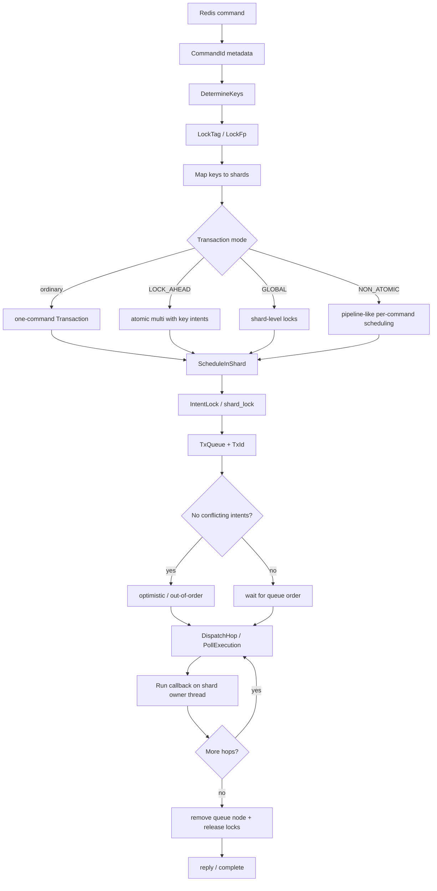

最重要的四句话是：

1. **Transaction 是 Dragonfly 的内部 shard 执行和并发控制抽象，不是 MULTI 专用对象。**
2. **IntentLock 记录 key 的读写意向数量，不保存 owner；TxQueue 才负责冲突事务的顺序。**
3. **普通命令也必须参与这个协议，否则它们会绕过跨 shard 事务的隔离边界。**
4. **Dragonfly 追求严格有序和原子可见性，但不是带通用 undo/rollback 的关系数据库事务。**
