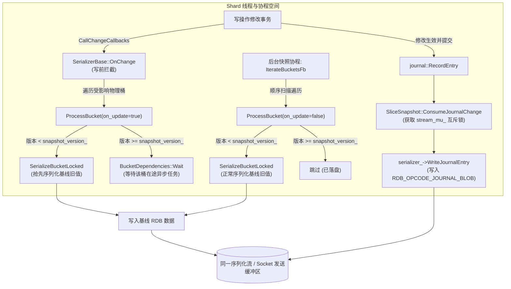
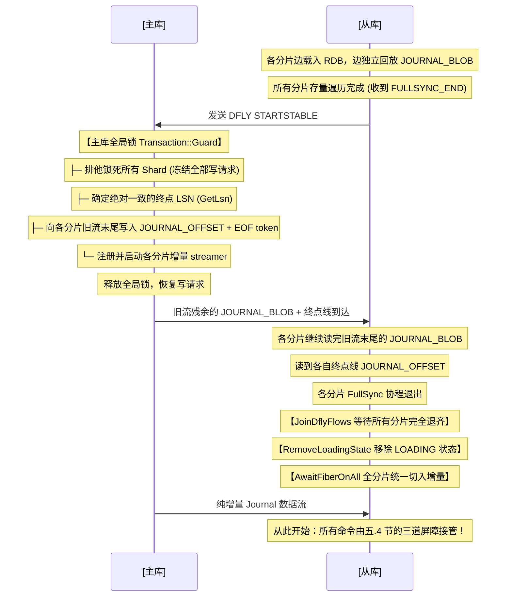
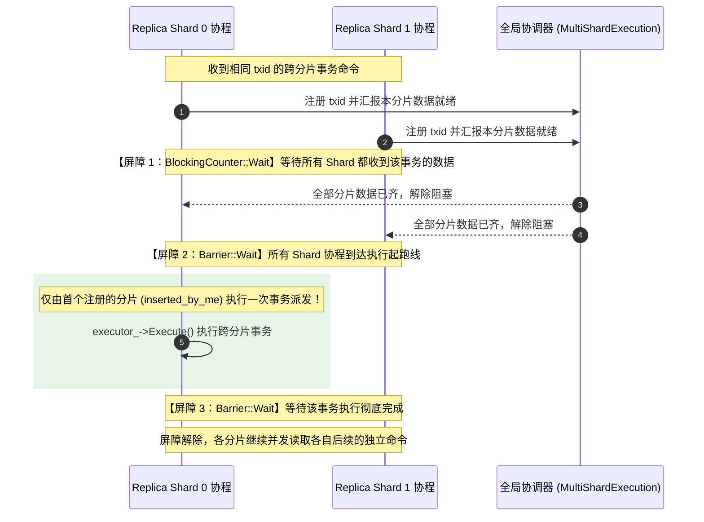

# Dragonfly 快照机制与主从复制对齐原理深度解析

> 本文系统性解析 Dragonfly 在无 `fork()` 架构下，如何基于 **DashTable 存储体系（Directory → Segment → Bucket → Slot）**、**桶版本控制（Bucket Versioning）**、**写前序列化（Serialize-Before-Mutate）** 与 **内嵌增量流（Inline Journal Stream）** 实现时间点一致性（Point-in-Time, PIT）快照及全量主从复制。

---

## 目录

1. [设计哲学与架构背景](#一设计哲学与架构背景)
2. [DashTable 存储层级深度剖析（Directory → Segment → Bucket → Slot）](#二dashtable-存储层级深度剖析directory--segment--bucket--slot)
   - [层级全景架构](#1-层级全景架构)
   - [为什么版本控制定格在 Bucket 级别？](#2-为什么版本控制定格在-bucket-级别)
   - [Slot 碰撞、探测与位移（Displacement）](#3-slot-碰撞探测与位移displacement)
3. [核心函数深度解析](#三核心函数深度解析)
   - [SerializerBase::ProcessBucket](#1-serializerbaseprocessbucket)
   - [SerializerBase::OnChange](#2-serializerbaseonchange)
   - [SliceSnapshot::ConsumeJournalChange](#3-slicesnapshotconsumejournalchange)
4. [逐 Bucket 扫描与数据落盘判定机制](#四逐-bucket-扫描与数据落盘判定机制)
   - [冷数据与热数据并发写时序](#1-冷数据与热数据并发写时序)
   - [插入位移（Displacement）与 CVCUponInsert](#2-插入位移displacement与-cvcuponinsert)
   - [Journal-Omit 极致优化](#3-journal-omit-极致优化)
   - [深度剖析：Dragonfly 磁盘分层存储与 BucketDependencies::Wait 的必要性](#4-深度剖析dragonfly-磁盘分层存储与-bucketdependencieswait-的必要性)
5. [全量 RDB 与增量 Journal（LSN）如何对齐](#五全量-rdb-与增量-journallsn如何对齐)
   - [同一管道的内嵌流（Inline Stream）](#1-同一管道的内嵌流inline-stream)
   - [控制帧机制：FULLSYNC_END 与 JOURNAL_OFFSET](#2-控制帧机制fullsync_end-与-journal_offset)
   - [Replica 端无缝切入 Stable Sync](#3-replica-端无缝切入-stable-sync)
   - [从机增量命令回放与跨分片事务屏障（Multi-Shard Barrier）](#4-从机增量命令回放与跨分片事务屏障multi-shard-barrier)
6. [Dragonfly 日志系统与持久化本质](#六dragonfly-日志系统与持久化本质)
   - [为什么没有磁盘 AOF？](#1-为什么没有磁盘-aof)
   - [纯内存环形缓冲区（Ring Buffer）](#2-纯内存环形缓冲区ring-buffer)
7. [核心代码文件与调用索引](#七核心代码文件与调用索引)

---

## 一、设计哲学与架构背景

### 1. Redis 与 Dragonfly 的快照路线对比

| 维度                 | Redis (`BGSAVE`)                                                | Dragonfly (`SliceSnapshot`)                                        |
| :------------------- | :---------------------------------------------------------------- | :------------------------------------------------------------------- |
| **并发模型**   | 单主线程 + 多 IO 线程                                             | 多线程无共享（Shared-Nothing）+ Fiber 协程                           |
| **快照实现**   | 调用操作系统`fork()` 生成子进程                                 | **无 `fork()`**，应用层用户态协作式调度                      |
| **一致性保障** | 依赖 Linux OS 内核页表 COW（Copy-On-Write）                       | **DashTable 桶版本号 + 写前序列化（Serialize-Before-Mutate）** |
| **大内存影响** | 百 GB 内存下`fork()` 复制页表导致数百毫秒卡顿，且有内存翻倍风险 | 内存开销极小、无页表停顿、毫秒级平滑运行                             |
| **增量日志**   | AOF 磁盘文件 / Replication Buffer                                 | **纯内存环形缓冲区（`ring_buffer_`） / 内嵌网络流**          |

### 2. 全局保序不变式（Ordering Invariant）

整个快照与复制机制遵循一个最高准则：

> **对于任意 Key，Replica（或快照目标端）必须严格先收到该 Key 的基线值（Baseline），随后才能接收针对该 Key 的 Journal 变更增量。**

---

## 二、DashTable 存储层级深度剖析（Directory → Segment → Bucket → Slot）

Dragonfly 能够实现高效的“无 `fork()` 快照”和“毫秒级写前拦截”，最底层依赖于其核心哈希表——[DashTable](file:///home/Dragonfly/dragonfly/src/core/dash.h) 的四级物理存储层级：

```
DashTable 层级示意：
┌───────────────────────────────────────────────────────────┐
│ Directory (目录数组: 存放指向 Segments 的全局指针)            │
└──────┬──────────────────────┬──────────────────────┬──────┘
       │                      │                      │
       ▼                      ▼                      ▼
┌──────────────┐       ┌──────────────┐       ┌──────────────┐
│  Segment 0   │       │  Segment 1   │       │  Segment N   │ (固定大小扁平哈希表)
└──────┬───────┘       └──────────────┘       └──────────────┘
       │
       ├──────────────────────────────────────────┐
       ▼                                          ▼
┌──────────────────────────────┐          ┌───────────────────┐
│ Regular Buckets (56 个物理桶) │          │ Stash Buckets (4个)│
└──────────────┬───────────────┘          └───────────────────┘
               │
               ▼
┌─────────────────────────────────────────────────────────────┐
│ Bucket (物理桶): 包含 version_ (64位版本戳) + 14 个 Slots     │
└──────┬──────────────────────────────────────────────────────┘
       │
       ▼
┌──────────────┬──────────────┬──────────────┬───...───┬──────────────┐
│    Slot 0    │    Slot 1    │    Slot 2    │         │   Slot 13    │
│ [FP | Key |  │ [FP | Key |  │ [FP | Key |  │         │ [FP | Key |  │
│    Value]    │    Value]    │    Value]    │         │    Value]    │
└──────────────┴──────────────┴──────────────┴─────────┴──────────────┘
```

### 1. 层级全景架构

1. **Directory（目录）**：
   - 基于 **Extendible Hashing（可扩展哈希）** 算法的顶层指针数组；
   - 根据 Key 哈希值的高位比特定位到具体的 Segment 指针；
   - 扩容时只需对 Directory 指针数组翻倍或做局部指针重映射，**无需对全表数亿个 Key 进行传统哈希表的全局 Rehashing 搬迁**。
2. **Segment（分段）**：
   - 一个 Segment 是固定大小（Constant Size）的紧凑微型哈希表；
   - 每个 Segment 包含 **56 个常规桶（Regular Buckets）** 和 **4 个溢出暂存桶（Stash Buckets）**，总计 60 个 Bucket；
   - 容量为 $60 \times 14 = 840$ 个 Slots。
3. **Bucket（物理桶）**：
   - 物理存储与版本控制的**最小核心单元**；
   - 每个 Bucket 包含 **14 个 Slots**，且维护一个 64 位的单调版本号：
     ```cpp
     // src/core/dash_internal.h: VersionedBB
     uint8_t version_[8]; // 64-bit 桶版本号
     uint64_t GetVersion() const;
     void SetVersion(uint64_t version);
     ```
4. **Slot（槽位）**：
   - 存放单一具体条目的位置（包含 1 字节哈希指纹 `Fingerprint`、`Key` 指针和 `Value` 负载）。

---

### 2. 为什么版本控制定格在 Bucket 级别？

为什么 Dragonfly 的快照和增量拦截不选在 Slot（Key）级别，也不选在 Segment 级别，而是偏偏选在 **Bucket**？

- **若在 Slot（Key 粒度）记录版本**：
  在数亿 Key 的大内存库中，为每个 Key 分配 8 字节版本号会带来巨大的内存浪费（几十到几百兆纯元数据消耗）。此外，Slot 内元素发生挤压移动时，维护逐 Key 版本的开销极高。
- **若在 Segment 粒度记录版本**：
  每个 Segment 包含 840 个条目。如果一旦发生修改就把整个 Segment 序列化，粒度过粗，前台写操作触发写前序列化时会造成严重的 CPU 毛刺与协程调度延迟。
- **Bucket 粒度的黄金平衡**：
  - 一个 Bucket 包含 14 个 Slots，占用大约几百字节，正好吻合现代 CPU 的 Cache Line 局部性；
  - 14 个 Slots 共用同一个 64 位版本戳（`version_`），均摊元数据开销极低（不足 5 bits/item）；
  - **遍历（`TraverseBuckets`）和写前拦截（`OnChange`）都以 Bucket 为原子步长，粒度精巧，落盘无锁无停顿**。

---

### 3. Slot 碰撞、探测与位移（Displacement）

当一个 Key 写入 Segment 时：

1. **Home Bucket 探测**：哈希计算定位到 56 个常规桶中的某一个（Home Bucket）。若其 14 个 Slot 未满，直接放入；
2. **邻居探测（Neighbour Bucket）**：若 Home Bucket 已满，尝试探测其紧邻的右侧 Bucket；
3. **Stash 溢出桶探测**：若邻居也满，尝试放入当前 Segment 专属的 4 个 Stash Buckets 中；
4. **位移（Displacement）与 Segment 拆分**：
   若上述桶全满，DashTable 会尝试重排位移某些条目；若仍无法容纳，则将此 Segment 分裂（Split）为两个 Segment。
   - **对快照的关键影响**：当客户端并发执行 `INSERT` 时，已有旧数据可能被挤压位移到另一个桶。Dragonfly 靠 [CVCUponInsert](file:///home/Dragonfly/dragonfly/src/core/dash.h) 算法预判所有受波及的桶，并全部交由写前拦截处理，防止位移遗漏数据。

---

## 三、核心函数深度解析

整个快照和主从复制管道由 `SerializerBase` 作为基类驱动，派生出用于 RDB 生成与全量复制的 `SliceSnapshot`。



### 1. `SerializerBase::ProcessBucket`

- **代码位置**：[src/server/serializer_base.cc:L175-L221](file:///home/Dragonfly/dragonfly/src/server/serializer_base.cc#L175-L221)
- **角色作用**：单桶序列化的**共同核心汇聚点**。无论是后台快照 Fiber 遍历（`on_update=false`），还是前台写操作被拦截（`on_update=true`），最终都由此函数处理。
- **内部实现原理**：
  1. **状态检查与过滤**：
     - 若 `it.is_done() || it.GetVersion() >= snapshot_version_`：说明此桶已在快照中或属于 $T_0$ 之后创建的新桶，直接跳过并增加 `buckets_skipped` 统计；
     - 若桶为空且版本偏小，盖上 `snapshot_version_` 戳，避免后续无谓重复扫描；
     - **防并发破坏**：调用 `BucketDependencies::Wait(it.bucket_address())`，阻塞等待该桶关联的任何异步在途任务（如分层存储磁盘读或大 Value 分块）完成，之后返回 `false`。
  2. **多快照优先级协调（仅限后台遍历流）**：
     - 若 `!on_update`，先调用 `db_slice_->FlushChangeToEarlierCallbacks(...)`。因为系统支持多快照共存（如备份与从库同步并行），必须让低版本戳的更早快照优先序列化，防止盖上高版本戳导致旧快照遗漏数据。
  3. **加盖版本戳与活跃依赖计数**：
     - `it.SetVersion(snapshot_version_)`：先盖戳，告知后续并发操作该桶已被快照；
     - `BucketDependencies::Increment(it.bucket_address())`：增加依赖计数，表示桶正在序列化中。
  4. **执行桶内 Slots 序列化**：
     - 调用虚函数 `SerializeBucketLocked`，遍历物理桶内所有 occupied slot，写入 RDB 或命令流；
     - 序列化完成后调用 `BucketDependencies::Decrement` 释放计数。

### 2. `SerializerBase::OnChange`

- **代码位置**：[src/server/serializer_base.cc:L227-L240](file:///home/Dragonfly/dragonfly/src/server/serializer_base.cc#L227-L240)
- **角色作用**：`SerializerBase` 实现了 `DbSlice::ChangeConsumerInterface`。在写事务真正修改哈希表数据之前，作为**写前拦截器（Serialize-Before-Mutate）**执行，抢在数据被修改前提取旧基线。
- **内部实现原理**：
  1. **触发源**：客户端执行写命令时，[DbSlice::CallChangeCallbacks](file:///home/Dragonfly/dragonfly/src/server/db_slice.cc#L2137-L2145) 在修改内存前传入受影响的物理桶集合（`ChangeReq`）。
  2. **遍历处理**：
     ```cpp
     void SerializerBase::OnChange(DbIndex db_index, const ChangeReq& req) {
       for (auto it : req.buckets())
         ProcessBucket(db_index, it, true);
     }
     ```
  3. **分流逻辑**：
     - 若桶未被扫描过（`version < snapshot_version_`）：`ProcessBucket` 立即将旧数据推入快照流，并打上 `snapshot_version_` 戳；
     - 若桶已被处理过（`version >= snapshot_version_`）：`ProcessBucket` 不会重复序列化，仅执行 `BucketDependencies::Wait` 确保之前的异步操作已结束。

### 3. `SliceSnapshot::ConsumeJournalChange`

- **代码位置**：[src/server/snapshot.cc:L351-L355](file:///home/Dragonfly/dragonfly/src/server/snapshot.cc#L351-L355)
- **角色作用**：主从全量复制期间消费增量变更日志的入口。修改操作在内存生效后生成 Journal，该函数将其安全追加到主从网络流中。
- **内部实现原理**：

  ```cpp
  void SliceSnapshot::ConsumeJournalChange(const journal::JournalChangeItem& item) {
    std::lock_guard lk{stream_mu_}; // 纤程锁
    std::ignore = serializer_->WriteJournalEntry(item.journal_item.data);
    ++stats_.jounal_changes;
  }
  ```

  1. **`stream_mu_` 锁的必要性**：
     全量快照和增量 Journal **共用同一个底层序列化缓冲区（`RdbSerializer`）**。当快照序列化大 Value 时会分块并跨协程调度（Yield/Preempt）。获取 `stream_mu_` 确保增量日志不会插在同一个大 Value 的两个数据块之间，避免破坏协议帧结构。
  2. **非阻塞追加**：
     仅将变更包装为 `RDB_OPCODE_JOURNAL_BLOB` 追加到缓冲区并统计计数，不在此处执行阻塞的 Socket I/O，保证事务写路径的高性能。

---

## 四、逐 Bucket 扫描与数据落盘判定机制

### 1. 冷数据与热数据并发写时序

在快照启动刻度 $T_0$ 时：
`snapshot_version_ = NextVersion()`（例如此时全局时钟推进到 100）。

```
时间线 ────────────────────────────────────────────────────────►
T0: 快照启动, 定格 snapshot_version_ = 100

[冷数据桶 A] (版本 = 40):
  后台扫描协程到达 ──> 发现 40 < 100 ──> 正常落盘 ──> 盖戳 100

[热数据桶 B] (版本 = 50):
  并发写请求 SET key_in_B 到达:
    1. 写前拦截 OnChange ──> 发现 50 < 100 ──> 【抢先序列化旧数据入流】 ──> 盖戳 100
    2. 执行真正修改内存
    3. 修改后提交 ──> 赋予新时钟 NextVersion() (版本变为 101)
  稍后后台扫描协程到达桶 B:
    发现 101 >= 100 ──> 【判定已落盘，直接跳过】
```

> **同桶二次修改**：
> 若客户端紧接着对桶 B 发起第 2 次写入，此时桶 B 的版本已是 101（$\ge 100$）。写前拦截会发现不需要落盘，直接修改内存并写 Journal。**每个 Bucket 在整个快照生命周期内恰好落盘一次**。

### 2. 插入位移（Displacement）与 CVCUponInsert

如前所述，向 DashTable 插入新 Key 时可能导致元素位移：

- 如果一个在 $T_0$ 前就存在的旧 Key，因为新的 `INSERT` 被挤到了另一个尚未扫描的 Bucket，会遗漏或错乱吗？
- **解决方案**：在插入执行前，`DbSlice` 调用 [PrimeTable::CVCUponInsert(key)](file:///home/Dragonfly/dragonfly/src/core/dash.h)，提前将可能发生位移的整个候选桶集合（Home Bucket + Neighbour + Stash）全部交由 `OnChange` 预先落盘，确保快照绝对完整。

### 3. Journal-Omit 极致优化

在 [DbSlice::IsOmittableWrite](file:///home/Dragonfly/dragonfly/src/server/db_slice.cc#L2152-L2160) 中，Dragonfly 针对主从同步实现了激进的优化：
如果是简单的单 Key 覆盖写（如 `SET foo bar`），且后台快照**尚未扫描到该桶**：

- 系统判定：稍后扫描遍历走到该桶时，自然会读出更新后的最终值 `bar`；
- 此时**跳过写前旧值序列化，且完全不记录该操作的增量 Journal**（“两边均省略”），大幅节省全量复制阶段的网络带宽。

### 4. 深度剖析：Dragonfly 磁盘分层存储与 BucketDependencies::Wait 的必要性

Dragonfly 具备原生高效的 **Tiered Storage（磁盘分层存储）** 能力，可以将冷数据（或大尺寸 Value）下沉并持久化到 NVMe/SSD 磁盘中，而内存 DashTable 的 Slot 里只保留该条目的元数据指纹及磁盘偏移指针（即 `PrimeValue::IsExternal() == true`）。

这一磁盘存储架构是系统必须引入 `BucketDependencies::Wait` 的核心原因：

#### (1) 跨协程异步磁盘 I/O 的冲突本质

当快照流程（无论是后台遍历还是写前拦截）序列化一个物理 Bucket 时：

- **纯内存数据**：直接在内存中编码为 RDB 二进制格式，CPU 同步完成，耗时极短；
- **磁盘分层存储数据（Tiered External Value）**：快照无法同步阻塞线程等待慢速磁盘 I/O，否则整个分片的所有高并发请求都会停摆。因此它必须发起**异步磁盘读取**（`DelayedEntryHandler::EnqueueOffloaded` 调用 `ReadTieredValue` 返回 Future），并将读取任务挂入延迟队列 `delayed_entries_`；
- **大 Value 分块流式传输（Big-Value Streaming）**：数十 MB 的大 Value 分块刷流时也会主动调用 `Fiber::Yield` 让出调度权。

#### (2) 致命并发竞态（若没有 `Wait` 屏障）

1. 快照协程处理桶 5，给桶 5 盖上 `snapshot_version_ = 100`，并触发了冷数据 Key 的异步读盘任务；
2. 快照协程挂起，让出 CPU 等待磁盘 I/O；
3. 客户端并发写操作（如 `DEL` 或覆盖写 `SET` 该冷数据 Key）到达；
4. 写操作进入 `ProcessBucket` 检查，发现桶 5 的版本已经是 100（$\ge snapshot_version_$）；
5. **若没有 `BucketDependencies::Wait`**：
   - 写操作会误以为“这个桶已经被快照保存过了”，于是直接在内存和磁盘上执行删除或改写；
   - 稍后异步读盘协程唤醒，读取到的要么是已被覆盖的新数据，要么是已释放的脏数据，导致快照基线被破坏；
   - 更致命的是，随后写操作生成的增量 Journal 会先于快照基线到达从节点，彻底破坏 PIT 一致性！

#### (3) 物理桶门阀：`BucketDependencies` 的实现机制

`BucketDependencies` 本质是以物理桶地址为 Key 的引用计数门阀（`Per-Bucket LocalLatch`）：

```cpp
// src/server/serializer_base.h
struct BucketDependencies {
  void Increment(BucketIdentity bucket); // 启动异步任务时: counter->lock()
  void Decrement(BucketIdentity bucket); // 异步任务完成时: counter->unlock()
  void Wait(BucketIdentity bucket) const;// 阻塞等待该桶全部异步任务完成
};
```

- 只要某个桶发起了分层磁盘异步读或大分块传输，立刻 `deps_.Increment(bucket)`，将该桶标记为“存在在途任务”；
- 任何并发写操作访问该桶时，在 `ProcessBucket` 中首先调用 `ProcessDelayedEntries` 尝试驱动异步处理，随后调用 **`BucketDependencies::Wait(bucket)`** 挂起等待；
- 直到该桶所有磁盘 I/O 读出并序列化完毕（`Decrement` 归零），并发写操作才被唤醒继续修改；
- **精细化并发优势**：这种等待被精确限制在**单个物理 Bucket** 上，其它没有在途异步任务的 Bucket 的读写操作完全并行无阻。

---

## 五、全量 RDB 与增量 Journal（LSN）如何对齐

### 1. 同一管道的内嵌流（Inline Stream）

与传统设计中全量 dump 文件与增量 binlog 文件相互独立的架构不同，Dragonfly 主从全量同步采用**同一条 TCP 流内联混合发送**：

```
Master 发送给 Replica 的单根 TCP 管道字节流：
┌──────────────┬──────────────┬────────────────────┬──────────────┬──────────────────┬─────────────────┐
│ RDB 基线数据  │ RDB 基线数据  │ JOURNAL_BLOB (增量) │ RDB 基线数据  │ FULLSYNC_END     │ JOURNAL_OFFSET  │
│ (冷桶/抢先桶) │ (冷桶/抢先桶) │ (并发写触发)        │ (冷桶/抢先桶) │ (全量基线扫描结束)│ (宣告当前 LSN)   │
└──────────────┴──────────────┴────────────────────┴──────────────┴──────────────────┴─────────────────┘
```

- **因果顺序强保证**：
  同一修改操作的时序为：`OnChange`（基线落流） $\rightarrow$ 内存更新 $\rightarrow$ `ConsumeJournalChange`（日志落流）。
  因此在发送给从节点的流中，**任何被修改 Key 的旧基线数据必定排列在其增量日志之前**。

### 2. 控制帧机制：FULLSYNC_END 与 JOURNAL_OFFSET

全量快照结束时，主节点如何告知从节点边界及后续增量从何处开始？

1. **全量扫描完成标记**：
   后台遍历完成所有 Bucket 后，主节点调用 [RdbSerializer::SendFullSyncCut](file:///home/Dragonfly/dragonfly/src/server/rdb_save.cc#L969-L979)，向流中写入：
   - **`RDB_OPCODE_FULLSYNC_END`**（Opcode 200）：通知 Replica 全量数据全部结束。
2. **宣布当前 LSN**：
   在 [SliceSnapshot::FinalizeJournalStream](file:///home/Dragonfly/dragonfly/src/server/snapshot.cc#L143-L149) 中，主节点调用 `SendJournalOffset(journal::GetLsn())`，向流中写入：
   - **`RDB_OPCODE_JOURNAL_OFFSET`**（Opcode 211）+ 8 字节整型数值：声明当前快照完成时刻的分片确切 LSN。

### 3. Replica 端无缝切入 Stable Sync

Replica 端在 [DflyShardReplica::FullSyncDflyFb](file:///home/Dragonfly/dragonfly/src/server/replica.cc#L1085-L1120) 中解析数据流：

1. 解析到常规 RDB 项：还原写入内存；
2. 解析到 `RDB_OPCODE_JOURNAL_BLOB`：立即刷新并像正常命令一样重放（Replay）增量日志；
3. 解析到 `RDB_OPCODE_FULLSYNC_END`：触发回调，通知状态机全量基线数据接收完成；
4. 解析到 `RDB_OPCODE_JOURNAL_OFFSET`：取出 Master 发送的最终 LSN，存入 `journal_rec_executed_`；
5. 全量同步协程退出，无缝切入稳定增量协程 [StableSyncDflyReadFb](file:///home/Dragonfly/dragonfly/src/server/replica.cc#L1106-L1120)：

   ```cpp
   TransactionReader tx_reader{journal_rec_executed_.load() - 1};
   // 接着以此 LSN 为起点，继续拉取后续增量日志
   ```

   整体的切换逻辑见如下时序图。主库通过全局锁来保证全量同步的结束位点，从库在接收到最终的结束位点后，继续读取并回放，直至所有分片全部对齐，最终切换增量同步。



### 4. 从机增量命令回放与跨分片事务屏障（Multi-Shard Barrier）

**针对全量同步结束后的增量同步，全量同步期间交错的增量，直接回放，不走跨分片事务屏障。**

当从机接收到增量日志后，如何进行回放？对于单分片命令和跨分片事务，回放机制有着本质的区别。

#### (1) 单分片普通命令：完全无锁、立刻回放

对于绝大多数单 Key 命令（`!tx_data.IsGlobalCmd()`）：

- 从机对应的 Shard 线程读到后，直接调用 `executor_->Execute(tx_data.dbid, tx_data.command)` 在本地分片内存中执行重放（[src/server/replica.cc:1248](file:///home/Dragonfly/dragonfly/src/server/replica.cc#L1248)）；
- 多个 Shard 各自独立回放，跨分片之间**互不干扰、不需要任何同步屏障**，确保了最大化的重放吞吐。

#### (2) 跨分片事务与全局命令：三道协程同步屏障

如果客户端执行的是跨分片多 Key 事务（如 `MSET key1{shard0} val1 key2{shard1} val2`，或 Lua 脚本、全局管理命令），各分片流收到的日志均带有相同的全局事务 ID（`TxId txid`）。此时从机会通过 [MultiShardExecution](file:///home/Dragonfly/dragonfly/src/server/journal/tx_executor.h#L17-L38) 启动**三道分布式协程屏障**强行对齐：



详细代码流程解析（[src/server/replica.cc:1255-1300](file:///home/Dragonfly/dragonfly/src/server/replica.cc#L1255-L1300)）：

1. **第一道屏障：等待所有涉及分片数据收齐（`block->Wait()`）**：

   ```cpp
   bool inserted_by_me = multi_shard_exe_->InsertTxToSharedMap(tx_data.txid, num_flows);
   auto& multi_shard_data = multi_shard_exe_->Find(tx_data.txid);
   multi_shard_data.block->Wait(); // 挂起，直到所有 flow 都把该事务的命令收齐入表
   ```

   - **作用**：防止某个分片收到网络包较快而提前执行半拉子事务，必须等该事务涉及的所有分片参数全部到达。
2. **第二道屏障：起跑线对齐与单点去重执行（`barrier.Wait()`）**：

   ```cpp
   multi_shard_data.barrier.Wait(); // 各分片协程齐聚起跑线
   bool execution_res = true;
   if (inserted_by_me) {
     // 仅由最早注册的那个分片线程调用引擎调度器执行一次！
     execution_res = executor_->Execute(tx_data.dbid, tx_data.command);
   }
   ```

   - **作用**：跨分片事务由引擎协调锁机制执行，从机上**绝不能让每个分片都重复调度一次**，而是通过 `inserted_by_me` 保证幂等执行一次。
3. **第三道屏障：等待跨分片事务执行完毕（`barrier.Wait()`）**：

   ```cpp
   multi_shard_data.barrier.Wait(); // 等待事务在所有分片彻底提交完成
   if (multi_shard_data.counter.fetch_sub(1) == 1) {
     multi_shard_exe_->Erase(tx_data.txid); // 最后一个离开的协程清理 Map 资源
   }
   ```

   - **作用**：确保当前跨分片事务完全落地之前，任何一个分片都不允许提前跳出屏障去读取和执行下一条命令，从根本上保证了时序严格一致。

### 5. 全量数据加载时，交错的增量日志不能走 inline 路径执行回放

```C++
if (type == RDB_OPCODE_JOURNAL_BLOB) {
  FlushAllShards();  // ① 先将所有缓冲的 RDB 存量数据刷向各个 Shard！
  RETURN_ON_ERR(HandleJournalBlob(service_)); // ② 然后紧接着执行增量日志！
  continue;
}
```

#### （1）网络与解析时序：存量一定先于其对应的增量到达并入队

主节点在发送数据或打包快照时，对于某一批 bucket/key 的存量数据，一定是：

- **先**发送这批存量数据；
- 从机收到后，`RdbLoader` 解析出这批数据，调用 `FlushShardAsync()`，通过 `shard_set->Add` **首先将 `LoadItemsBuffer` 推入目标 Shard 的任务队列**；
- **后**发送紧随其后发生的增量日志（Journal Blob / Replication Stream）；
- 从机随后才解析到对应的增量日志。

#### （2）正常路径的排队秩序：增量一定挂在队尾

因为从节点处于 `GlobalState::LOADING` 状态，`AllowInlineScheduling()` 返回 `false`：

- 后到的增量日志事务**严禁插队（禁止走调用栈内联）**；		
- 它只能老老实实调用 `shard_set->Add`，**追加挂在同一个 Shard 任务队列的队尾**。

#### （3）单分片消费顺序：先加载存量，后回放增量

在具体分片（Shard）的视角下，它的单线程事件循环队列里是这样的：

```
[队头 (先执行)]                                    [队尾 (后执行)]
------------------------------------------------------------------
[LoadItemsBuffer: bucket存量数据写入]  -->  [Journal Tx: 增量日志修改]
------------------------------------------------------------------
```

因为队列是**严格单线程 FIFO（先进先出）**的：

1. **先出队**：该分片先执行 `LoadItemsBuffer`，将 bucket 内的存量数据落入内存哈希表（DashTable）。
2. **后出队**：增量事务出队，在刚刚加载好的存量数据之上进行修改、更新或删除。


正是因为**存量数据先行到达并入队**，而**增量日志通过正常路径排在队尾**，只要**不让增量日志利用 Inline 机制跳过队列插队执行**，单分片的 FIFO 机制就从根本上保证了：**存量数据必先入库，增量日志必定在其后回放**。

---

## 六、Dragonfly 日志系统与持久化本质

### 1. 为什么没有磁盘 AOF？

- 在百万级 QPS 下，每秒数十兆写盘和 `fsync` 会破坏系统的极低延迟与协程协作能力；
- Dragonfly 官方持久化方案为**高频的内存快照（DFS / RDB 格式）**，在代码库中**没有设计落盘的 AOF/Journal 磁盘文件**。

### 2. 纯内存环形缓冲区（Ring Buffer）

- **存储载体**：Journal 项仅保存在线程局部的内存环形队列中：
  `boost::circular_buffer_space_optimized<JournalItem> ring_buffer_;`
- **生命周期**：
  - 无主从复制或槽迁移时：完全关闭（`set_journal(false)`），零额外开销；
  - 复制/迁移开始时：激活记录，用于在线 Socket 流式分发，或者为短线重连的从节点提供部分重同步（Partial Sync）。
- **“落盘”术语在复制中的真实含义**：
  在 `SAVE` / `BGSAVE` 时，落盘指写入本地磁盘文件；在主从全量复制（Full Sync）时，所谓的“落盘”实际上指**序列化为字节并推入与从节点建立的 TCP Socket 发送缓冲区**。

---

## 七、核心代码文件与调用索引

| 功能模块                             | 核心源码位置                                                                                                                                                         | 关键类 / 函数 / 结构体                                                                                                           |
| :----------------------------------- | :------------------------------------------------------------------------------------------------------------------------------------------------------------------- | :------------------------------------------------------------------------------------------------------------------------------- |
| **DashTable 存储体系**         | [dash.h](file:///home/Dragonfly/dragonfly/src/core/dash.h)[dash_internal.h](file:///home/Dragonfly/dragonfly/src/core/dash_internal.h)                                 | `DashTableSegment``VersionedBB`（Bucket 版本控制）`CVCUponInsert`（位移预判）                                                |
| **序列化基类与写前拦截**       | [serializer_base.h](file:///home/Dragonfly/dragonfly/src/server/serializer_base.h)[serializer_base.cc](file:///home/Dragonfly/dragonfly/src/server/serializer_base.cc) | `SerializerBase::ProcessBucketSerializerBase::OnChange``BucketDependencies`                                                    |
| **分片快照与全量遍历**         | [snapshot.h](file:///home/Dragonfly/dragonfly/src/server/snapshot.h)[snapshot.cc](file:///home/Dragonfly/dragonfly/src/server/snapshot.cc)                             | `SliceSnapshot::StartSliceSnapshot::IterateBucketsFb``SliceSnapshot::ConsumeJournalChangeSliceSnapshot::FinalizeJournalStream` |
| **分片数据表与版本维护**       | [db_slice.h](file:///home/Dragonfly/dragonfly/src/server/db_slice.h)[db_slice.cc](file:///home/Dragonfly/dragonfly/src/server/db_slice.cc)                             | `DbSlice::RegisterOnChangeDbSlice::PreUpdateBlocking``DbSlice::CallChangeCallbacksDbSlice::IsOmittableWrite`                   |
| **RDB 序列化扩展与控制帧**     | [rdb_save.h](file:///home/Dragonfly/dragonfly/src/server/rdb_save.h)[rdb_save.cc](file:///home/Dragonfly/dragonfly/src/server/rdb_save.cc)                             | `RdbSerializer::WriteJournalEntryRdbSerializer::SendFullSyncCut``RdbSerializer::SendJournalOffset`                             |
| **Replica 数据加载与状态流转** | [rdb_load.cc](file:///home/Dragonfly/dragonfly/src/server/rdb_load.cc)[replica.cc](file:///home/Dragonfly/dragonfly/src/server/replica.cc)                             | `RdbLoaderBase::LoadDflyShardReplica::FullSyncDflyFb``DflyShardReplica::StableSyncDflyReadFb`                                  |
| **内存 Journal 管理**          | [journal_slice.h](file:///home/Dragonfly/dragonfly/src/server/journal/journal_slice.h)[journal.cc](file:///home/Dragonfly/dragonfly/src/server/journal/journal.cc)     | `JournalSlice::ring_buffer_journal::RecordEntry``journal::GetLsn`                                                              |
